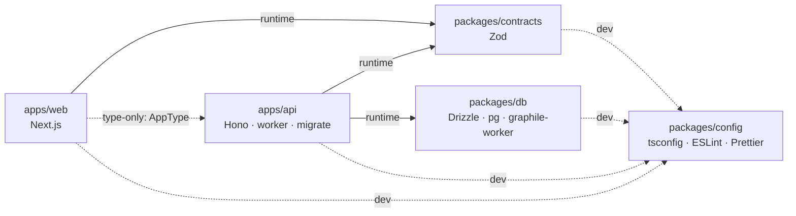
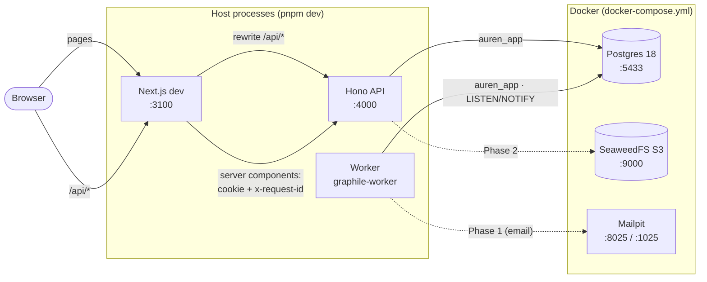
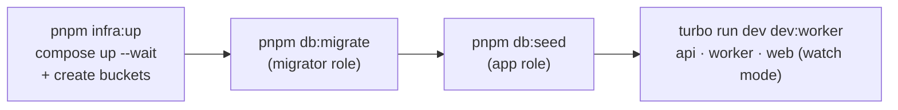
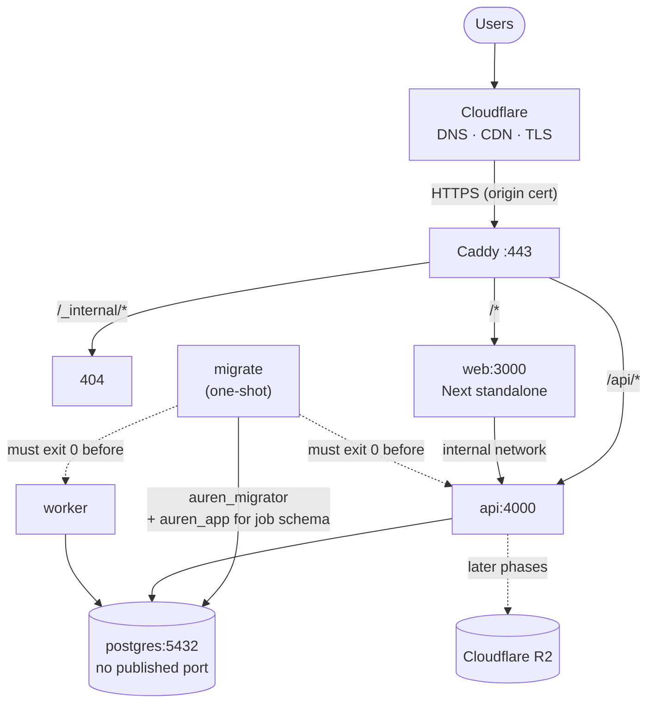
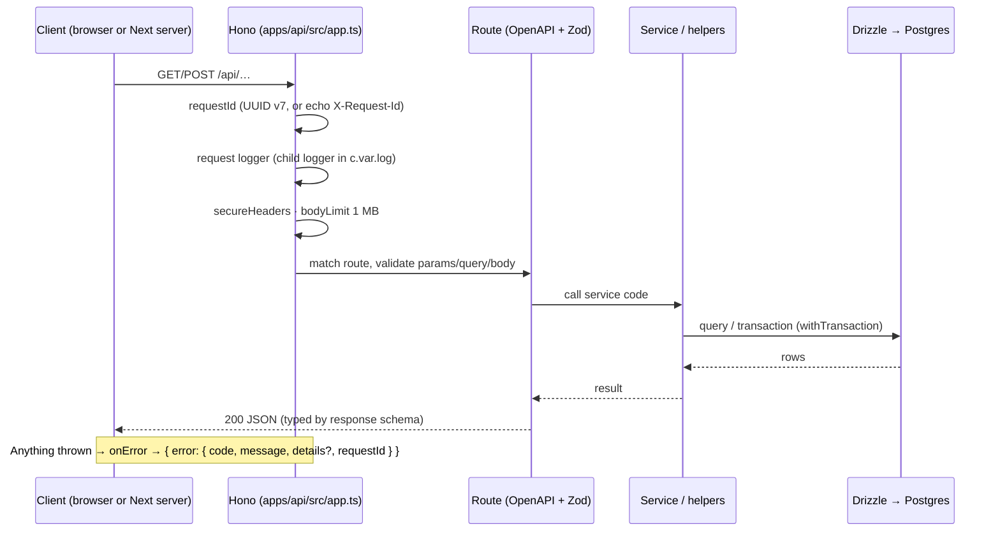
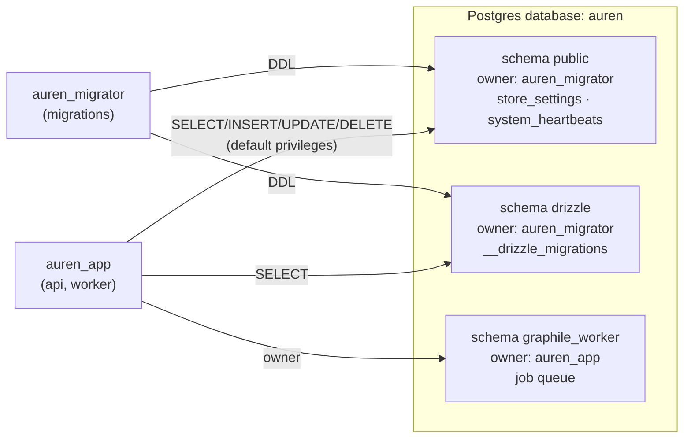
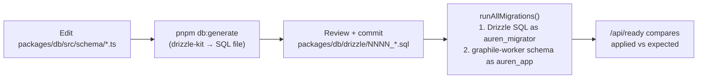
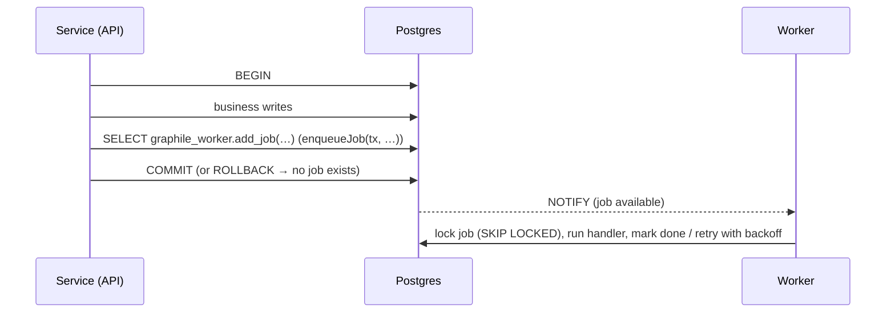
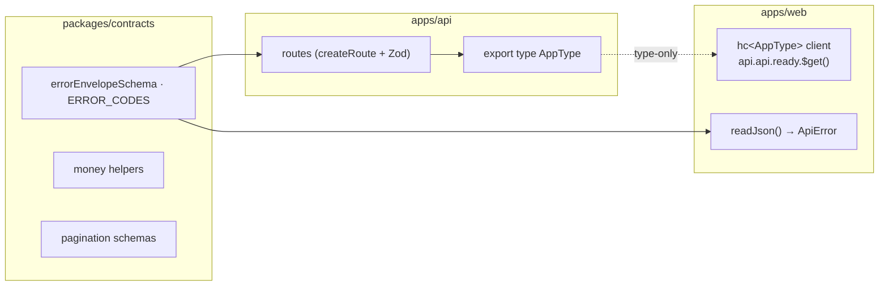
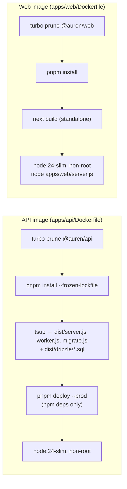

# Auren Architecture (as built)

> How the repository actually works today: packages, processes, connections and data flow.
> [`PLAN.md`](./PLAN.md) is the target design; this file describes the **current implementation**.
> **State:** end of Phase 0 (foundations), 2026-10-03. Update this file when structure or connections change.

---

## 1. Repository layout

```text
auren/
├── apps/
│   ├── web/        Next.js 16: storefront (/) and back office (/admin)
│   └── api/        Hono API, plus the worker and migrate entrypoints (the only code that touches the database)
├── packages/
│   ├── db/         Drizzle schema, SQL migrations, DB client, seeds, readiness check
│   ├── contracts/  Shared Zod schemas: error envelope and codes, money helpers, pagination
│   └── config/     tsconfig bases, ESLint flat configs, Prettier config
├── infra/
│   ├── postgres/   Local DB role setup (runs on first start of the dev database)
│   ├── storage/    Local S3 (SeaweedFS) credentials and bucket bootstrap
│   └── deploy/     Production stack: Compose, Caddyfile, role provisioning, env template
├── docs/           PLAN, PROGRESS, ARCHITECTURE, DEPLOY
├── .github/workflows/ci.yml
└── docker-compose.yml   Local infrastructure (Postgres, SeaweedFS, Mailpit)
```

## 2. Package dependency graph



| Package | Purpose | Main dependencies |
|---|---|---|
| `@auren/web` | UI. Talks to the API only | next, react, tailwindcss, shadcn (Radix), `hono/client`, `@auren/contracts` |
| `@auren/api` | Business logic and HTTP. Owns all database access | hono, @hono/node-server, @hono/zod-openapi, `@auren/db`, `@auren/contracts`, pino, graphile-worker, zod |
| `@auren/db` | Schema, migrations, client | drizzle-orm, pg, graphile-worker, uuidv7 (dev: drizzle-kit) |
| `@auren/contracts` | Code shared by API and web | zod |
| `@auren/config` | Tool presets | eslint, typescript-eslint, @next/eslint-plugin-next, eslint-plugin-react-hooks |

**How workspace packages are consumed:** they are published as TypeScript source (`exports` points to `src/*.ts`) and compiled by whoever uses them:

| Consumer | How it compiles workspace TS |
|---|---|
| API in dev, db scripts | `tsx` |
| Tests | Vitest |
| Next.js | `transpilePackages: ['@auren/contracts']` |
| API production build | `tsup` inlines `@auren/*` into `dist/` |

**Boundary enforcement (PLAN §6.2):** `apps/web` may not import `@auren/db`, `pg` or `drizzle-orm`. Two things stop it:
1. An ESLint `no-restricted-imports` rule.
2. pnpm's strict `node_modules`: undeclared packages can't be resolved.

From `@auren/api`, web may only use `import type`.

## 3. Local development



- **One origin.** The browser only talks to `http://localhost:3100`. Next.js forwards `/api/*` to the API (dev-only `rewrites` in `apps/web/next.config.ts`), so cookies are first-party and no CORS is needed. Verified: `Set-Cookie`, `Origin`, `Cookie` and request bodies all pass through the rewrite.
- **Server-side data:** `serverApi()` (`apps/web/src/lib/api/server.ts`) calls `API_INTERNAL_URL` directly. It forwards the visitor's `cookie`, `x-forwarded-for` and an `x-request-id`, and uses `cache: 'no-store'`. `publicApi` is the cookie-less variant for cacheable public reads.
- **Browser data:** `browserApi()` (`apps/web/src/lib/api/browser.ts`) calls the same origin.

**`pnpm dev` startup sequence:**



| Service | Port | Credentials (local only) |
|---|---|---|
| Web | 3100 | — |
| API | 4000 | — |
| Postgres | 5433 (5432 is often taken by a host Postgres) | `auren_app`/`auren_app`, `auren_migrator`/`auren_migrator`, superuser `postgres`/`postgres` |
| SeaweedFS (S3 API) | 9000 | `auren` / `auren-dev-secret`; buckets `auren-public-media` (anonymous read), `auren-private-docs` |
| Mailpit | UI 8025, SMTP 1025 | — |

## 4. Production (single VPS + Cloudflare)



- **Everything runs in `infra/deploy/compose.yml`** on one VPS. The API, worker and migrate services share one image and differ only in the command they run.
- **Startup order is enforced:** postgres healthy → `migrate` exits 0 → `api` and `worker` start → `api` passes `/api/ready` → `web` and `caddy` start.
- **Caddy:**
  - routes by path, so the browser still sees one origin
  - blocks `/_internal/*`
  - limits request bodies to 10 MB
  - compresses responses
  - trusts `CF-Connecting-IP` only from Cloudflare IP ranges
- Deployment procedure: [`DEPLOY.md`](./DEPLOY.md). Hosting decision: PLAN §25.2.1.

## 5. Request lifecycle (API)



**Error mapping** (`apps/api/src/lib/errors.ts`, `pg-errors.ts`, `middleware/error-handler.ts`):

| Source | Client sees |
|---|---|
| `AppError` thrown by code | Its status and code (catalog in `@auren/contracts`) |
| Zod validation failure | `400 VALIDATION_ERROR` with `details.issues` |
| Unique / FK violation | `409 CONFLICT`, or a specific code registered for that constraint |
| Serialization conflict or deadlock (`40001` / `40P01`) | Retried once by `withTransaction`, then `409 CONCURRENT_UPDATE` |
| CHECK violation, unknown error | `500 INTERNAL_ERROR`: a bug. Details are logged, never returned |
| DB unreachable or timeout | `503 SERVICE_UNAVAILABLE` |
| Unknown route / oversized body | `404 ROUTE_NOT_FOUND` / `413 PAYLOAD_TOO_LARGE` |

**Routes today:**
- `GET /api/health`: liveness.
- `GET /api/ready`: DB reachable and migrations applied match the count this build expects.
- `GET /api/openapi.json`: outside production only.

## 6. Database



- **Least privilege:**
  - `auren_app` can change data in `public` but can't create or alter objects there.
  - It owns `graphile_worker` and has `CREATE` on the database, because the job library's row-level security only lets the schema owner enqueue (PLAN §22.2).
- **Where the roles come from:**
  - Local: `infra/postgres/init/01-roles.sql`.
  - Production: `infra/deploy/postgres-init/10-roles.sh`, with passwords from env.
  - Both run only on the first start of an empty data volume.
- **Conventions in code** (`packages/db/src/columns.ts`, PLAN §8.1):
  - UUID v7 IDs generated in the app
  - money as `bigint` minor units mapped to JS `number`
  - `timestamptz` timestamps
  - camelCase in TypeScript, snake_case in SQL (Drizzle `casing: 'snake_case'`)

**Migration flow:**



| Migration | Contents |
|---|---|
| `0000_platform_setup` | Extensions (`citext`, `pg_trgm`, `unaccent`) and **default grants**, so every future table automatically gets DML-only access for `auren_app` |
| `0001_store_settings` | Singleton store configuration (CHECK `id = 1`) |
| `0002_system_heartbeats` | Liveness rows written by the worker |

The same `runAllMigrations()` (`packages/db/src/migrate.ts`) is used by `pnpm db:migrate` (dev), the integration-test setup, and the production `dist/migrate.js`.

## 7. Background jobs



- **Transactional enqueue** (`apps/api/src/jobs/enqueue.ts`): a job exists **if and only if** the business transaction commits. This is the outbox guarantee without a custom outbox table (PLAN §4.4), and it's covered by integration tests.
- **Task registry:**
  - `TaskPayloads` (types) plus `createTaskList()` (handlers) in `apps/api/src/jobs/`.
  - Names use `module:action`.
  - Current task: `system:heartbeat`, cron every minute, which writes `system_heartbeats`.
- **Worker** (`apps/api/src/worker.ts`):
  - runs as `auren_app`, concurrency `WORKER_CONCURRENCY`
  - graceful shutdown lets in-flight jobs finish
  - log lines keep job IDs only, never payloads

## 8. Shared contracts and typed calls



- **End-to-end types with no code generation.** Web's `hc<AppType>` knows every route, parameter and response shape. Changing an API response breaks `pnpm typecheck` in web.
- **One error format.** The API produces the envelope and documents it in OpenAPI. Web decodes it into a typed `ApiError` (`apps/web/src/lib/api/errors.ts`).
- **Money:** integer minor units everywhere. The helpers (`allocate`, `percentOfBps`, `applyRatePpm`, `parseMoneyInput`, `formatMoney`) never use floating point.

## 9. Configuration

| Where | What reads it | Notes |
|---|---|---|
| `.env` (from `.env.example`, gitignored) | API (`apps/api/src/env.ts`), db scripts, `drizzle.config.ts`, Next.js (`API_INTERNAL_URL`) | Local only. The API validates it with Zod at boot and fails listing every problem |
| `infra/deploy/.env` (from its `.env.example`) | Production Compose | Domain, origin, DB passwords. Never committed |

**Key variables:**

| Variable | Meaning |
|---|---|
| `DATABASE_URL` | App role connection |
| `DATABASE_MIGRATOR_URL` | Migrator role connection |
| `WEB_ORIGIN` | The single public origin |
| `API_INTERNAL_URL` | API address as seen from the web server |
| `API_PORT`, `LOG_LEVEL`, `DB_POOL_MAX`, `WORKER_CONCURRENCY` | Runtime tuning |

## 10. Tooling

| Concern | Setup |
|---|---|
| Runtime | Node 24 (`.nvmrc`, `engines` + `engineStrict`) |
| Package manager | pnpm 11 via corepack (`packageManager`) |
| Dependency versions | One **catalog** in `pnpm-workspace.yaml` (`catalogMode: strict`); packages use `"catalog:"` |
| Supply chain | `minimumReleaseAge: 1440` (one day) with exclusions for `next`, `react`, `react-dom`, `better-auth`; install scripts explicitly allowed or denied (`allowBuilds`) |
| Task runner | Turborepo: `dev`, `dev:worker`, `build` (`^build`), `lint`, `typecheck`, `test`, `test:integration`, `test:e2e` |
| TypeScript | 6.0.x, strict, `verbatimModuleSyntax`, `noUncheckedIndexedAccess`, Bundler resolution (`packages/config/tsconfig/*`) |
| Lint / format | ESLint flat config, type-aware (floating promises are errors) plus Next.js and React rules; Prettier at the root (`docs/` excluded) |

## 11. Build and delivery



- **The API bundle** inlines the workspace packages; npm dependencies stay external (48 MB `node_modules` in the image).
- **The web app** is built as a Next standalone server. The home page is fully static, and `/admin` is a partial prerender: a static shell with live data streamed in.
- **CI** (`.github/workflows/ci.yml`):
  - `checks`: format, lint, typecheck, unit tests, build
  - `migrations`: schema and migrations in sync, plus `drizzle-kit check`
  - `integration`
  - `e2e`

## 12. Testing

| Level | Tool | Where | What runs |
|---|---|---|---|
| Unit | Vitest (`unit` project) | `src/**/*.test.ts` | Money math, error mapping, transaction retry, env validation, HTTP behaviour with a stub DB |
| Integration | Vitest (`integration` project) + Testcontainers | `apps/api/test/*.int.test.ts` | Real Postgres 18: readiness, transactional enqueue, real constraint violations, a genuine `40001` retry |
| E2E | Playwright (Chromium) | `apps/web/e2e/` | Starts or reuses the API and web: storefront renders, same-origin `/api`, admin status streams |

**How integration tests get a database:**
1. Once per run, `test/global-setup.ts` starts a Postgres 18 container and migrates a **template database**.
2. Each test file calls `createTestDatabase()` to clone the template (about 100 ms).
3. `resetDatabase()` empties tables and the job queue between tests.

## 13. Not wired yet (where it lands)

| Piece | Status | Phase |
|---|---|---|
| Authentication (Better Auth), sessions, staff 2FA, RBAC, audit log, origin check on mutating requests | — | 1 |
| Email via Mailpit/SMTP | Mailpit running, unused | 1 |
| Object storage (SeaweedFS locally, R2 in production) | Buckets exist, unused | 2 |
| Storefront cache revalidation (`/_internal/revalidate`) | Already blocked at the edge | 4 |
| First GitHub CI run, VPS deployment | Waiting on a push and on VPS access | 0 (P0-12/13) |
