# Auren Implementation Plan

> **Status:** Draft v1 · **Created:** 2026-10-03 · **Scope:** architecture + phased roadmap.
> This is the source of truth for how Auren gets built. When a decision changes, update the relevant section **and** add a dated entry under §29.

**Contents:**
1 Executive Summary · 2 Goals · 3 Non-Goals · 4 Architecture Overview · 5 Technology Stack · 6 Monorepo Structure · 7 Domain Architecture · 8 Database Architecture · 9 API Architecture · 10 Authentication & Authorization · 11 Product Architecture · 12 Inventory Architecture · 13 Order Architecture · 14 Payment Architecture · 15 POS Architecture · 16 Invoice Architecture · 17 Returns & Refunds · 18 Customer Architecture · 19 Discount Architecture · 20 Dashboard & Analytics · 21 Audit Logging · 22 Security · 23 Testing Strategy · 24 Observability · 25 Deployment · 26 Development Phases · 27 MVP Scope · 28 Post-MVP Scope · 29 Architectural Decisions · 30 Risks & Open Questions · 31 Final Recommended Architecture

---

## 1. Executive Summary

Auren is the operating system for **one fashion retailer**. It runs the online storefront and the back office: catalog, inventory, orders, payments, invoices, returns/refunds, discounts, staff permissions, reporting and audit. In-store POS is designed for now and built after the MVP. Every sales channel works on the same products, stock, customers and money records. There is one source of truth.

The recommended shape:

- A **modular monolith**. One Hono API (Node.js, TypeScript) owns all business logic and all database access. It is split into domain modules (catalog, inventory, orders, payments, …) that have explicit boundaries.
- **One PostgreSQL database**, accessed through Drizzle. Multi-entity changes run in transactions. Stock, money and documents are kept as **append-only ledgers and immutable snapshots**, so history is never overwritten.
- **One Next.js app** for the storefront, customer account and admin back office. It talks to the API only: over HTTP from the browser, or server-to-server from React Server Components. It never touches the database.
- **Better Auth**, running inside the API, for customers and staff. Staff get **permission-based RBAC** (role → permissions) stored in the database, plus mandatory 2FA.
- **Postgres-backed background jobs** for reservation expiry, emails and PDF generation, so there is no Redis or Kafka.
- **Integer minor units** (`bigint`) for every monetary value.

These design choices matter most:

1. **Inventory = balance + ledger + reservations.** `inventory_level` holds `on_hand` and `reserved` per variant and location. Every physical change is an `inventory_movement` row that records who, why and which document caused it. `inventory_reservation` records which order holds which stock. A single conditional `UPDATE` makes "two customers buy the last item" safe.
2. **Orders have separate state dimensions.** Order, payment, fulfillment and returns each have their own status, so the order does not carry one giant status field. Refunds, returns and credit notes are separate records that point at the order. The original order is never rewritten.
3. **Payments are provider-agnostic.** A `PaymentProvider` interface has COD, manual and one gateway adapter. Each attempt is a `payment` row, webhooks go through a deduplicating inbox, and every money-moving call is idempotent.
4. **Invoices and credit notes are immutable**, with gapless numbering. Corrections are made with credit notes, never by editing.

The roadmap (§26) delivers a launchable online store in **twelve phases (0–11)**: COD checkout comes first, then the gateway, invoices, returns and discounts. RBAC and audit logging go into **Phase 1**, not at the end, because bolting permission checks onto finished code later is error-prone. POS is the first post-MVP phase.

---

## 2. Goals

| # | Goal | Measured by |
|---|---|---|
| G1 | One source of truth for products, stock, customers, orders and money across channels | No channel keeps its own stock or price copy; every report reconciles to ledgers |
| G2 | Never oversell under concurrency | Concurrency test: N parallel checkouts for the last unit → exactly 1 success |
| G3 | Complete financial and inventory history | Any stock level or order balance can be explained from ledger/event rows |
| G4 | Safe money handling | No float money anywhere. Refunds can never exceed captured amounts (DB-enforced). Webhooks are idempotent |
| G5 | Least-privilege staff access | Every admin endpoint is permission-guarded (deny by default). Sensitive actions are audit-logged |
| G6 | Fast, SEO-friendly storefront | Product and category pages are server-rendered and cached, with on-demand revalidation. LCP < 2.5 s on 4G for PDP/PLP |
| G7 | A maintainable codebase that a small team can extend | Clear module boundaries, shared Zod contracts, end-to-end type safety, tests on critical flows |
| G8 | Growth without a rewrite | POS, multiple locations, a search engine, more payment providers and notification channels can be added behind existing seams |

## 3. Non-Goals

- **Multi-tenant / multi-store SaaS.** Auren serves one retailer. There is no `tenant_id` anywhere.
- **Marketplace / multi-vendor** features.
- **Multi-currency** pricing or settlement (single currency, confirmed).
- **Microservices, Kafka, Kubernetes, Elasticsearch, event sourcing, CQRS, multiple databases.** None of the requirements justify them (§29).
- **Offline-capable POS.** POS is post-MVP and will be online-only when built (§15).
- **Native mobile apps** and a public third-party API (the API is first-party only for now).
- **A full ERP or accounting system.** Auren produces invoices, credit notes and exportable reports. The general ledger, payroll and supplier accounting stay in external tools.
- **Destination-based multi-jurisdiction tax calculation** in the MVP. A single configured rate is used (§30, Q2).
- **Real-time analytics or a data warehouse.** The MVP reports from transactional data.
- **Carrier/courier API integration** in the MVP. Tracking numbers are entered manually.

---

## 4. Architecture Overview

### 4.1 System context

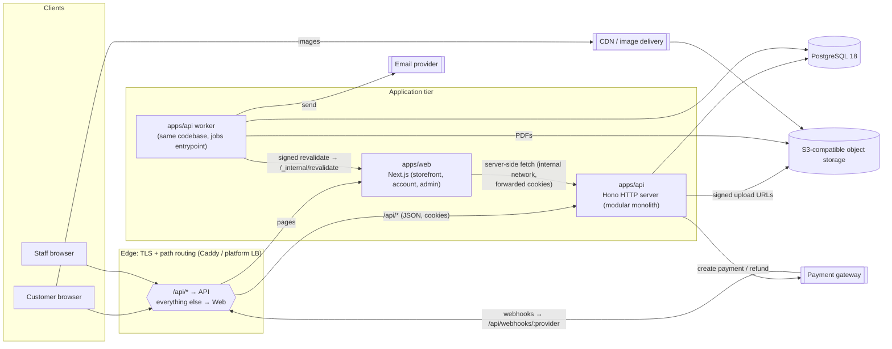

- **One public origin** (for example `https://auren.example`). The edge routes `/api/*` to Hono and everything else to Next.js. Browser calls to the API are therefore **same-origin**: first-party cookies work, there is no CORS and no Safari ITP problem. In local development, Next.js `rewrites` do the same routing (§10.2).
- **Next.js never touches PostgreSQL.** It gets data in two ways:
  - **Server-side** (React Server Components, route handlers) over the private network with the user's cookie forwarded.
  - **Client-side** (cart, checkout, admin interactions) straight to `/api/*`.
- **The API is the only writer and reader of the database.** The worker is a second entrypoint of the same `apps/api` package. It shares the modules, but runs as its own process so that slow jobs (PDFs, emails) never block HTTP requests.

### 4.2 Request flow and layering inside the API

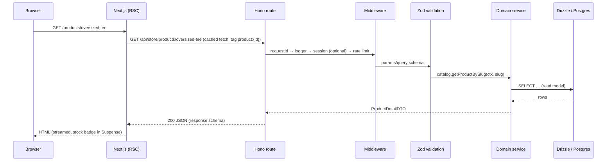

**Layers:** `route` (HTTP only) → `validation` (Zod, from `packages/contracts`) → `service` (business rules, transactions, authorization checks that need data) → `Drizzle` (queries) → `PostgreSQL`.

- Route handlers have **no business logic**. They map HTTP to a service call and the result (or error) back to HTTP.
- **There is no generic repository layer.** Services use Drizzle directly through a `DbExecutor` (either the pool or an open transaction). Complex or reused reads go in a module-local `queries.ts`. Drizzle is already the abstraction, and wrapping it again would only add indirection. The trade-off: services are coupled to Drizzle. Tests run against a real Postgres instead of repository mocks, which is the better test for transactional code anyway (§23).

### 4.3 Runtime processes

| Process | Code | Scales | Notes |
|---|---|---|---|
| `web` | `apps/web` (`next start`, standalone output) | 1 instance in the MVP (see the caching caveat in §4.7) | Stateless apart from the Next.js data cache |
| `api` | `apps/api/src/server.ts` (`@hono/node-server`) | 1–N, stateless | Better Auth handler mounted inside |
| `worker` | `apps/api/src/worker.ts` | 1 (job locks make N safe) | Jobs, crons, outbox side effects |
| `postgres` | Managed PostgreSQL 18 | Vertical scaling plus point-in-time recovery | The only stateful core service |
| Object storage | S3-compatible | Managed | Images (public via CDN), invoices (private) |

### 4.4 Background jobs

**Choice: a Postgres-backed queue, `graphile-worker`.** pg-boss is the equivalent fallback. No Redis.

**Why:** jobs are enqueued **inside the business transaction**, using `SELECT graphile_worker.add_job(...)` through the same Drizzle `tx`. A job then exists if and only if the business change committed. That is the transactional-outbox guarantee without a custom outbox table. The library also provides retries with backoff, cron schedules, `LISTEN/NOTIFY` for low latency, and `SKIP LOCKED` workers.

| Job | Schedule / trigger |
|---|---|
| `inventory.expire_reservations` | Every minute |
| `orders.cancel_unpaid` | Every 15 minutes |
| `payments.poll_stale` | Every 5 minutes |
| `payments.process_webhook` | On webhook receipt |
| `payments.execute_refund` / `payments.execute_void` | On refund or cancellation |
| `invoices.render_pdf` | On invoice issue |
| `notifications.send_email` | On domain events (order placed, paid, shipped, refund issued, return updates, staff invite, auth emails) |
| `storefront.revalidate` | On catalog, price or stock-visibility changes |
| `maintenance.reconcile_inventory`, `maintenance.purge` (carts, idempotency keys, webhook payloads) | Nightly |

### 4.5 Notifications

- **Where they live:** a `notifications` module in the API. It is **only invoked through jobs**: domain services enqueue `notifications.send_email({ template, to, data })` in their transaction.
- **Templates:** React Email components rendered in the worker.
- **Transport:** an `EmailSender` interface with an SMTP or provider adapter (Resend, SES, Postmark, …). Mailpit is used locally.
- **MVP emails:**
  - auth (verify email, reset password, staff invite)
  - order confirmation
  - payment received
  - shipped (with tracking)
  - delivered / COD collected (with the invoice)
  - order cancelled
  - return request received, approved and rejected
  - refund issued
- **Staff alerts in the MVP** go to email: order on hold, webhook failures, inventory drift, oversold. A daily low-stock digest is post-MVP.
- **Future:** SMS and WhatsApp (likely in COD-heavy markets) as extra transports behind the same interface, plus notification preferences.

### 4.6 File and image storage

- **`StorageService` interface:** `putObject`, `getSignedUploadUrl`, `getSignedDownloadUrl`, `delete`, `publicUrl`.
  - The adapter is **S3-compatible** (AWS S3, Cloudflare R2, Backblaze B2, SeaweedFS locally), so there is no lock-in.
  - Business modules only store `media_assets.storage_key`. They never store URLs or bucket names.
- **Two buckets:**
  - `public-media`: product and category images, served through a CDN, immutable keys like `products/{assetId}/{hash}.jpg`.
  - `private-docs`: invoice PDFs and future documents, accessed only through API-issued signed URLs that live 60 s.
- **Upload flow:**
  1. The admin asks the API for a presigned PUT, restricted by content type (`image/jpeg|png|webp|avif`, **no SVG**) and size (≤ 10 MB).
  2. The browser uploads directly to storage.
  3. The admin confirms.
  4. The API verifies the object (HEAD, size, magic bytes), records its dimensions and marks the asset `ready`.
- **Image delivery:** `next/image` with a custom loader. The loader points at the CDN's resizing service if it has one. Otherwise it uses Next's built-in optimizer, whose cache needs a persistent volume. Originals are kept; variants are derived on the fly.

### 4.7 Caching

| Layer | What is cached | Invalidation |
|---|---|---|
| Next.js data cache (`'use cache'`, `cacheTag`) | Public catalog reads: product content and price, category trees, category listings without filters, navigation | The API's `storefront.revalidate` job calls a signed `POST /_internal/revalidate` (HMAC, blocked at the edge for external traffic). Tags: `product:{id}`, `category:{id}`, `catalog`, `nav` |
| **Not cached** | Stock availability, cart, checkout, account, admin, search results | — (stock badges are streamed in `<Suspense>` and fetched live) |
| API in-process memory | Category tree, store settings, role → permission sets (tiny, hot) | Short TTL (60 s) plus bump on write. Safe with N instances because the TTL is short |
| CDN | Images (immutable keys), static assets | Content-hashed names |
| HTTP | `Cache-Control: private, no-store` on authenticated API responses | — |

**Multi-instance caveat:** when Next.js is self-hosted with more than one instance, `revalidateTag` clears only the instance that receives it. **The MVP therefore runs one `web` instance.** Scaling out needs a shared `cacheHandler` (for example Redis), which would be the first and only reason to add Redis (§29, D12).

**No Redis in the MVP:**
- rate-limit counters live in Postgres (Better Auth `storage: "database"`) and in-process for API routes behind one instance
- sessions are in Postgres
- jobs are in Postgres

---

## 5. Technology Stack

Versions are the latest stable releases as of 2026-10-03. They are **pinned through pnpm catalogs** and re-verified at Phase 0.

| Layer | Choice | Version | Why this, for Auren |
|---|---|---|---|
| Runtime | **Node.js 24 LTS** | 24.x | The local Node 23 has been **end-of-life since 2025-06** and must not be used. 26 becomes LTS on 2026-10-28; move to it after a few patch releases. Pinned with `.nvmrc` plus `engines` plus `engineStrict` |
| Package manager / monorepo | **pnpm 11** workspaces + **Turborepo 2** | pnpm 11.x, turbo 2.11.x | Strict `node_modules` (undeclared dependencies can't be imported, which enforces the web ↛ db rule), catalogs for single-version deps, cached task graph. pnpm 12 waits until `turbo prune` support is confirmed |
| Language | **TypeScript** (strict) | **6.0.x** (verified in Phase 0: typescript-eslint 8.71 supports TypeScript `<6.1`, so TS 7 is deferred) | Type safety end-to-end. One TypeScript version across the repo. Move to TS 7 once typescript-eslint supports it |
| Web | **Next.js 16** (App Router, `cacheComponents`, `proxy.ts`) + **React 19** | next 16.3.x, react 19.x | SSR and caching for SEO pages, streaming, one app for storefront and admin |
| UI | **Tailwind CSS 4** + **shadcn/ui** (copied components) + Radix primitives | tailwind 4.3.x, shadcn CLI 4.x | Owned components with no runtime UI library lock-in |
| Admin data and forms | TanStack Query, TanStack Table, React Hook Form + Zod resolver | latest | Client-heavy admin grids and forms, sharing the API's Zod schemas |
| API | **Hono 4** on `@hono/node-server` 2, **`@hono/zod-openapi`** | hono 4.13.x | Small, fast, web-standard; typed RPC client (`hc`) and an OpenAPI document from the same route definitions |
| Validation and contracts | **Zod 4** (one copy through the catalog) | 4.x | Shared request and response schemas, env validation, discount-condition schemas |
| Database | **PostgreSQL 18** + **Drizzle ORM 0.45.x** / drizzle-kit 0.31.x | PG 18.x | Drizzle **v1 is still a release candidate**, so stay on 0.45 and write v1-friendly code: the core query builder for writes, Relational Queries only for reads |
| Auth | **Better Auth 1.7** + `@better-auth/drizzle-adapter`, plugins: `twoFactor` | 1.7.x | Self-hosted, Drizzle-native, sessions in Postgres, TOTP 2FA, hooks for staff policies |
| Jobs | **graphile-worker** (fallback: pg-boss) | latest | Postgres-only queue with transactional enqueue (§4.4) |
| PDF | `@react-pdf/renderer` | latest | Pure JavaScript, so no headless Chrome in containers |
| Email | React Email + `EmailSender` adapter | — | Provider-agnostic |
| Storage | `@aws-sdk/client-s3` against any S3-compatible service | — | Portable |
| IDs | `uuidv7` (app-side), PG 18 `uuidv7()` available | — | §8.1 |
| Logging | `pino` (JSON), `hono/request-id` | — | §24 |
| Errors | Sentry SDK (web + api + worker) — optional SaaS, or self-hosted GlitchTip | — | §24 |
| Testing | Vitest, Testcontainers (Postgres), Playwright | — | §23 |
| Lint and format | ESLint (flat config, typescript-eslint **type-aware**: `no-floating-promises`, `no-misused-promises`) + Prettier | — | Type-aware promise rules matter for transactional code. `next lint` was removed in Next 16, so ESLint runs directly |
| Local infrastructure | Docker Compose: postgres:18, **SeaweedFS** (S3 API), Mailpit | — | One-command local environment (`pnpm infra:up`). SeaweedFS replaced MinIO in Phase 0 because MinIO no longer publishes container images; production uses Cloudflare R2. Use PG 18 client tools from the container; the local `psql 14` is too old for `pg_dump` against 18 and reaches EOL on 2026-11-12 |

---

## 6. Monorepo Structure

```text
auren/
├── apps/
│   ├── web/                          # Next.js 16 — storefront, customer account, admin (route groups)
│   │   ├── src/app/
│   │   │   ├── (storefront)/         # /, /c/[...slug], /p/[slug], /search, /cart, /checkout
│   │   │   ├── (account)/account/    # profile, orders, addresses, returns
│   │   │   ├── admin/                # back office (noindex, staff-only)
│   │   │   ├── _internal/revalidate/ # signed revalidation endpoint (blocked at edge)
│   │   │   ├── sitemap.ts, robots.ts
│   │   ├── src/components/{ui,storefront,admin}/
│   │   ├── src/lib/api/              # typed hc clients (store, admin), server fetch helper (cookie forwarding)
│   │   ├── src/proxy.ts              # optimistic auth redirects only (never authorization)
│   │   └── next.config.ts            # cacheComponents, rewrites (dev), images loader
│   └── api/                          # Hono — the only process family that touches the DB
│       ├── src/server.ts             # HTTP entrypoint
│       ├── src/worker.ts             # jobs entrypoint (graphile-worker + crontab)
│       ├── src/app.ts                # compose: middleware, /auth, /store, /admin, /webhooks; export StoreApi/AdminApi types
│       ├── src/env.ts                # Zod-validated env
│       ├── src/lib/                  # errors, money, allocation, ids, pagination, tx helper (retry 40001/40P01), clock
│       ├── src/middleware/           # request-id, logger, session, require-staff, require-permission, origin-check, rate-limit, idempotency
│       ├── src/platform/             # storage (S3), email, pdf, payment-providers/{cod,fake,manual,<gateway>}, search
│       ├── src/modules/<domain>/     # index.ts (public API), service.ts, queries.ts, routes.store.ts, routes.admin.ts, transitions.ts, *.test.ts
│       └── src/jobs/                 # job handlers → call module services
├── packages/
│   ├── db/                           # Drizzle schema (one file per domain), migrations (SQL), client factory, seeds — imported ONLY by apps/api
│   ├── auth/                         # Better Auth: `server` export (createAuth(db, env)) for api; `client` export for web
│   ├── contracts/                    # Zod schemas (requests/responses/DTOs), inferred types, enums, error codes, permission catalog, money format helpers
│   └── config/                       # tsconfig bases, ESLint flat configs, Prettier config
├── docs/PLAN.md
├── docker-compose.yml                # postgres:18, seaweedfs (S3), mailpit
├── .nvmrc · package.json (packageManager, engines) · pnpm-workspace.yaml (packages, catalogs, allowBuilds) · turbo.json · tsconfig.json
```

### 6.1 Changes from the proposed structure

| Proposed | Recommendation | Reason |
|---|---|---|
| `packages/validation` + `packages/types` | **Merged into `packages/contracts`** | Types are inferred from Zod schemas (`z.infer`). Two packages would split one source of truth and invite drift. DB row types stay private to the API. The web app gets its types from contracts and the `hc` client |
| `packages/ui` | **Deferred.** Components live in `apps/web/src/components/ui` | Only one frontend app exists. POS will be a route group in the same app. Extracting later is mechanical (`shadcn` supports a monorepo `packages/ui`) once a second app really exists |
| — | **Added `packages/config`** | Shared tsconfig, ESLint and Prettier configuration |
| Domain logic location | **Inside `apps/api/src/modules`**, not packages | Business logic belongs to the API. Packaging domains separately is premature, and would tempt the web app to import them |
| Worker | **Second entrypoint in `apps/api`**, not a separate app | Shares modules and config. It is deployed as a separate process from the same image |

### 6.2 Dependency graph and boundary enforcement

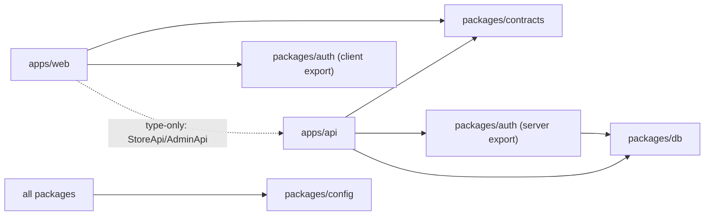

- `apps/web/package.json` **never** lists `@auren/db`. pnpm's strict layout makes such an import fail. An ESLint `no-restricted-imports` rule and Turborepo boundaries tags add a second guard.
- The web app imports the API's **types only** (`import type { AdminApi } from '@auren/api/types'`), emitted as `.d.ts`. No runtime code from the API is bundled into the web app.
- `pnpm-workspace.yaml`:
  - catalogs with `catalogMode: strict`
  - `allowBuilds` for native dependencies (esbuild, sharp)
  - `minimumReleaseAge` kept, but with `minimumReleaseAgeExclude` for `next`, `react` and `better-auth`, so that same-day security patches can be applied

---

## 7. Domain Architecture

The API is a **modular monolith**. Each module owns its tables, its business rules and its public service functions. Other modules call those functions. They never write the module's tables directly.

### 7.1 Modules

| Module | Responsibility | Owns tables (§8) | MVP |
|---|---|---|---|
| `settings` | Store profile, currency, timezone, tax default, policies | `store_settings` | ✅ |
| `identity` | Better Auth: sign-up, sign-in, sessions, email verification, password reset, 2FA | `users`, `sessions`, `accounts`, `verifications`, `two_factors` (Better Auth-managed) | ✅ |
| `staff` | Staff profiles, invites, roles, role permissions | `staff_members`, `staff_invites`, `roles`, `role_permissions` | ✅ |
| `customers` | Customer profiles (registered + guest), addresses, guest-order claiming | `customers`, `customer_addresses` | ✅ |
| `catalog` | Products, variants, attributes (color/size), categories, brands, tags, images, size charts, SEO, search | `products`, `product_variants`, `product_categories`, `attributes`, `attribute_values`, `product_attributes`, `variant_attribute_values`, `categories`, `brands`, `tags`, `product_tags`, `product_images`, `size_charts` | ✅ |
| `media` | Storage abstraction, upload signing, image metadata | `media_assets` | ✅ |
| `inventory` | Stock levels, movement ledger, reservations, receipts, adjustments | `stock_locations`, `inventory_levels`, `inventory_movements`, `inventory_reservations`, `stock_receipts` | ✅ |
| `pricing` | Pure price, tax, shipping and total calculation; rounding and allocation rules | `tax_rates`, `shipping_methods` | ✅ |
| `discounts` | Discount definitions, eligibility evaluation, redemptions | `discounts`, `discount_targets`, `discount_redemptions` | ✅ (codes) |
| `cart` | Carts for guests and customers, merge on login | `carts`, `cart_lines` | ✅ |
| `checkout` | Orchestrator: cart → priced order + reservations + payment intent (no tables of its own) | — | ✅ |
| `orders` | Order aggregate, lines, address snapshots, state machines, cancellation | `orders`, `order_lines`, `order_addresses`, `order_discounts` | ✅ |
| `fulfillment` | Shipments, delivery tracking (manual) | `shipments`, `shipment_lines` | ✅ |
| `payments` | Provider abstraction, payment attempts, webhook inbox, refunds | `payments`, `payment_transactions`, `webhook_events`, `refunds`, `refund_lines` | ✅ |
| `returns` | Return requests (RMA), receipt and inspection, restock disposition | `return_requests`, `return_lines` | ✅ |
| `invoicing` | Invoices and credit notes, gapless numbering, PDFs | `invoices`, `invoice_lines`, `document_counters` | ✅ |
| `reporting` | Read-only dashboard and report queries | — (later: summary tables) | ✅ basic |
| `audit` | Append-only audit trail and order timeline | `audit_logs` | ✅ |
| `notifications` | Email templates and dispatch through background jobs | — (job queue) | ✅ minimal |
| `pos` | Registers, register sessions, POS sale orchestration | `registers`, `register_sessions`, `cash_movements` | ❌ post-MVP |
| `store-credit` | Store-credit accounts and ledger | `store_credit_accounts`, `store_credit_entries` | ❌ post-MVP |

Platform tables that belong to no single domain: `idempotency_keys` and the job-queue schema (owned by the job library).

### 7.2 Layering and dependency rules

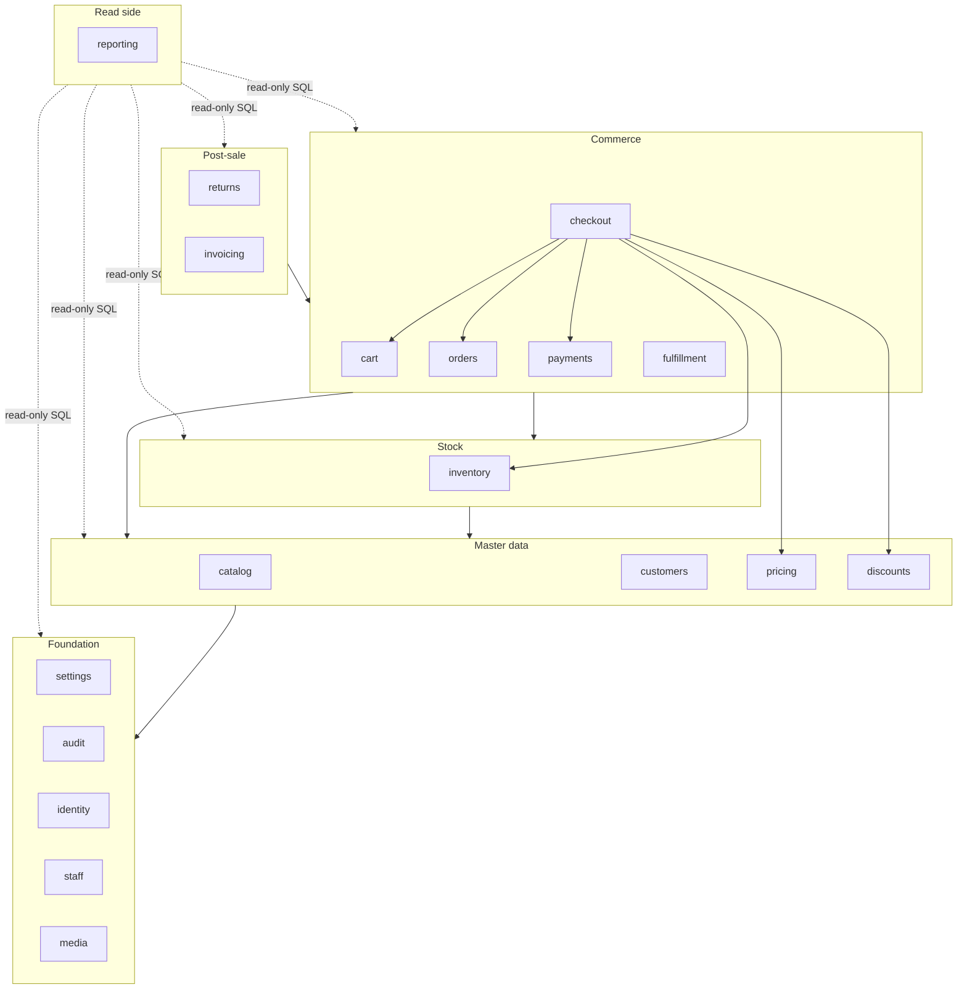

Rules (enforced by code review plus an ESLint `no-restricted-imports` rule on `modules/*/internal/**`):

1. A module may depend only on modules in its own layer or lower layers. Inventory never imports orders. Orders tell inventory what to do.
2. A module exposes `modules/<name>/index.ts` (service functions and types). Everything else is internal.
3. **Consistency-critical effects happen synchronously in the same DB transaction.** The caller passes its `tx` to the callee's service. Examples: reserving stock while placing an order, restocking while receiving a return.
4. **Side effects happen after commit** through a transactional job enqueue: emails, storefront cache revalidation, PDF rendering, low-stock alerts. The job is inserted in the same transaction, so it cannot be lost or sent for a rolled-back change (§4.4).
5. `reporting` only reads. It may join across all tables, because it is the one place where cross-module SQL is allowed.

### 7.3 Domain relationships (conceptual)

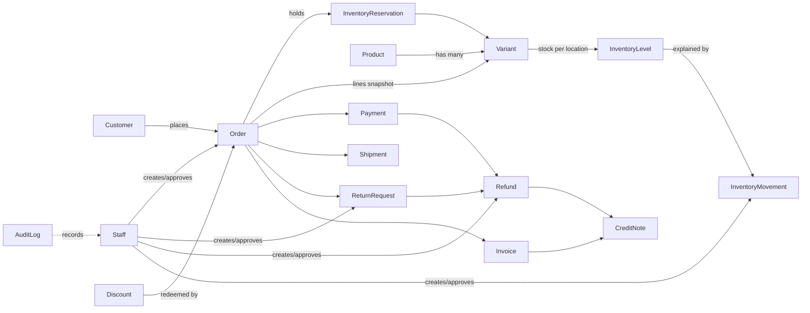

---

## 8. Database Architecture

### 8.1 Conventions

| Concern | Decision | Why |
|---|---|---|
| Engine | **PostgreSQL 18** (17 acceptable if the host lacks 18). Extensions: `citext`, `pg_trgm`, `unaccent` | One database is the source of truth. Mature row locking, partial indexes, full-text search |
| Table names | `snake_case`, **plural** (`orders`, `users`). Better Auth configured with `usePlural: true` | `order` and `user` are reserved words in SQL. Plural avoids quoting everywhere |
| Primary keys | `uuid` **v7**, generated in the app (`$defaultFn(uuidv7)`). Better Auth's ID generator is set to the same function | Ordered (B-tree friendly). Known before insert, so it can be used in idempotency keys, provider keys and job payloads. Safe in URLs |
| Human-facing numbers | Separate columns. `order_number` and `return_number` come from sequences (gaps are fine). Invoice and credit-note numbers come from a gapless counter (§16) | IDs are not business identifiers |
| Money | `bigint` **minor units**, column suffix `_amount`, `CHECK (… >= 0)` unless the column is a signed delta (§8.8) | Exact integer arithmetic |
| Rates | Percentage discounts as integer **basis points** (`percent_bps`, 10% = 1000). Tax rates as integer **parts-per-million** (`rate_ppm`, 8.875% = 88 750) | Basis points cannot express rates like 8.875% |
| Quantities | `integer` | Fashion items are counted in whole units |
| Timestamps | `timestamptz` everywhere. `created_at` and `updated_at` on mutable tables. Business-day bucketing uses `store_settings.timezone` | Reports need the store's local day, not UTC |
| Status fields | `text` + `CHECK (status IN (…))`, typed through Drizzle `text({ enum })` from shared TS const arrays | Easier to evolve than Postgres `ENUM` types |
| Deletion | No global soft-delete column. Catalog rows are **archived** (status). Financial and ledger rows are **never deleted**. FKs default to `ON DELETE RESTRICT`. `CASCADE` only for children owned by a mutable parent (cart lines, addresses, images, role permissions) | History must stay explainable |
| Append-only tables | `inventory_movements`, `audit_logs`, `payment_transactions`, `invoices`, `invoice_lines`: the app DB role gets only `INSERT, SELECT` on them, and a trigger raises on `UPDATE`/`DELETE` | Defense in depth for financial records |
| Isolation | `READ COMMITTED` (the default), plus explicit row locks and conditional `UPDATE … WHERE … RETURNING`. No global `SERIALIZABLE` | Simple. The hot spots are known and locked deliberately |
| Optimistic concurrency | `version integer` on admin-edited aggregates (`products`, `product_variants`, `discounts`, `orders`). Updates are `WHERE id = $1 AND version = $2` | Stops two staff from silently overwriting each other |

### 8.2 Core ERD

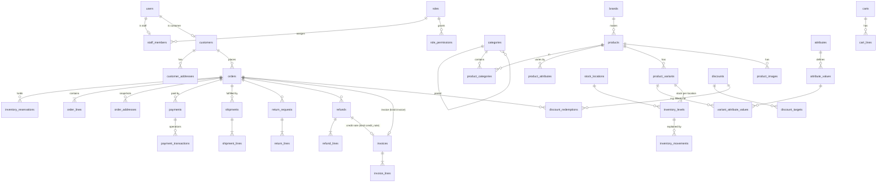

### 8.3 Table catalogue

Abbreviations: **PK** primary key, **FK** foreign key (RESTRICT unless stated), **UQ** unique, **CK** check, **IX** index.

#### Identity & staff (`identity`, `staff`)

| Table | Key columns | Constraints & indexes |
|---|---|---|
| `users`, `sessions`, `accounts`, `verifications`, `two_factors` | Managed by Better Auth (schema generated by its CLI into `packages/db`). **No business columns are added here.** | `users.email` UQ; `sessions.token` UQ; `sessions.user_id` FK CASCADE |
| `roles` | `key`, `name`, `description`, `is_system` | UQ(`key`). The `owner` role is system-managed and immutable |
| `role_permissions` | `role_id`, `permission` (text) | PK(`role_id`, `permission`); FK `role_id` CASCADE. Permission keys are validated against the code catalog (§10.4) |
| `staff_members` | `user_id`, `role_id`, `display_name`, `status` (`active`/`suspended`), `deactivated_at` | UQ(`user_id`); FK `role_id`. Staff are deactivated, never deleted |
| `staff_invites` | `email` citext, `role_id`, `token_hash`, `invited_by`, `expires_at`, `accepted_at` | UQ(`token_hash`) |

#### Customers (`customers`)

| Table | Key columns | Constraints & indexes |
|---|---|---|
| `customers` | `user_id` NULL, `email` citext NULL, `phone` (E.164) NULL, `first_name`, `last_name`, `marketing_opt_in`, `note`, `anonymized_at` | FK `user_id` → users **SET NULL**; UQ(`user_id`); UQ(`email`) WHERE `anonymized_at IS NULL`; IX(`phone`); CK `anonymized_at IS NOT NULL OR num_nonnulls(email, phone) >= 1` |
| `customer_addresses` | `customer_id`, `recipient_name`, `phone`, `line1`, `line2`, `city`, `region`, `postal_code`, `country_code` char(2), `is_default_shipping`, `is_default_billing` | FK CASCADE; UQ(`customer_id`) WHERE `is_default_shipping`, and the same for billing |

#### Catalog (`catalog`, `media`)

| Table | Key columns | Constraints & indexes |
|---|---|---|
| `brands` | `name`, `slug`, `status` | UQ(`slug`) |
| `categories` | `parent_id` NULL, `name`, `slug`, `position`, `status`, `seo_title`, `seo_description`, `image_asset_id` | FK self; UQ(`slug`); CK `parent_id <> id`; depth ≤ 3 and no cycles (enforced in the service) |
| `products` | `name`, `slug`, `description` (sanitized rich text), `brand_id` NULL, `size_chart_id` NULL, `status` (`draft`/`active`/`archived`), `tax_class` (default `standard`), `is_returnable`, `seo_title`, `seo_description`, `search_vector` tsvector, `published_at`, `version` | UQ(`slug`); IX(`status`, `published_at`); GIN(`search_vector`); GIN trigram(`name`) |
| `product_categories` | `product_id`, `category_id`, `is_primary`, `position` | PK(`product_id`, `category_id`); FK `product_id` CASCADE; UQ(`product_id`) WHERE `is_primary` |
| `attributes` | `code` (`color`, `size`, `fit`, …), `name`, `kind` (`color`/`size`/`text`), `position` | UQ(`code`). **Global**, so "size M" means the same thing across the catalog |
| `attribute_values` | `attribute_id`, `label`, `slug`, `swatch_hex` NULL, `position` | FK CASCADE; UQ(`attribute_id`, `slug`); UQ(`id`, `attribute_id`) (target of a composite FK) |
| `product_attributes` | `product_id`, `attribute_id`, `position` | PK(`product_id`, `attribute_id`). The axes the product varies by |
| `product_variants` | `product_id`, `sku`, `barcode` NULL, `price_amount`, `compare_at_amount` NULL, `cost_amount` NULL, `weight_grams`, `status` (`active`/`archived`), `position`, `option_key`, `version` | FK `product_id` CASCADE (blocked in practice once sold, see below); UQ(`sku`); UQ(`barcode`) WHERE NOT NULL; UQ(`product_id`, `option_key`) WHERE `status <> 'archived'`; CK `price_amount >= 0`, `compare_at_amount > price_amount`, `cost_amount >= 0` |
| `variant_attribute_values` | `variant_id`, `attribute_id`, `attribute_value_id` | PK(`variant_id`, `attribute_id`); composite FK (`attribute_value_id`, `attribute_id`) → `attribute_values`(`id`, `attribute_id`), so a value must belong to its attribute; IX(`attribute_value_id`) for storefront filters |
| `product_images` | `product_id`, `media_asset_id`, `attribute_value_id` NULL (colour-specific), `alt`, `position` | FK `product_id` CASCADE; IX(`product_id`, `position`) |
| `media_assets` | `storage_key`, `content_type`, `byte_size`, `width`, `height`, `status` (`pending`/`ready`), `uploaded_by` | UQ(`storage_key`) |
| `tags`, `product_tags` | `name`, `slug`; (`product_id`, `tag_id`) | UQ(`slug`); PK on the link table; CASCADE on links |
| `size_charts` | `name`, `content` jsonb (column headers and rows), `note` | — |

`option_key` is a canonical string of the variant's attribute-value IDs sorted by attribute (for example `color:<id>;size:<id>`). With the partial unique index, it prevents duplicate "Black / M" variants.

Hard-deleting a product cascades to its variants. **This is blocked automatically once anything has been sold or stocked**, because `order_lines` and `inventory_movements` reference variants with RESTRICT. In practice only never-used drafts can be deleted. Everything else is archived.

#### Inventory (`inventory`)

| Table | Key columns | Constraints & indexes |
|---|---|---|
| `stock_locations` | `code`, `name`, `kind` (`store`/`warehouse`), `is_default`, `is_active`, `address` jsonb | UQ(`code`); UQ(`is_default`) WHERE `is_default`. **One row is seeded**, and every stock row references it |
| `inventory_levels` | PK(`variant_id`, `location_id`), `on_hand`, `reserved`, `available` **GENERATED ALWAYS AS (on_hand − reserved) STORED**, `low_stock_threshold` NULL, `updated_at` | CK `on_hand >= 0`, `reserved >= 0`; IX(`location_id`, `available`) |
| `inventory_movements` | `id` bigint identity, `variant_id`, `location_id`, `quantity_delta`, `on_hand_after`, `reason`, `channel` (`online`/`pos`/`admin`/`system`), `reference_type`, `reference_id`, `unit_cost_amount` NULL, `note`, `actor_type`, `actor_id`, `created_at` | CK `quantity_delta <> 0`; IX(`variant_id`, `location_id`, `created_at DESC`); IX(`reference_type`, `reference_id`). Append-only |
| `inventory_reservations` | `order_id`, `order_line_id`, `variant_id`, `location_id`, `quantity`, `status` (`active`/`committed`/`released`/`expired`), `expires_at` NULL, `release_reason` | CK `quantity > 0`; UQ(`order_line_id`, `location_id`) WHERE `status = 'active'`; IX(`expires_at`) WHERE `status = 'active' AND expires_at IS NOT NULL`; IX(`order_id`) |
| `stock_receipts` | `reference` (supplier delivery note), `supplier_name`, `note`, `received_by`, `received_at` | Header row for one delivery. Its lines **are** the `receipt` movements (`reference_type = 'stock_receipt'`) |

#### Pricing & tax (`pricing`)

| Table | Key columns | Constraints & indexes |
|---|---|---|
| `tax_rates` | `tax_class`, `name`, `rate_ppm`, `applies_to_shipping`, `valid_from`, `valid_to` NULL | CK `rate_ppm BETWEEN 0 AND 1000000`; UQ(`tax_class`, `valid_from`). Single jurisdiction in the MVP (§30, Q2) |
| `shipping_methods` | `name`, `description`, `price_amount`, `free_over_amount` NULL, `is_active`, `position` | Flat-rate, domestic |
| `store_settings` | Singleton: `store_name`, `legal_name`, `tax_registration_id`, `address` jsonb, `currency` char(3), `currency_exponent`, `timezone`, `order_number_prefix`, `return_window_days`, `low_stock_default`, `payment_hold_minutes`, `unpaid_order_cancel_hours`, `cod_enabled`, `cod_max_order_amount` NULL, `cod_requires_review` | PK `id smallint` CK `id = 1` |

#### Cart (`cart`)

| Table | Key columns | Constraints & indexes |
|---|---|---|
| `carts` | `token_hash`, `customer_id` NULL, `email` NULL, `status` (`active`/`converted`/`abandoned`), `discount_code` NULL, `expires_at` | UQ(`token_hash`); FK `customer_id` SET NULL; IX(`customer_id`) WHERE `status = 'active'` |
| `cart_lines` | `cart_id`, `variant_id`, `quantity`, `price_at_add_amount` | FK `cart_id` CASCADE; UQ(`cart_id`, `variant_id`); CK `quantity BETWEEN 1 AND 20` |

Cart totals are never stored. They are recomputed by `pricing` on every read. `price_at_add_amount` exists only to show a "price changed" notice.

#### Orders & fulfillment (`orders`, `fulfillment`)

| Table | Key columns | Constraints & indexes |
|---|---|---|
| `orders` | `order_number` bigint (sequence), `channel` (`online`/`pos`), `location_id`, `cart_id` NULL, `customer_id` NULL, `email`, `phone`, `status`, `payment_status`, `fulfillment_status`, `hold_reason` NULL, `currency`, `subtotal_amount`, `discount_amount`, `shipping_amount`, `tax_amount`, `total_amount`, `paid_amount`, `refunded_amount`, `payment_method_type` (`cod`/`gateway`/…), `shipping_method_id`, `shipping_method_name`, `customer_note`, `staff_note`, `guest_token_hash` NULL, `placed_at`, `confirmed_at`, `completed_at`, `cancelled_at`, `cancel_reason`, `created_by_staff_id` NULL, `version` | UQ(`order_number`); UQ(`cart_id`); CK `total_amount = subtotal_amount − discount_amount + shipping_amount + tax_amount`; CK `refunded_amount <= paid_amount`; CK `customer_id IS NOT NULL OR channel = 'pos'`; IX(`customer_id`, `placed_at DESC`); IX(`status`, `placed_at DESC`); IX(`placed_at`) |
| `order_lines` | `order_id`, `line_no`, `variant_id`, `product_id`. Snapshots: `sku`, `product_name`, `variant_title`, `attributes` jsonb (`{"color":"Black","size":"M"}`), `image_url`, `tax_class`, `unit_cost_amount`. Amounts: `quantity`, `unit_price_amount`, `compare_at_amount`, `subtotal_amount`, `discount_amount`, `tax_rate_ppm`, `tax_amount`, `total_amount`, `qty_fulfilled`, `qty_returned` | FK `order_id`, `variant_id` (RESTRICT); CK `subtotal_amount = unit_price_amount * quantity`; CK `total_amount = subtotal_amount − discount_amount + tax_amount`; CK `0 <= qty_returned AND qty_returned <= qty_fulfilled AND qty_fulfilled <= quantity`; IX(`variant_id`) |
| `order_addresses` | PK(`order_id`, `kind` `shipping`/`billing`) + snapshot fields | Copied at placement and never linked back to `customer_addresses` |
| `order_discounts` | `order_id`, `discount_id` NULL, `code`, `title`, `value_type`, `amount` | Snapshot of what was applied |
| `shipments` | `order_id`, `location_id`, `status`, `carrier`, `tracking_number`, `tracking_url`, `shipped_at`, `delivered_at`, `created_by` | IX(`order_id`) |
| `shipment_lines` | PK(`shipment_id`, `order_line_id`), `quantity` | CK `quantity > 0` |

#### Payments & refunds (`payments`)

| Table | Key columns | Constraints & indexes |
|---|---|---|
| `payments` (one row per attempt or tender) | `order_id`, `method` (`cod`/`gateway`/`cash`/`card_present`/`bank_transfer`/`mobile_wallet`/`store_credit`), `provider` NULL, `provider_ref` NULL, `status`, `amount`, `captured_amount`, `refunded_amount`, `currency`, `failure_code`, `failure_message`, `collected_by_staff_id` NULL, `expires_at` NULL | UQ(`provider`, `provider_ref`) WHERE NOT NULL; CK `0 <= refunded_amount AND refunded_amount <= captured_amount AND captured_amount <= amount`; IX(`order_id`); IX(`created_at`) WHERE `status = 'pending'` |
| `payment_transactions` | `id` bigint identity, `payment_id`, `refund_id` NULL, `kind` (`authorize`/`capture`/`void`/`refund`/`cod_collect`), `status` (`pending`/`succeeded`/`failed`), `amount`, `provider_txn_id` NULL, `idempotency_key`, `error_code`, `raw` jsonb (scrubbed) | UQ(`idempotency_key`); UQ(`payment_id`, `provider_txn_id`) WHERE NOT NULL. Append-only, except a `pending` row is resolved exactly once |
| `webhook_events` (inbox) | `provider`, `event_id`, `event_type`, `payload` jsonb, `status` (`received`/`processed`/`failed`/`ignored`), `attempts`, `last_error`, `received_at`, `processed_at` | UQ(`provider`, `event_id`); IX(`status`) WHERE `status IN ('received','failed')` |
| `refunds` | `order_id`, `payment_id`, `return_request_id` NULL, `status` (`pending`/`succeeded`/`failed`/`cancelled`), `method` (`original_payment`/`cash`/`bank_transfer`/`mobile_wallet`/`store_credit`), `amount`, `shipping_amount`, `reason`, `external_reference` (for manual transfers), `idempotency_key`, `created_by_staff_id`, `processed_at` | UQ(`idempotency_key`); CK `amount > 0`; IX(`order_id`) |
| `refund_lines` | `refund_id`, `order_line_id`, `quantity`, `amount`, `tax_amount` | FK `refund_id` CASCADE |

#### Returns (`returns`)

| Table | Key columns | Constraints & indexes |
|---|---|---|
| `return_requests` | `return_number` (sequence), `order_id`, `customer_id`, `status`, `resolution` (`refund`; later `store_credit`/`exchange`), `requested_by` (`customer`/`staff`), `customer_note`, `staff_note`, `requested_at`, `approved_at`, `received_at`, `completed_at`, `approved_by`, `received_by` | UQ(`return_number`); IX(`order_id`); IX(`status`) |
| `return_lines` | `return_request_id`, `order_line_id`, `quantity`, `reason_code`, `received_quantity`, `condition` (`as_new`/`damaged`/`unsellable`), `disposition` (`pending`/`restock`/`write_off`), `inventory_movement_id` NULL | FK CASCADE on the parent; CK `received_quantity <= quantity` |

#### Invoicing (`invoicing`)

| Table | Key columns | Constraints & indexes |
|---|---|---|
| `invoices` | `kind` (`invoice`/`credit_note`), `number` (e.g. `INV-2026-000123`), `series`, `order_id`, `original_invoice_id` NULL, `refund_id` NULL, `issued_at`, `currency`, `seller` jsonb snapshot, `buyer` jsonb snapshot, `subtotal_amount`, `discount_amount`, `shipping_amount`, `tax_amount`, `total_amount`, `payment_summary` jsonb | UQ(`number`); UQ(`order_id`) WHERE `kind = 'invoice'`; UQ(`refund_id`) WHERE NOT NULL; CK `kind = 'invoice' OR original_invoice_id IS NOT NULL`. **Immutable** (trigger) |
| `invoice_lines` | `invoice_id`, `line_no`, `order_line_id` NULL, `description`, `sku`, `quantity`, `unit_price_amount`, `discount_amount`, `tax_rate_ppm`, `tax_amount`, `total_amount` | **Immutable** |
| `document_counters` | PK `series` (`INV-2026`, `CN-2026`), `next_value` | Gapless allocation (§16.3) |

PDFs are written to a deterministic object key (`invoices/{id}.pdf`) after commit, so the immutable row never needs updating.

#### Discounts (`discounts`)

| Table | Key columns | Constraints & indexes |
|---|---|---|
| `discounts` | `title`, `code` citext NULL (NULL means automatic, which is post-MVP), `status` (`active`/`disabled`/`archived`), `value_type` (`percentage`/`fixed_amount`/`free_shipping`), `percent_bps` NULL, `amount` NULL, `scope` (`order`/`items`), `min_subtotal_amount` NULL, `starts_at`, `ends_at` NULL, `usage_limit` NULL, `usage_count`, `once_per_customer`, `excludes_sale_items`, `channels` text[], `version` | UQ(`code`) WHERE NOT NULL; CK `usage_limit IS NULL OR usage_count <= usage_limit`; CK value columns consistent with `value_type`; CK `percent_bps BETWEEN 1 AND 10000` |
| `discount_targets` | `discount_id`, `mode` (`include`/`exclude`), `product_id` NULL, `variant_id` NULL, `category_id` NULL, `brand_id` NULL | FK CASCADE on `discount_id`, real FKs for the targets; CK `num_nonnulls(product_id, variant_id, category_id, brand_id) = 1` |
| `discount_redemptions` | `discount_id`, `order_id`, `customer_key` NULL, `amount`, `status` (`active`/`released`) | UQ(`discount_id`, `order_id`); UQ(`discount_id`, `customer_key`) WHERE `status = 'active'` (`customer_key` is set only for once-per-customer discounts) |

#### Platform (`audit`, cross-cutting)

| Table | Key columns | Constraints & indexes |
|---|---|---|
| `audit_logs` | `id` bigint identity, `occurred_at`, `actor_type` (`staff`/`customer`/`system`/`webhook`), `actor_id`, `actor_label`, `action`, `entity_type`, `entity_id`, `root_type`, `root_id`, `changes` jsonb, `metadata` jsonb (`reason`, `ip`, `user_agent`), `request_id` | IX(`entity_type`, `entity_id`, `occurred_at DESC`); IX(`root_type`, `root_id`, `occurred_at DESC`) (order timeline); IX(`actor_id`, `occurred_at DESC`); IX(`action`, `occurred_at DESC`). Append-only |
| `idempotency_keys` | PK(`scope`, `key`), `request_hash`, `status` (`in_progress`/`completed`), `response_status`, `response_body` jsonb, `resource_id`, `expires_at` | Purged after 24–72 h |
| Job queue | Owned by the job library, in its own schema (§4.4) | — |

**Total: about 45 tables.** That is proportionate for this domain. **Deliberately not created:**
- a `permissions` table (the catalog lives in code)
- an `order_events` table (the order timeline is `audit_logs` filtered by `root`)
- separate `payment_attempts` and `credit_notes` tables
- `coupons` separate from `discounts`
- an `exchanges` table (post-MVP, built on returns)
- `price_history` (the audit log covers it)
- purchase orders and suppliers, stock-count sessions, transfers, store credit, and POS registers (all post-MVP, §28)

### 8.4 Key invariants

| # | Invariant | Enforced by |
|---|---|---|
| I1 | `inventory_levels.on_hand = Σ inventory_movements.quantity_delta` per (variant, location) | Same-transaction writes. A nightly reconciliation job alerts on drift |
| I2 | `inventory_levels.reserved = Σ active reservations` | Same-transaction writes. The nightly job checks it |
| I3 | `on_hand ≥ 0`, `reserved ≥ 0` | CHECK |
| I4 | Order totals add up; line totals add up | CHECK constraints on `orders` and `order_lines` |
| I5 | `refunded ≤ captured ≤ amount` per payment; `refunded_amount ≤ paid_amount` per order | CHECK, plus service checks under the order lock |
| I6 | Returned ≤ fulfilled ≤ ordered quantity per line | CHECK |
| I7 | Coupon usage never exceeds its limit | Conditional `UPDATE` plus CHECK |
| I8 | Invoices and credit notes never change; numbers are gapless per series | Trigger, grants, counter row lock |
| I9 | One active default stock location, tax rate per class/period, default address | Partial unique indexes |

### 8.5 Transaction boundaries

| Operation | Inside one DB transaction | After commit (job) |
|---|---|---|
| Place order | idempotency key → lock cart → upsert guest customer → reprice → evaluate discount → compute tax → insert order, lines, addresses, discounts → **reserve stock (sorted)** → increment coupon usage + redemption → insert pending payment → mark cart converted → audit → enqueue `order.placed` | Create gateway session (provider idempotency key = `payment.id`); send email |
| Gateway payment webhook | dedupe inbox row → lock order + payment → insert `capture` transaction → verify amount/currency → update payment and order money fields → firm or re-reserve stock → order `confirmed` (or `on_hold`) → audit → enqueue `order.paid` | Confirmation email, storefront revalidation |
| Ship order | lock order → create shipment + lines → **commit reservations** (`on_hand −= q`, `reserved −= q`, `sale` movement) → `qty_fulfilled` → fulfillment status → issue invoice if paid → audit | Shipping email, invoice PDF |
| COD collected | lock order → shipment `delivered` → `cod_collect` transaction → payment captured → payment status → issue invoice → order `completed` → audit | Invoice PDF + email |
| Cancel order | lock order (must be unfulfilled) → release reservations → release redemption + decrement usage → void pending payments; create `pending` refunds for captured amounts → order `cancelled` → audit | Provider void/refund calls; email |
| Receive return | lock order + return → received quantities + disposition → restock movements (sorted) → `qty_returned` → return `received` → audit | — |
| Issue refund | lock order + payments → compute refundable → insert refund + lines + pending `refund` transaction(s) → audit | Provider refund call → on success: refund `succeeded`, credit note issued, return `completed` (own transaction) |
| Inventory adjustment | conditional `UPDATE inventory_levels` → movement row → audit | Low-stock alert, storefront revalidation |
| Price change | `UPDATE product_variants … WHERE version = $v` → audit diff | Storefront revalidation |

**Rule:** no network calls (payment provider, email, storage) are made inside a DB transaction. Calls that need to happen are either made before the transaction or enqueued as jobs inside it.

### 8.6 Concurrency hazards

| Hazard | Mitigation |
|---|---|
| Two customers buy the last unit | One conditional `UPDATE … WHERE on_hand − reserved >= q RETURNING`. The second transaction re-evaluates after the lock is released, gets 0 rows, and rolls back with `409 OUT_OF_STOCK` (§12.4) |
| Deadlocks between multi-line orders | **Global lock order:** order/cart row → `inventory_levels` sorted by `variant_id` → discount row → document counter. Deadlock or serialization errors (`40P01`/`40001`) are retried once by the transaction helper |
| Duplicate order submit (double click, retry) | `Idempotency-Key` header stored in `idempotency_keys` inside the transaction, plus UQ(`orders.cart_id`), plus the cart status check under `FOR UPDATE` |
| Duplicate or out-of-order webhooks | UQ(`provider`, `event_id`) inbox; UQ provider transaction id; state transitions are compare-and-set (`WHERE status = ANY(allowed_from)`), so regressive events are recorded but have no effect |
| Duplicate payments for one order | A new attempt is allowed only if no payment is `captured`/`authorized` for the order (checked under the order lock). The provider idempotency key is `payment.id` |
| Coupon over-redemption | Conditional increment plus CHECK. Partial unique index for once-per-customer |
| Concurrent or excessive refunds | All money mutations on an order serialize on the order row lock. Refundable amount = captured − (pending + succeeded refunds). CHECK as backstop |
| Price change during checkout | Client sends `expected_total`. Mismatch → `409 PRICE_CHANGED` with a fresh quote. Orders snapshot prices, so later changes never affect placed orders |
| Product archived with open carts | Cart lines show "no longer available" and block checkout. Orders are unaffected (snapshots + RESTRICT FKs) |
| Two staff edit the same product | `version` column → `409 STALE_WRITE` |
| Reservation sweeper vs late webhook | The sweeper uses `FOR UPDATE SKIP LOCKED` on the order. The webhook path re-reserves if needed (§12.5) |
| Gapless invoice numbers under concurrency | Counter row `UPDATE … RETURNING` in the issuing transaction, taken last in the lock order. A rollback also rolls back the increment, so there are no gaps |

### 8.7 Migrations & data lifecycle

- **Schema-as-code** in `packages/db/src/schema/*.ts`, one file per domain. `drizzle-kit generate` produces SQL migrations, which are **committed and reviewed**. `drizzle-kit push` is only allowed against throwaway local databases.
- Things Drizzle can't express go in hand-written SQL migrations (`drizzle-kit generate --custom`): extensions, immutability triggers, `GRANT`s, generated tsvector maintenance.
- Migrations run as a **release step** before the new API version starts (§25). Destructive changes use **expand → migrate → contract** across two deploys.
- Seeds: `seed:base` (roles, permissions, default location, store settings, attributes, tax class) runs in every environment. `seed:demo` (sample catalog) runs only in local and staging.
- **Retention:**
  - Orders, invoices, payments, refunds and movements are kept for the legal retention period (§30, Q6).
  - Customer deletion = **anonymization**. PII is nulled or replaced on `customers` and order contact snapshots, addresses are deleted, and the Better Auth user is deleted (sessions cascade). Invoices keep the buyer snapshot as a legal record.
  - Carts are purged 30 days after last activity. Idempotency keys after 72 h. Processed webhook payloads after 90 days.

### 8.8 Money representation

| Layer | Representation |
|---|---|
| PostgreSQL | `bigint`, **minor units** (cents, paisa, …). The currency exponent comes from `store_settings.currency_exponent` (ISO 4217: usually 2; 0 for JPY-like currencies; 3 for KWD-like). A `currency char(3)` column is kept on `orders`, `payments` and `invoices` as a safeguard, even though Auren has one currency |
| Drizzle | `bigint('price_amount', { mode: 'number' })` |
| TypeScript | A branded integer `type MinorUnits = number & { readonly __brand: 'MinorUnits' }`. Helpers in `packages/contracts/src/money.ts`: `add`, `sub`, `mulQty`, `percentOf(amount, bps)`, `applyRatePpm(amount, ppm)`, `allocate(total, weights)` (largest remainder), `parseMoneyInput("25.90", exp) → 2590` (string-based, never via float), `formatMoney(amount, currency, locale)` (`Intl.NumberFormat`) |
| Zod / JSON | `z.number().int().min(0).max(Number.MAX_SAFE_INTEGER)` (signed for deltas). JSON carries integers only |
| Arithmetic | Intermediate products such as `amount × ppm` use `BigInt`, then are converted back with a safe-integer assertion. Rounding is **half-up** for tax and percentages. Allocation uses the largest-remainder method (§13.4) |

**Why not the alternatives**
- `numeric(12,2)`: Drizzle returns it as a string, so a decimal library would be needed everywhere, and it hard-codes 2 decimals while the currency is still undecided.
- Floating point: never acceptable for money.
- JS `bigint` mode: `JSON.stringify` can't serialize it, and the range isn't needed. 2^53 minor units is about 90 trillion in a 2-decimal currency.

---

## 9. API Architecture

### 9.1 Style

- **Resource-oriented JSON over HTTP ("REST-ish")**, with **explicit action endpoints for state transitions**, e.g. `POST /admin/orders/{id}/cancel`, never a generic `PATCH {status}`. Each action is a business command with its own permission, validation, audit entry and error codes.
- **Contracts:**
  - Routes are defined with `@hono/zod-openapi` (`createRoute` with request and response Zod schemas from `packages/contracts`).
  - This gives runtime validation, an **OpenAPI document** (`/api/openapi.json`; served in non-production environments, and to staff in production) and **end-to-end types** through Hono's `hc` client.
  - Two separately exported app types, `StoreApi` and `AdminApi`, keep TypeScript inference fast. Each has its own precompiled client.
- **Why not pure RPC or tRPC:** HTTP semantics (status codes, caching of public GETs, webhooks, idempotency headers) matter here. An OpenAPI contract also keeps the door open for POS devices, a mobile app or integrations without a rewrite. The trade-off: route definitions are more verbose than a bare `zValidator`.
- **No URL versioning** while the only clients are first-party apps deployed together. Breaking changes follow expand → migrate clients → contract. A `/v2` surface is added only if an external client appears.

### 9.2 Surfaces (the real API boundaries)

| Prefix | Audience | Auth | Rate limit | Notes |
|---|---|---|---|---|
| `/api/auth/*` | Everyone | Better Auth handler | Better Auth's own limiter (DB storage) | Sign-up/in/out, verify, reset, 2FA |
| `/api/store/*` | Storefront (customers + guests) | Optional customer session, cart token cookie, guest order token | Per IP, plus stricter limits on checkout and coupon | Public catalog reads are cacheable |
| `/api/admin/*` | Back office (and POS later) | **Staff session + 2FA + permission per route** | Per staff user | Never cacheable |
| `/api/webhooks/:provider` | Payment providers | Signature verification only | Generous | Raw body; skips origin check |
| `/api/health`, `/api/ready` | Load balancer | None | — | `ready` checks DB connectivity |

Splitting by **audience** rather than by entity lets auth, rate limits, response shapes and caching differ cleanly. For example, the store product DTO never includes `cost_amount`. Each domain module contributes `routes.store.ts` and/or `routes.admin.ts`.

### 9.3 Conventions

- **JSON:** camelCase. IDs are UUID strings. Timestamps are ISO-8601 UTC. **Money is an integer in minor units plus a `currency`** (`{ "amount": 2500, "currency": "USD" }` in DTOs, or `priceAmount` fields alongside a top-level currency).
- **Lists:** `{ data: [...], page: { … } }`. The storefront uses `?page=&pageSize=` (max 48). The admin uses cursor pagination `?cursor=&limit=` (max 100) with `nextCursor`.
- **Filtering and sorting:** `?status=confirmed&sort=-placedAt`. The allowed fields are listed in each query schema, so arbitrary fields are rejected.
- **Headers:** `X-Request-Id` (echoed; generated if absent), `Idempotency-Key` (required where marked ⓘ below), `If-Match: <version>` for optimistic concurrency on admin updates. These are alternatives to a body `version` field.
- **Mutations require `Content-Type: application/json`**, which helps against CSRF (§22).

### 9.4 Middleware pipeline

```text
requestId → logger(child with requestId) → secureHeaders → bodyLimit
  → [webhooks: rawBody + signature verify → handler]                       (branch)
  → originCheck (mutations: Origin / Sec-Fetch-Site must equal WEB_ORIGIN)
  → session (Better Auth getSession; admin uses disableCookieCache)
  → rateLimit (per surface/route)
  → surface guard (store: optional customer | admin: requireStaff → active + 2FA enrolled)
  → route: requirePermission('x.y') → idempotency (ⓘ routes) → zod validation → handler → service
  → onError (AppError → JSON; unknown → 500 generic + Sentry)  ·  notFound → 404 JSON
```

Typed Hono `Variables`: `requestId`, `log`, `session`, `actor` (`{ kind: 'customer'|'staff'|'guest'|'system', userId?, customerId?, staffId?, permissions: ReadonlySet<Permission> }`). A service receives a `ctx = { db, actor, requestId, clock }`, and **services open their own transactions**. Routes never hold one transaction for the whole request.

### 9.5 Route catalogue

**Legend:** 🔓 public · 👤 customer session · 🎫 guest token or customer · 🛡 staff + permission · ⓘ `Idempotency-Key` required.
Request and response names refer to Zod schemas in `packages/contracts`.
Common errors are not repeated per row: `400 VALIDATION_ERROR`, `401 UNAUTHENTICATED`, `403 FORBIDDEN`, `404 *_NOT_FOUND`, `429 RATE_LIMITED`.

#### Storefront — catalog (`catalog`)

| Method & path | Auth | Request → Response | Business logic / notable errors |
|---|---|---|---|
| `GET /store/categories` | 🔓 | — → `CategoryTreeDTO` | Active categories only. Cached (tag `nav`) |
| `GET /store/categories/{slug}` | 🔓 | — → `CategoryDTO` (+ breadcrumbs, SEO) | 404 if inactive |
| `GET /store/products` | 🔓 | `ProductListQuery` (category, brand, attr values, price range, inStock, onSale, tag, sort, page) → `Paged<ProductCardDTO>` + `facets` | Active products with ≥1 active variant |
| `GET /store/products/{slug}` | 🔓 | — → `ProductDetailDTO` (variants, attributes, images by colour, price, compareAt, size chart, SEO, related) | `410 PRODUCT_ARCHIVED` (with primary category for redirect), 404 for draft |
| `GET /store/products/{slug}/availability` | 🔓 | — → `{ variantId, available: 'in_stock' \| 'low' \| 'out', qtyHint? }[]` | Live, not cached |
| `GET /store/search` | 🔓 | `SearchQuery` (q, filters, page) → `Paged<ProductCardDTO>` + facets | `CatalogSearch` seam (§11.4); `q` max 100 chars |

#### Storefront — cart & checkout (`cart`, `checkout`, `pricing`, `discounts`)

| Method & path | Auth | Request → Response | Business logic / notable errors |
|---|---|---|---|
| `GET /store/cart` | 🔓 cart cookie | — → `CartDTO` (lines with live prices, availability flags, `priceChanged`, totals estimate) | Creates nothing. An empty cart is returned if there is no cookie |
| `POST /store/cart/lines` | 🔓 | `{ variantId, quantity }` → `CartDTO` | Creates the cart and sets an httpOnly `auren_cart` cookie on first add. Soft stock check → `409 INSUFFICIENT_STOCK` (max available). `422 VARIANT_UNAVAILABLE` |
| `PATCH /store/cart/lines/{lineId}` | 🔓 | `{ quantity }` → `CartDTO` | Same checks. Quantity 1–20 |
| `DELETE /store/cart/lines/{lineId}` | 🔓 | — → `CartDTO` | |
| `POST /store/cart/discount` / `DELETE` | 🔓 | `{ code }` → `CartDTO` | Rate-limited. `422 DISCOUNT_INVALID { reason }` |
| `POST /store/checkout/quote` | 🔓 | `CheckoutQuoteInput` (cartId, shipping address, shippingMethodId, paymentMethod) → `QuoteDTO` (lines, discount, shipping, tax, total, `codAvailable`) | Pure pricing. No writes |
| `GET /store/shipping-methods` | 🔓 | — → `ShippingMethodDTO[]` | |
| `POST /store/checkout` ⓘ | 🔓 / 👤 | `PlaceOrderInput` → `201 PlaceOrderResult` (`orderNumber`, `status`, `nextAction`, `guestAccessUrl?`) | §13.5. `409 OUT_OF_STOCK {items}`, `409 PRICE_CHANGED {quote}`, `409 CART_ALREADY_CONVERTED`, `422 DISCOUNT_INVALID`, `422 COD_NOT_AVAILABLE`, `422 CART_EMPTY` |
| `POST /store/orders/{number}/payments` ⓘ | 🎫 | — → `{ nextAction }` | Retry the gateway payment while `pending_payment`. Re-reserves if expired → `409 OUT_OF_STOCK`. `409 ORDER_NOT_PAYABLE` |

```ts
// packages/contracts — representative schema
export const PlaceOrderInput = z.object({
  email: z.string().email(),
  phone: PhoneE164,
  shippingAddress: AddressInput,
  billingAddress: AddressInput.optional(),       // defaults to shipping
  shippingMethodId: z.string().uuid(),
  paymentMethod: z.enum(['cod', 'gateway']),
  expectedTotal: MoneyAmount,                    // integer minor units; mismatch → 409 PRICE_CHANGED
  customerNote: z.string().max(500).optional(),
  marketingOptIn: z.boolean().default(false),
});
```

#### Storefront — account, orders, returns (`customers`, `orders`, `returns`, `invoicing`)

| Method & path | Auth | Request → Response | Business logic / notable errors |
|---|---|---|---|
| `GET/PATCH /store/me` | 👤 | `UpdateProfileInput` → `CustomerDTO` | |
| `GET/POST/PATCH/DELETE /store/me/addresses[/{id}]` | 👤 | `AddressInput` → `AddressDTO` | Ownership enforced |
| `GET /store/me/orders` | 👤 | `Paged<OrderSummaryDTO>` | Only the caller's own customer ID |
| `GET /store/orders/{number}` | 🎫 | `?token=` for guests → `OrderDetailDTO` | Token hash compared in constant time. Otherwise 404 (not 403), to avoid leaking that the order exists |
| `POST /store/orders/lookup` | 🔓 | `{ orderNumber, email }` → `202` | Always 202. Emails a fresh access link if the pair matches. Rate-limited |
| `POST /store/orders/{number}/cancel` | 🎫 | `{ reason? }` → `OrderDetailDTO` | Only while `pending_payment` or `confirmed` and unfulfilled → `409 INVALID_STATE_TRANSITION` |
| `GET /store/orders/{number}/invoice` | 🎫 | — → PDF stream / 302 signed URL | `404 INVOICE_NOT_ISSUED` |
| `POST /store/orders/{number}/returns` | 🎫 | `ReturnRequestInput { lines[{orderLineId, quantity, reasonCode}], note }` → `ReturnDTO` | Window, returnable flag, and returnable quantity checked under the order lock → `422 RETURN_NOT_ALLOWED {reason}` |
| `GET /store/me/returns` | 👤 | `Paged<ReturnDTO>` | |

#### Admin — catalog & media

| Method & path | Permission | Request → Response | Business logic / notable errors |
|---|---|---|---|
| `GET /admin/products` | `products.read` | `AdminProductQuery` → `Paged<AdminProductRowDTO>` | Includes drafts and archived products. Search by name, SKU or barcode |
| `POST /admin/products` | `products.write` | `CreateProductInput` (base data, axes, variants) → `AdminProductDTO` | `409 SLUG_TAKEN`, `409 SKU_TAKEN {sku}`, `409 BARCODE_TAKEN` |
| `GET/PATCH /admin/products/{id}` | `products.read` / `products.write` | `UpdateProductInput` + `If-Match` → `AdminProductDTO` | `409 STALE_WRITE`. Audit diff. Enqueues revalidation |
| `POST /admin/products/{id}/publish` · `/archive` · `/restore` | `products.write` | — → `AdminProductDTO` | Publishing requires ≥1 active variant with a price and ≥1 image → `422 PRODUCT_NOT_PUBLISHABLE {missing}` |
| `DELETE /admin/products/{id}` | `products.write` | — → `204` | Only never-referenced drafts → `409 PRODUCT_IN_USE` (use archive) |
| `POST /admin/products/{id}/variants` · `PATCH/…/variants/{vid}` · `POST …/variants/generate` | `products.write` | `VariantInput[]` / `GenerateVariantsInput` → `VariantDTO[]` | Price changes are audit-logged with old and new values. `cost` editable only with `products.cost.read` |
| `PATCH /admin/variants/bulk` | `products.write` | `{ variantIds, set: { priceAmount?, compareAtAmount?, status? } }` → `VariantDTO[]` | One transaction, one audit entry per variant |
| `CRUD /admin/categories`, `/admin/brands`, `/admin/tags`, `/admin/attributes[/{id}/values]`, `/admin/size-charts` | `products.write` (read: `products.read`) | Standard | Category delete only if empty → `409 CATEGORY_IN_USE`. Cycle and depth check → `422 CATEGORY_DEPTH_EXCEEDED` |
| `POST /admin/media/uploads` | `products.write` | `{ contentType, byteSize, filename }` → `{ assetId, uploadUrl, headers }` | `422 UNSUPPORTED_MEDIA_TYPE`, `422 FILE_TOO_LARGE` |
| `POST /admin/media/{assetId}/complete` | `products.write` | — → `MediaAssetDTO` | Verifies the object exists, its size and magic bytes |

#### Admin — inventory

| Method & path | Permission | Request → Response | Business logic / notable errors |
|---|---|---|---|
| `GET /admin/inventory` | `inventory.read` | `InventoryQuery` (search, lowStock, outOfStock, category) → `Paged<InventoryRowDTO>` (on_hand, reserved, available, threshold) | |
| `GET /admin/inventory/{variantId}/movements` | `inventory.read` | cursor → `Paged<MovementDTO>` | Includes the resolved reference (order number, receipt ref) and actor name |
| `GET /admin/inventory/{variantId}/reservations` | `inventory.read` | — → `ReservationDTO[]` | |
| `POST /admin/inventory/receipts` ⓘ | `inventory.receive` | `StockReceiptInput { reference, supplierName?, lines[{variantId, quantity>0, unitCostAmount?}] }` → `StockReceiptDTO` | One transaction, sorted locks, a movement per line |
| `POST /admin/inventory/adjustments` ⓘ | `inventory.adjust` | `AdjustmentInput { lines[{variantId, delta≠0 \| countedQuantity}], reason, note (required) }` → `AdjustmentResultDTO` (+ `oversoldWarnings`) | `422 NEGATIVE_STOCK` if on_hand would go below 0. Audit-logged |
| `PATCH /admin/inventory/{variantId}` | `inventory.adjust` | `{ lowStockThreshold }` → `InventoryRowDTO` | |
| `POST /admin/inventory/import` ⓘ | `inventory.adjust` | CSV (multipart) → `ImportReportDTO` | Dry-run mode. Per-row errors. Used for the opening balance |

#### Admin — orders, fulfillment, payments

| Method & path | Permission | Request → Response | Business logic / notable errors |
|---|---|---|---|
| `GET /admin/orders` | `orders.read` | `AdminOrderQuery` (status, paymentStatus, fulfillmentStatus, channel, date range, q=number/email/phone) → `Paged<AdminOrderRowDTO>` | |
| `GET /admin/orders/{id}` | `orders.read` | — → `AdminOrderDTO` (lines, payments, shipments, returns, refunds, invoice, timeline from `audit_logs`) | |
| `POST /admin/orders/{id}/confirm` | `orders.update` | `{ note? }` → `AdminOrderDTO` | `on_hold` → `confirmed` (COD review, stock resolved). `409 INVALID_STATE_TRANSITION` |
| `POST /admin/orders/{id}/hold` | `orders.update` | `{ reason }` → … | |
| `PATCH /admin/orders/{id}` | `orders.update` | `{ shippingAddress?, staffNote? }` + `If-Match` | Address editable only while unfulfilled. Audit |
| `POST /admin/orders/{id}/cancel` ⓘ | `orders.cancel` | `{ reason, refundMethod? }` → `AdminOrderDTO` | Unfulfilled only. Releases stock and coupon. Creates refunds for captured payments (also needs `refunds.create`). `409 ORDER_ALREADY_FULFILLED` |
| `POST /admin/orders/{id}/shipments` ⓘ | `orders.fulfill` | `CreateShipmentInput { lines?[{orderLineId, quantity}] (default all), carrier?, trackingNumber? }` → `ShipmentDTO` | Commits reservations, `sale` movements, issues the invoice if paid. `409 NOTHING_TO_FULFILL`, `409 RESERVATION_MISSING` (oversold) |
| `POST /admin/shipments/{id}/mark-shipped` · `mark-delivered` · `mark-failed` · `mark-returned-to-origin` | `orders.fulfill` | `{ trackingNumber?, note? }` → `ShipmentDTO` | RTO → `rto_restock` movements, COD payment voided, order cancelled |
| `POST /admin/orders/{id}/payments/cod-collect` ⓘ | `payments.record` | `{ amount, collectedAt?, settlementRef? }` → `PaymentDTO` | Amount must equal the outstanding balance (`422 AMOUNT_MISMATCH`). Issues the invoice. Completes the order |
| `POST /admin/payments/cod-collect/bulk` ⓘ | `payments.record` | `{ orderIds[], settlementRef }` → `BulkResultDTO` | Per-order result. Each order in its own transaction |
| `POST /admin/orders/{id}/payments/manual` ⓘ | `payments.record` | `{ method: bank_transfer\|mobile_wallet\|cash, amount, reference }` → `PaymentDTO` | For orders paid outside the gateway |
| `GET /admin/payments` | `payments.read` | filters → `Paged<PaymentRowDTO>` | Exception views: stale pending, mismatches |

#### Admin — returns, refunds, invoices

| Method & path | Permission | Request → Response | Business logic / notable errors |
|---|---|---|---|
| `GET /admin/returns` · `GET /admin/returns/{id}` | `returns.manage` | → `Paged<ReturnRowDTO>` / `ReturnDTO` | |
| `POST /admin/orders/{id}/returns` | `returns.manage` | `ReturnRequestInput` (+ `status: 'approved' \| 'received'` for in-person) → `ReturnDTO` | Same eligibility rules as the storefront. Staff may override the window with a reason (audit) |
| `POST /admin/returns/{id}/approve` · `/reject` · `/cancel` | `returns.manage` | `{ note }` → `ReturnDTO` | State machine guard |
| `POST /admin/returns/{id}/receive` ⓘ | `returns.manage` | `{ lines[{returnLineId, receivedQuantity, condition, disposition}] }` → `ReturnDTO` | Restock movements. `qty_returned` updated |
| `POST /admin/orders/{id}/refunds` ⓘ | `refunds.create` | `CreateRefundInput { returnId?, lines[{orderLineId, quantity}], shippingAmount?, method, externalReference?, reason }` → `RefundDTO` | Server computes the amounts (§17.3). `422 REFUND_EXCEEDS_REFUNDABLE {refundable}`, `422 REFUND_METHOD_NOT_SUPPORTED`. Requires a fresh session (≤ 15 min) |
| `POST /admin/refunds/{id}/retry` ⓘ | `refunds.create` | — → `RefundDTO` | Only `failed` |
| `GET /admin/invoices` · `GET /admin/invoices/{id}` · `GET …/{id}/pdf` | `invoices.read` | filters → `Paged<InvoiceRowDTO>` / `InvoiceDTO` / PDF | Reprints are audit-logged |
| `GET /admin/invoices/export` | `invoices.read` + `reports.read` | date range → CSV | For the accountant |

#### Admin — customers, discounts, staff, reports, audit, settings

| Method & path | Permission | Request → Response | Business logic / notable errors |
|---|---|---|---|
| `GET /admin/customers` · `GET /admin/customers/{id}` | `customers.read` | q (name/email/phone) → `Paged<CustomerRowDTO>` / `AdminCustomerDTO` (+ stats, orders, returns) | |
| `PATCH /admin/customers/{id}` | `customers.write` | `{ note?, phone?, marketingOptIn? }` | Audit |
| `POST /admin/customers/{id}/anonymize` | `customers.delete` | `{ confirm: true, reason }` → `204` | Fresh session. Irreversible. `409 CUSTOMER_HAS_OPEN_ORDERS` |
| `CRUD /admin/discounts` · `POST …/{id}/disable` | `discounts.manage` | `DiscountInput` (Zod discriminated union on `valueType`) → `DiscountDTO` | `409 CODE_TAKEN`. Usage stats in the DTO |
| `GET /admin/me` | any staff | — → `{ staff, permissions[] }` | Drives UI visibility only |
| `GET/POST /admin/staff` · `POST /admin/staff/invites` · `PATCH /admin/staff/{id}` · `POST …/{id}/suspend` · `/reactivate` | `users.manage` | `InviteStaffInput { email, roleId }` etc. | Cannot grant a role holding permissions you lack (`403 PRIVILEGE_ESCALATION`). Cannot suspend yourself or the last owner (`409 LAST_OWNER`). Suspending revokes sessions |
| `GET/POST/PATCH /admin/roles[/{id}]` | `users.manage` | `RoleInput { name, permissions[] }` | `owner` immutable (`409 SYSTEM_ROLE`). Unknown permission → 400. Audit with diff. Fresh session |
| `GET /admin/reports/dashboard` | `reports.read` | `{ range, compareTo? }` → `DashboardDTO` | §20 |
| `GET /admin/reports/{sales\|products\|inventory\|customers\|payments}` | `reports.read` | range, groupBy, channel → report DTO / CSV | |
| `GET /admin/audit-logs` | `audit.read` | entityType, entityId, actorId, action, date range → `Paged<AuditLogDTO>` | |
| `GET/PATCH /admin/settings` · `CRUD /admin/shipping-methods` · `CRUD /admin/tax-rates` | `settings.manage` | `StoreSettingsInput` … | Currency is immutable once orders exist (`409 CURRENCY_LOCKED`) |

#### Webhooks & internal

| Method & path | Auth | Behaviour |
|---|---|---|
| `POST /api/webhooks/{provider}` | Provider signature | §14.5. Always a fast 200 for valid signatures, including duplicates. 400 for invalid ones |
| `POST /_internal/revalidate` (on **web**) | HMAC (shared secret + timestamp) | Calls `revalidateTag`. Blocked at the edge for external traffic |

### 9.6 Representative OpenAPI route (pattern)

```ts
// apps/api/src/modules/inventory/routes.admin.ts
export const adjustStock = createRoute({
  method: 'post', path: '/inventory/adjustments',
  middleware: [requirePermission('inventory.adjust'), idempotent()] as const,
  request: { body: { content: { 'application/json': { schema: AdjustmentInput } } } },
  responses: {
    201: { content: { 'application/json': { schema: AdjustmentResult } }, description: 'Adjusted' },
    ...errorResponses(400, 401, 403, 409, 422),
  },
});
export const inventoryAdmin = new OpenAPIHono<AppEnv>()
  .openapi(adjustStock, async (c) => c.json(await inventory.adjust(ctx(c), c.req.valid('json')), 201));
```

### 9.7 Error handling

**One envelope for every non-2xx response:**

```json
{
  "error": {
    "code": "OUT_OF_STOCK",
    "message": "Some items are no longer available in the requested quantity.",
    "details": { "items": [{ "variantId": "…", "sku": "AUR-TS-BLK-M", "available": 0 }] },
    "requestId": "01J…"
  }
}
```

| Class | HTTP | `code` examples | Notes |
|---|---|---|---|
| Validation | 400 | `VALIDATION_ERROR` | `details.issues: [{ path, message, code }]` from Zod. Never echoes raw input |
| Authentication | 401 | `UNAUTHENTICATED`, `SESSION_EXPIRED`, `TWO_FACTOR_REQUIRED`, `FRESH_SESSION_REQUIRED` | |
| Authorization | 403 | `FORBIDDEN`, `PRIVILEGE_ESCALATION` | `details.permission` included for staff (UI messaging) |
| Not found | 404 | `PRODUCT_NOT_FOUND`, `ORDER_NOT_FOUND`, … | Also used instead of 403 where existence must not leak (guest orders, other customers' resources) |
| Conflict | 409 | `OUT_OF_STOCK`, `PRICE_CHANGED`, `STALE_WRITE`, `INVALID_STATE_TRANSITION`, `SKU_TAKEN`, `CART_ALREADY_CONVERTED`, `LAST_OWNER` | The state of the world prevents the action; a retry after refreshing may succeed |
| Business rule | 422 | `DISCOUNT_INVALID`, `REFUND_EXCEEDS_REFUNDABLE`, `RETURN_NOT_ALLOWED`, `COD_NOT_AVAILABLE`, `NEGATIVE_STOCK`, `IDEMPOTENCY_KEY_REUSED` | The request is well-formed but violates a domain rule |
| Gone | 410 | `PRODUCT_ARCHIVED` | |
| Rate limited | 429 | `RATE_LIMITED` | `Retry-After` header |
| Internal | 500 | `INTERNAL_ERROR` | Generic message only. Details go to logs and Sentry with the `requestId` |
| Upstream | 502/503 | `PAYMENT_PROVIDER_UNAVAILABLE`, `SERVICE_UNAVAILABLE` | |

**Implementation**
- An `AppError` class (code, status, message, details, `expose` flag) with typed factories per domain lives in `apps/api/src/lib/errors.ts`.
- Error **codes are a const union in `packages/contracts`**, so the web app can `switch` on them exhaustively.
- The global `onError` maps:
  - `AppError` → its envelope
  - `ZodError` → 400
  - Better Auth `APIError` → passes its status through with a normalized code
  - **Postgres errors**: `23505` unique_violation → 409 with a constraint-name → code map (e.g. `product_variants_sku_key` → `SKU_TAKEN`); `23514` check_violation and `23503` FK violation → 409/422 via the same map, otherwise 500; `40001`/`40P01` → retried once by the transaction helper, then 409 `CONCURRENT_UPDATE`
  - anything else → 500 `INTERNAL_ERROR`
- **Never exposed to clients:** SQL, stack traces, constraint names, provider error payloads. All of these are logged.

---

## 10. Authentication & Authorization

### 10.1 Placement

Better Auth runs **inside the Hono API**, mounted at `/api/auth/*`. It uses the Drizzle adapter, and its tables live in `packages/db` (generated with the Better Auth CLI and committed alongside our migrations). `packages/auth` exports:
- `server`: `createAuth({ db, env, hooks })`, used by the API.
- `client`: a `createAuthClient` preset for the web app (sign-in and sign-up forms, `useSession` in client components).

### 10.2 Cookies, origins and CSRF

- **Same-origin by design.** The edge routes `/api/*` to the API (§4.1). In development, Next.js `rewrites` forward `/api/:path*` to `http://localhost:4000/api/:path*`. Verified in Phase 0: Next 16 rewrites pass through multiple `Set-Cookie` headers and forward `Origin`, `Cookie` and request bodies.
- Better Auth settings:
  - `baseURL = WEB_ORIGIN`
  - `trustedOrigins = [WEB_ORIGIN]`
  - `advanced.useSecureCookies = true`
  - `cookiePrefix = 'auren'`
  - `ipAddress.trustedProxies` set for the edge
- Cookies are **HttpOnly, Secure, SameSite=Lax**, host-only (no `Domain` attribute), so no subdomain shares them.
- **Server-side calls** from React Server Components forward the incoming `cookie` header to the API over the internal network. Auth **mutations** (sign-in and so on) are always made from the browser, so Better Auth's origin checks see a real `Origin` header.
- **CSRF:**
  - Better Auth protects only its own routes.
  - For **business routes**, Auren adds `originCheck` middleware. Every non-GET request must carry an `Origin` (or `Sec-Fetch-Site: same-origin`) that matches `WEB_ORIGIN`, plus `Content-Type: application/json`.
  - Together with SameSite=Lax cookies, this closes cross-site form posts and cross-origin fetches.
  - Webhooks are exempt because they are signature-verified.
- **`apps/web/src/proxy.ts`** does only *optimistic* redirects (no session cookie → `/login`). **All authorization happens in the API.**

### 10.3 Users, customers and staff

- **One Better Auth instance, one `users` table**, with role-specific profile tables: `customers` (1:1, optional) and `staff_members` (1:1, optional). The same person can be both.
- **Customers** sign up themselves (email and password; social login is post-MVP). Email verification is required before guest orders are claimed and before returns can be requested online.
- **Staff are invite-only.**
  1. An owner or admin with `users.manage` creates an invite (hashed token, 72 h).
  2. The invitee sets a password and **must enrol TOTP 2FA** before accessing anything.
  3. The very first owner is created by a CLI command (`pnpm --filter api cli create-owner`). There is no public staff sign-up and no code path that sets staff status from user input.
- Staff **cannot use the same browser session for the storefront and admin with different identities**. That is acceptable, and documented.

### 10.4 Sessions

| Concern | Customers | Staff |
|---|---|---|
| Lifetime | 30 days, sliding (refresh after 1 day) | **12 h absolute**, enforced in `databaseHooks.session.create` plus a check in `requireStaff` |
| Revocation latency | ≤ 5 min (Better Auth `cookieCache` 5 min) | **Immediate**: `requireStaff` uses `disableCookieCache` |
| 2FA | Optional | **Mandatory TOTP + backup codes**. `requireStaff` returns `401 TWO_FACTOR_REQUIRED` until enrolled |
| Sensitive actions | Password or email change re-authenticates | **Fresh session (≤ 15 min)** for refunds, role or permission changes, staff management, customer anonymization, settings |
| On suspension or role change | — | All sessions revoked |

**Passwords**
- Better Auth's default hashing (scrypt).
- Minimum 10 characters.
- A breached-password check (Have I Been Pwned k-anonymity API) at sign-up and on password change, if the Better Auth plugin is available in 1.7; otherwise a small hook (§30, Q14).
- Rate-limited sign-in and reset with Better Auth's limiter, using database storage.
- Generic error messages, so emails can't be enumerated.

### 10.5 RBAC: role → permissions

**Decision: custom tables enforced in Hono middleware.** Better Auth's admin plugin is not used, because its access control is static code with roles stored as a string on the user. The organization plugin is not used either, because it imposes an organization and membership model that a single store doesn't need.

- **The permission catalog lives in code** (`packages/contracts/src/permissions.ts`), as a const array with groups and descriptions:
  - The typed `Permission` union makes `requirePermission('refunds.create')` compile-checked.
  - The admin UI renders the role editor from this catalog.
- **Roles and their permission sets live in the database** (`roles`, `role_permissions`), so they can be edited without a deploy. Each staff member has **one role**. Multiple roles add little for five roles and complicate the UI. If needed later, add a join table.
- **Enforcement:**
  - `requireStaff` loads the staff member and their role's permission set, cached in-process for 60 s and keyed by role ID plus `roles.updated_at`.
  - Each admin route declares `requirePermission(...)`. **The router fails closed:** a test asserts that every `/admin` route has a permission declaration.
  - Services re-check **data-dependent rules**, for example "can't refund more than captured" or "can't edit cost without `products.cost.read`".
- **Guard rails:**
  - `owner` is a system role with all permissions. It can't be edited or deleted, and at least one active owner must exist.
  - A staff member can only assign roles whose permissions are a subset of their own (no privilege escalation).
  - Every role, permission or staff change is audit-logged with a diff and requires a fresh session.

**Permission catalog (MVP):**
- `products.read`, `products.write`, `products.cost.read`
- `inventory.read`, `inventory.receive`, `inventory.adjust`
- `orders.read`, `orders.update`, `orders.fulfill`, `orders.cancel`
- `payments.read`, `payments.record`
- `refunds.create`, `returns.manage`
- `customers.read`, `customers.write`, `customers.delete`
- `discounts.manage`, `invoices.read`, `reports.read`, `audit.read`
- `users.manage`, `settings.manage`
- *Post-MVP:* `pos.sell`, `pos.override_stock`, `pos.registers.manage`

**Default role matrix (seeded, editable except Owner):**

| Permission group | Owner | Admin | Manager | Cashier* | Inventory Staff |
|---|:-:|:-:|:-:|:-:|:-:|
| products.read / write / cost.read | ✅✅✅ | ✅✅✅ | ✅✅✅ | ✅ – – | ✅ – – |
| inventory.read / receive / adjust | ✅✅✅ | ✅✅✅ | ✅✅✅ | ✅ – – | ✅✅✅ |
| orders.read / update / fulfill / cancel | ✅✅✅✅ | ✅✅✅✅ | ✅✅✅✅ | ✅ – – – | ✅ – ✅ – |
| payments.read / record | ✅✅ | ✅✅ | ✅✅ | ✅✅ | – – |
| refunds.create · returns.manage | ✅✅ | ✅✅ | ✅✅ | – ✅ | – ✅ (receive) |
| customers.read / write / delete | ✅✅✅ | ✅✅✅ | ✅✅ – | ✅✅ – | – – – |
| discounts.manage · invoices.read · reports.read | ✅✅✅ | ✅✅✅ | ✅✅✅ | – ✅ – | – – – |
| audit.read · users.manage · settings.manage | ✅✅✅ | ✅✅✅ | ✅ – – | – – – | – – – |

\*The Cashier role becomes meaningful with POS (post-MVP: `pos.sell`). In the MVP it can serve as a "customer service" role. The Admin role can't modify or remove owners.

### 10.6 Customer-side authorization

- Every store query is scoped to `actor.customerId`. The route never accepts a `customerId` parameter.
- **Guest access** uses order-scoped tokens. 256-bit random values are emailed as links, only their SHA-256 hashes are stored, and comparison is constant-time. A token grants view, cancel, invoice download and return request for **that order only**.
- **Cart access** uses the `auren_cart` httpOnly cookie, a random token whose hash is stored. When a customer signs in, their guest cart is **merged** into their active cart. Quantities are summed, capped by availability and by the 20-unit line limit.

---

## 11. Product Architecture

### 11.1 Model

```text
Product "Oversized Cotton T-Shirt"  (slug, description, brand, categories[primary], tags, size chart, SEO, status)
 ├─ varies by: Color, Size                   (product_attributes → global attributes)
 ├─ images: [front.jpg (Black), back.jpg (Black), front.jpg (White), …]   (colour-level via attribute_value_id)
 └─ variants (one per Color × Size combination that is actually sold)
     ├─ AUR-TS-BLK-S   Black / S   price 2500  compare_at 3200  cost 900  barcode 890…  stock per location
     ├─ AUR-TS-BLK-M   Black / M   …
     └─ …
```

- **The variant is the unit of sale and of stock.** Carts, order lines, reservations, movements, discounts (optionally) and barcodes all point at `product_variants`. A product with no options has exactly one "default" variant, so there is never a special case.
- **Global attributes** (`attributes` / `attribute_values`):
  - `color` and `size` are seeded. Staff can add others, such as `fit`, `length` or `waist`.
  - Values are shared across products, which gives consistent storefront filters ("Size: M" across a category) and reliable analytics (sales by size and colour).
  - Size runs (XS–XXL, 26–40, EU 36–46) are ordered with `position`.
  - Colour values carry `swatch_hex`.
- **Product axes** (`product_attributes`) declare which attributes a product varies by. Variant generation in the admin UI creates the Cartesian product of the chosen values. Staff can then delete combinations that aren't sold, and set SKU, barcode and price per variant, or in bulk per colour.
- **Images belong to the product and are optionally tagged with a colour value.** Fashion photography differs by colour, not by size. The PDP switches the gallery when a colour is selected. Per-size images are not supported, on purpose.
- **Pricing:**
  - `price_amount` is the current selling price, tax-exclusive.
  - `compare_at_amount` is the optional "was" price shown struck through. "On sale" means `compare_at_amount > price_amount`.
  - `cost_amount` is for margin and inventory valuation, and is visible only to staff with `products.cost.read`.
  - Scheduled sales are post-MVP, done via automatic discounts or scheduled price changes. This keeps `price_amount` a plain, indexable, sortable column with no time-dependent logic.
- **Statuses:**
  - `draft` (not visible).
  - `active` (visible if at least one variant is active).
  - `archived` (hidden; kept for history; can be restored).
  - Variants have their own `active`/`archived` status.
  - **Products are never hard-deleted once referenced** (§8.3).
- **Categories:**
  - A tree up to 3 levels deep (Women → Tops → T-Shirts).
  - A product can appear in several categories. Exactly one is **primary**; it drives the breadcrumb, the canonical URL and "sales by category".
  - Category pages include descendants. The tree is small, so it is loaded and cached in memory, and descendant IDs are computed in code (with a recursive CTE as fallback).
- **Brands** are optional. **Tags** are free-form labels for merchandising and filtering.
- **Size charts** are reusable structured tables (`size_charts.content` jsonb), assigned per product.
- **SEO:** `slug` (unique, editable; **slug redirects** are post-MVP), `seo_title`, `seo_description`, image alt text, and JSON-LD generated from data (§11.3).
- **Rich text:** descriptions are authored in the admin (Markdown or a constrained rich-text editor). They are **sanitized on save** with an allow-list and rendered as trusted HTML only after sanitization.

### 11.2 Catalog read model for the storefront

The public listing query (category, search and filters) returns **product cards**. Each card has:
- the name, slug and primary image (or the first image of each colour, for swatches)
- the price range (min/max `price_amount` over active variants) and whether anything is on sale
- the available colours and sizes
- an `in_stock` flag (any active variant with `available > 0`)

At MVP scale (≤ 10k variants) this is a single SQL query using lateral joins and aggregates, with no denormalized table. If p95 latency for listing queries goes above roughly 150 ms, introduce a `product_listing` table maintained on write (§29, D15).

**Filters:**
- category (with descendants)
- brand
- attribute values (size, colour; multi-select, OR within an attribute, AND across attributes)
- price range
- in stock
- on sale
- tag

**Sorting:** newest, price ascending/descending (on the min variant price), best-selling (post-MVP, needs aggregates), and relevance (search only).

**Pagination:**
- Storefront: offset/limit (page numbers are SEO-friendly; catalogs are small).
- Admin tables and large logs: keyset (`created_at, id`) pagination.

### 11.3 SEO

- Product and category pages are server-rendered with `generateMetadata`: title, description, canonical URL and Open Graph image.
- Product pages carry **JSON-LD** `Product` + `Offer`/`AggregateOffer` (price, currency, availability), plus `BreadcrumbList`.
- `sitemap.xml` is generated from the API (active products and categories with `updated_at`). `robots.txt` disallows `/admin`, `/account`, `/checkout`, `/cart` and `/search`.
- Filtered category URLs (`?size=m&color=black`) set `<link rel="canonical">` to the unfiltered category and `noindex`. This avoids indexing a huge number of filter combinations.
- Archived products return **410**, or redirect to their primary category. Draft products return 404.

### 11.4 Search

- **MVP: PostgreSQL only.**
  - `products.search_vector` is a weighted tsvector: name (A), brand and category names (B), tags and colour names (C), description (D), using the `simple` configuration + `unaccent`. It is maintained by the catalog service on product writes, and by a job when a brand or category name changes.
  - **Trigram** similarity on `products.name` handles typo tolerance and prefix-ish matching.
  - **Exact** matches on `sku` and `barcode` (unique indexes) power the admin lookup and, later, POS scanning.
  - Ranking: `ts_rank_cd` + trigram similarity, with active, in-stock items boosted.
- **Seam:** everything goes through a `CatalogSearch` interface (`search(query, filters, sort, page) → { productIds, total, facets }`). The Postgres implementation lives in `modules/catalog/search/pg.ts`.
  - **When to replace it:** more than about 50k SKUs, multilingual stemming, typo-tolerant faceting, or measured p95 above 300 ms.
  - **How:** add a Meilisearch or Typesense adapter and sync it with `catalog.product_changed` jobs. No domain rewrite is needed.
- **Facet counts:** computed with grouped SQL over the filtered set. They are cheap at MVP scale.

---

## 12. Inventory Architecture

### 12.1 Three concepts

| Concept | Table | Meaning |
|---|---|---|
| **Balance** | `inventory_levels` | Per variant and location: `on_hand` (physically present and sellable), `reserved` (promised to open orders, not yet shipped), `available = on_hand − reserved` (sellable now) |
| **Ledger** | `inventory_movements` | Append-only record of every change to `on_hand`: delta, balance after, reason, channel, reference document, actor, note, time |
| **Reservations** | `inventory_reservations` | Which order line holds how many units, until when, and in what state. Explains `reserved` |

`reserved` is a denormalized counter, kept in the same transaction as the reservation rows. This lets a single conditional `UPDATE` both check and claim stock. Reservations are **not** in the ledger, because they don't change physical stock.

### 12.2 The movement record (evaluating the requested fields)

| Requested field | Decision |
|---|---|
| Product variant | `variant_id` ✅ plus `location_id` (location-ready) |
| Quantity change | `quantity_delta` (signed, ≠ 0) ✅ |
| Previous quantity | **Derived** (`on_hand_after − quantity_delta`). Storing it would be redundant |
| New quantity | `on_hand_after` ✅. Captured from `UPDATE … RETURNING` under the row lock, so it is exact. It makes point-in-time stock and audits trivial |
| Reason | `reason` enum (below) ✅ plus a free-text `note`, which is **required** for manual adjustments |
| Source | `channel` (`online`/`pos`/`admin`/`system`) ✅ |
| Reference entity | `reference_type` + `reference_id` (order, shipment, return_request, stock_receipt, adjustment) ✅. Polymorphic, so it has no FK. Every reference type has a resolver in code |
| User | `actor_type` + `actor_id` ✅ (staff member, or `system` for automated jobs) |
| Timestamp | `created_at` ✅ |
| *(added)* Unit cost | `unit_cost_amount` on receipts, for future cost valuation (weighted average) |

**Reasons:**

| Reason | Δ | Trigger |
|---|---|---|
| `initial` | + | Opening balance, imported at launch |
| `receipt` | + | Stock receipt (supplier delivery) |
| `sale` | − | Shipment of an online order, or a POS sale (post-MVP) |
| `return_restock` | + | Returned item received in sellable condition |
| `rto_restock` | + | A COD parcel returned to origin (refused or undeliverable) |
| `damaged` | − | Manual: damaged stock |
| `lost` | − | Manual: lost or stolen stock |
| `found` | + | Manual: stock found |
| `internal_use` | − | Manual: samples, photoshoots, staff use |
| `in_store_sale` | − | **MVP stop-gap until POS exists.** An in-store sale recorded through the admin "quick stock-out" screen (scan barcode → −1). See §30, R1 |
| `count_correction` | ± | Manual: set to the counted quantity (delta = counted − current) |
| `transfer_out` / `transfer_in` | ∓ | Future: multi-location |

### 12.3 Lifecycle

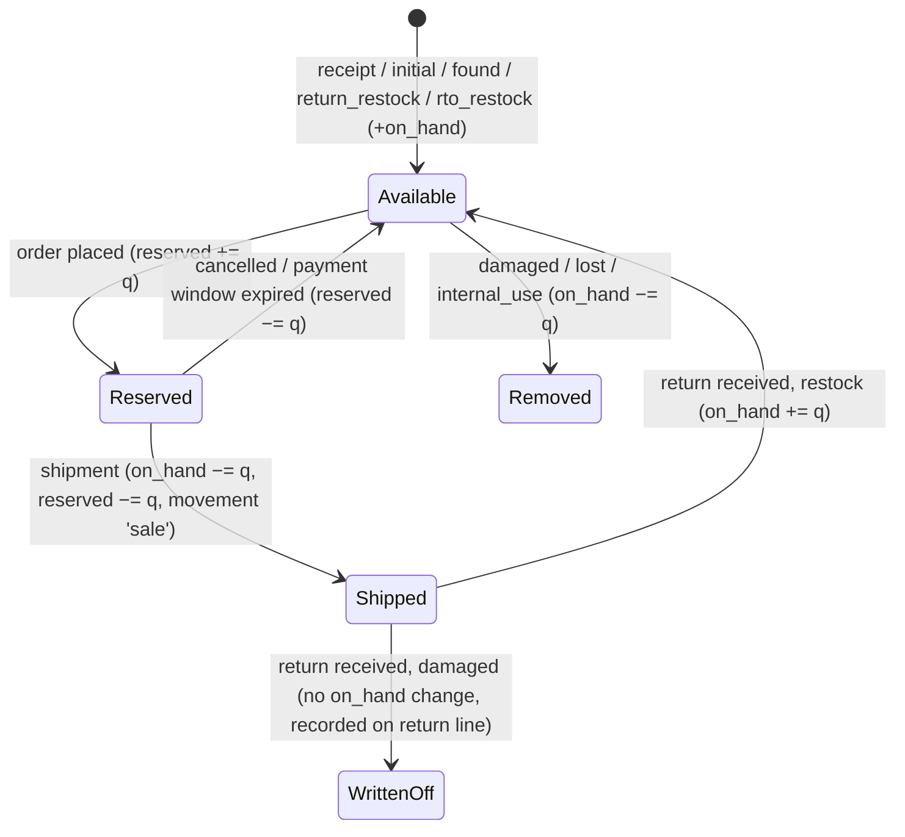

**When does stock leave `on_hand`? At shipment.** For a physical store, `on_hand` must equal what is on the shelf, so that stock counts reconcile. Paid-but-unshipped units are "reserved". POS sales (post-MVP) deduct `on_hand` immediately, because the item leaves with the customer.

| Order type | Reserve at | Reservation expiry | Becomes firm when | Deducted from `on_hand` |
|---|---|---|---|---|
| Online, gateway (prepaid) | Order placement | `now + payment_hold_minutes` (default 30). The gateway session expiry is set ≤ this where the provider supports it | Payment captured (`expires_at = NULL`) | At shipment |
| Online, COD | Order placement | None (`NULL`). If `cod_requires_review`, a review deadline applies (default 48 h) | Immediately (or on staff review) | At shipment |
| POS (post-MVP) | — | — | — | At sale |

**Carts do not reserve stock.** Adding to cart does only a soft availability check. Reserving at cart time would let bots or abandoned carts lock up stock (§22). The hard check happens at order placement.

### 12.4 Atomic operations (inside the inventory service)

**Reserve** (per line, **sorted by `variant_id`**, in the caller's transaction):

```sql
UPDATE inventory_levels
   SET reserved = reserved + $qty, updated_at = now()
 WHERE variant_id = $variant AND location_id = $location
   AND on_hand - reserved >= $qty
RETURNING on_hand, reserved;
-- 0 rows ⇒ throw OUT_OF_STOCK(variant, available) ⇒ whole order transaction rolls back
```

Then insert the `inventory_reservations` row.

Why this works for the last item: under READ COMMITTED, the second transaction blocks on the row lock. When it resumes, Postgres re-evaluates the `WHERE` clause against the newly committed row. `on_hand − reserved` is now 0, so the update matches no rows. Exactly one buyer wins, and the other gets `409 OUT_OF_STOCK`, naming the SKU. **No application-level read-then-write occurs.**

**Commit at shipment:**
```sql
UPDATE inventory_levels SET on_hand = on_hand - $q, reserved = reserved - $q WHERE … RETURNING on_hand;
```
This also marks the reservation `committed` and inserts a `sale` movement with `on_hand_after`.

**Release** (cancel or expiry): `reserved = reserved − $q`, and the reservation is set to `released` or `expired`.

**Adjust:**
```sql
UPDATE … SET on_hand = on_hand + $delta WHERE … AND on_hand + $delta >= 0 RETURNING on_hand
```
It also writes the movement and the audit log. If `available` becomes negative (stock that was reserved got damaged), the adjustment **still succeeds**, because reality wins. It raises an `inventory.oversold` alert and flags the affected orders in the admin.

**Count correction:** `SELECT … FOR UPDATE` reads the current `on_hand`, then the service sets it to the counted value and records `delta = counted − current`.

### 12.5 Expiry and the late-payment case

- **Reservation sweeper** (a job every minute; only one instance runs at a time):
  1. Find active reservations whose `expires_at` has passed.
  2. For each affected order, start a transaction and lock it with `FOR UPDATE SKIP LOCKED`. An order being processed by a webhook at that moment is skipped.
  3. Mark the reservations `expired` and decrement `reserved` (sorted by variant).
  4. The order stays `pending_payment`. A payment retry re-reserves first.
- **Unpaid order cancellation** (job): `pending_payment` orders older than `unpaid_order_cancel_hours` (default 24) are cancelled. This releases the coupon redemption.
- **Payment captured after the reservation expired:**
  1. Record the capture first, because the money is real.
  2. Try to re-reserve every line.
  3. If that succeeds, confirm the order.
  4. If it fails, set the order to `on_hold` with `hold_reason = 'stock_unavailable_after_payment'` and alert staff.
  5. **A human decides**: wait for a restock, offer a substitute, or refund. This follows the organization's human-in-the-loop policy for customer-facing financial decisions. The auto-refund policy is an open question (§30, Q9).

### 12.6 Other inventory features

- **Low stock:** `available <= coalesce(inventory_levels.low_stock_threshold, store_settings.low_stock_default)`. Out of stock: `available <= 0`. Both appear in the dashboard and inventory lists in the MVP. Email digests are post-MVP.
- **Storefront availability:** shown as "In stock", "Only N left" (when `available ≤ 3`) or "Out of stock". It is read live and is not part of the page cache (§4.7). Out-of-stock variants stay visible but can't be selected. There are no backorders in the MVP.
- **Stock receipts:** one form records a delivery (supplier name and reference) with many lines. Each line creates a `receipt` movement.
- **Inventory value:** `Σ on_hand × cost_amount` at the current cost. Weighted-average cost from receipt movements is post-MVP.
- **Bulk operations:** CSV import for the opening stock (`initial` movements) and for bulk count corrections. These are launch-critical (§26, Phase 11).
- **Nightly reconciliation job:** verifies invariants I1 and I2 (§8.4) and alerts on drift.
- **Multi-location (future):** add rows to `stock_locations`, add transfer movements, and add a rule for choosing the fulfilment location. The schema already carries `location_id` everywhere.

---

## 13. Order Architecture

### 13.1 One order model for every channel

Online and POS (later) orders share `orders` and `order_lines`. `channel` records where the sale came from. Channel-specific differences live in the **workflow**, not the schema:

| | Online | POS (post-MVP) |
|---|---|---|
| Customer | Registered or guest customer (required) | Optional (walk-in = `customer_id NULL`) |
| Addresses | Shipping and billing snapshot | None, or billing only if requested |
| Stock | Reserve → commit at shipment | Deduct at sale |
| Payment | COD or gateway, asynchronous | Cash or card terminal, synchronous; split tender allowed |
| Fulfillment | Shipment(s) | Fulfilled at sale (implicit shipment, `delivered`) |
| Invoice | When both paid and shipped | Immediately |

**Why unified:** reports, customer history, returns, refunds and invoices all work the same way across channels. The alternative, separate `pos_sales` tables, would duplicate every downstream feature.

### 13.2 Separate state dimensions

An order has **four independent dimensions**. Collapsing them into one status (for example "Shipped but Partially Refunded") causes a combinatorial explosion.

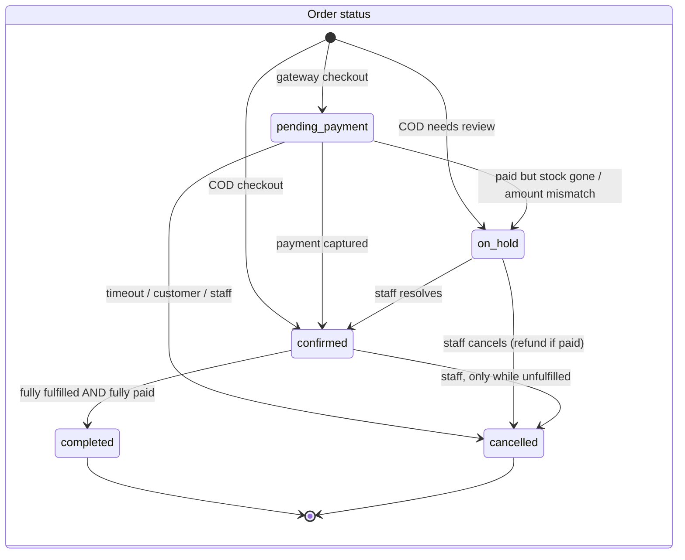

| Dimension | Values | Stored as | Derived from |
|---|---|---|---|
| **Order status** | `pending_payment`, `on_hold`, `confirmed`, `completed`, `cancelled` | `orders.status` (state machine) | Explicit transitions |
| **Payment status** | `unpaid`, `authorized`, `partially_paid`, `paid`, `partially_refunded`, `refunded`, `voided` | `orders.payment_status` | Recomputed from `payments` + `refunds` in the same transaction |
| **Fulfillment status** | `unfulfilled`, `partially_fulfilled`, `fulfilled` (shipped), `delivered`, `returned_to_origin` | `orders.fulfillment_status` | Recomputed from `shipments` and `qty_fulfilled` |
| **Returns** | Lives on each `return_request` (§17) | `return_requests.status` | — (the order shows "has returns" by query) |

The requested lifecycle **Pending → Confirmed → Processing → Packed → Shipped → Delivered** maps like this:
- *Pending/Confirmed* is the order status.
- *Processing/Packed/Shipped/Delivered* is the **shipment** status (`pending → packed → shipped → delivered`, plus `delivery_failed → returned_to_origin`).
- *Cancelled* is an order status.
- *Failed* is a payment status.
- *Returned/Refunded* is shown as return and refund records plus the payment status. Returns do **not** reopen or overwrite the order.

**Transitions are guarded in code.** A `transitions` map per dimension lists the allowed `from → to` pairs and the permission each needs. They are applied as compare-and-set:

```sql
UPDATE orders SET status = $to, version = version + 1 WHERE id = $id AND status = ANY($allowedFrom) RETURNING *
```

Zero rows returned means a `409 INVALID_STATE_TRANSITION`. Every transition writes an audit row with `root = order`, which together form the order timeline.

### 13.3 Snapshots (protecting history)

At placement, the order copies everything that might change later:
- product name, variant title, attribute values, SKU, image URL
- unit price, compare-at price, unit cost
- tax class and rate
- discount allocation
- shipping method name and price
- contact details and addresses

Later edits to the catalog, prices, tax rates, discounts or customer profile **never change past orders**. Variant FKs are kept (with RESTRICT) for reporting joins.

### 13.4 Totals and rounding (pure functions in `pricing`)

```text
line.subtotal   = unit_price × qty
line.discount   = allocated share of item/order discounts         (largest-remainder allocation)
taxable(line)   = line.subtotal − line.discount
tax per rate    = round_half_up(Σ taxable × rate_ppm / 1e6)        (per rate group, allocated back to lines by largest remainder)
shipping        = method price (0 if free_over reached or free-shipping discount); taxed if rate.applies_to_shipping
order.total     = Σ subtotal − Σ discount + shipping + Σ tax
```

- **All arithmetic is integer.** Intermediate products use `BigInt`, then results are converted back to safe `number`s.
- Allocation always sums exactly to the header amount.
- Whether tax is rounded per line or per rate group is a **setting**. Jurisdictions differ, so it must be confirmed once the country is known (§30, Q2).

### 13.5 Order placement (checkout) flow

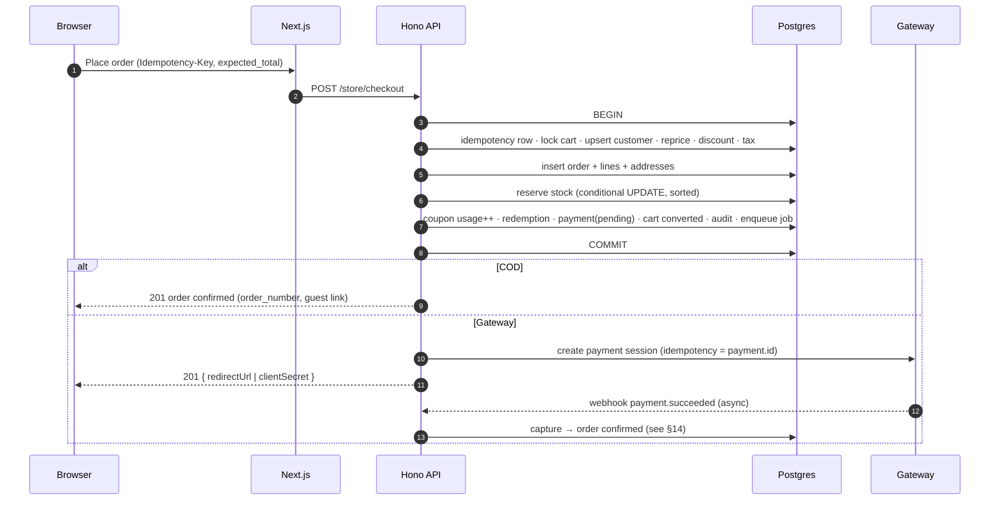

**Errors:**
- `409 OUT_OF_STOCK` (with the SKUs and their available quantities)
- `409 PRICE_CHANGED` (with a fresh quote)
- `422 DISCOUNT_INVALID` (expired, minimum not met, used up, already used by this customer)
- `422 COD_NOT_AVAILABLE` (amount over the COD limit, or COD disabled)
- `409 CART_ALREADY_CONVERTED` (replays the original order through idempotency)
- `400 VALIDATION_ERROR`

### 13.6 Cancellation and modification

- **Cancel:** allowed while `fulfillment_status = unfulfilled`.
  - Customers can cancel their own `pending_payment` and `confirmed` COD orders until staff mark them "packing". Staff can cancel with `orders.cancel`.
  - Effects: reservations released, coupon redemption released, pending payments voided, captured payments refunded through a refund record (§17).
- **After shipment:** use returns. There is no cancellation after shipment.
- **No order editing in the MVP:** line items can't be added or removed after placement. Staff cancel and the customer re-orders. Editing addresses before shipment **is** allowed, and is audit-logged.
- **Guest order access:** the confirmation email contains a signed link (`/orders/{number}?token=…`). Only the token hash is stored. There is also a lookup form that takes the order number and email, then emails a fresh link. Order data is never shown on the strength of the order number alone.

---

## 14. Payment Architecture

### 14.1 Model

| Entity | Role |
|---|---|
| `payments` | **One row per attempt or tender**, for example a declined card attempt followed by a successful retry. Holds the method, provider, provider reference, status, amount, captured and refunded amounts. An order's `paid_amount` is the sum of captured amounts. |
| `payment_transactions` | Every money operation against a payment: `authorize`, `capture`, `void`, `refund`, `cod_collect`. Each has its own idempotency key and provider transaction id. This is the reconciliation trail. |
| `webhook_events` | Inbox of verified provider events, deduplicated on (`provider`, `event_id`). |
| `refunds` / `refund_lines` | The business decision to give money back: what for, which lines, how much tax. It is executed as `refund` transactions on one or more payments (§17). |

The order domain never imports a provider SDK. It only knows `payments.*` service functions and normalized statuses.

### 14.2 Provider abstraction

```ts
interface PaymentProvider {
  id: 'cod' | 'manual' | 'fake' | (string & {});           // e.g. 'stripe', 'sslcommerz', 'razorpay'
  capabilities: { async: boolean; authCapture: boolean; apiRefunds: boolean; partialRefunds: boolean };
  createPayment(i: { paymentId: string; orderNumber: string; amount: number; currency: string;
    customer: { email?: string; phone?: string; name?: string };
    returnUrl: string; cancelUrl: string; expiresAt: Date; idempotencyKey: string })
    : Promise<{ providerRef: string | null; nextAction: { type: 'redirect'; url: string } | { type: 'client_secret'; secret: string } | { type: 'none' } }>;
  verifyAndParseWebhook(raw: { body: string; headers: Headers }): Promise<NormalizedEvent | null>; // throws on bad signature
  fetchPayment(providerRef: string): Promise<NormalizedPaymentState>;                              // polling / reconciliation
  refund(i: { providerRef: string; amount: number; idempotencyKey: string; reason?: string })
    : Promise<{ providerRefundId: string; status: 'pending' | 'succeeded' | 'failed' }>;
  void?(i: { providerRef: string; idempotencyKey: string }): Promise<void>;
}
type NormalizedEvent = { eventId: string; type: 'payment.authorized' | 'payment.captured' | 'payment.failed'
  | 'payment.cancelled' | 'refund.succeeded' | 'refund.failed'; providerRef: string; amount: number; currency: string; occurredAt: Date };
```

- **MVP adapters:**
  - `cod`: no external calls; refunds are manual.
  - One **gateway** adapter, chosen once the country is known (§30, Q1).
  - `fake`: for local development and E2E tests. It simulates redirects and webhooks.
  - `manual`: for staff recording bank or mobile transfers.
- **Hosted checkout or redirect is preferred**, so that card data never reaches Auren's servers (PCI DSS SAQ-A scope).
- Adding a provider means adding one adapter file and one webhook route parameter. Nothing in the order, inventory or invoicing modules changes.

### 14.3 Payment lifecycle

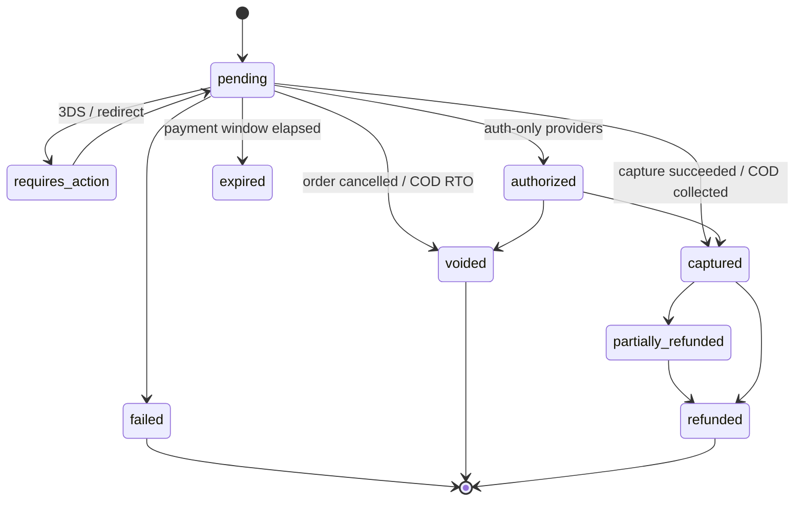

`failed` and `expired` are terminal **for that attempt**. A retry creates a new `payments` row. A new attempt is allowed only while no other attempt for the order is `captured`, `authorized` or `pending` with a live provider session. This is checked under the order lock, and it prevents double payment.

### 14.4 Gateway flow

1. Checkout commits the order with a `pending` payment. After commit, the API calls `createPayment` with `idempotencyKey = payment.id` and stores `provider_ref`. If the call fails, the payment is marked `failed` and the customer can retry from the order page.
2. The browser is redirected to the provider. The **return URL is not trusted**. The order page shows "confirming payment…" and polls `GET /store/orders/{number}` until the webhook confirms it.
3. **The webhook is the source of truth** (§14.5).
4. **A stale-payment poller** runs every 5 minutes. It calls `fetchPayment` for payments still `pending` after 10 minutes, which covers missed or delayed webhooks.
5. Amount and currency from the provider must equal the payment row. On a mismatch, the payment is recorded, the order goes to `on_hold` (`amount_mismatch`) and staff are alerted.

### 14.5 Webhook processing

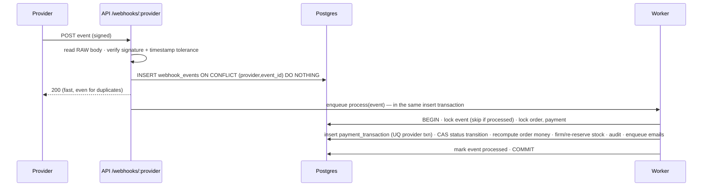

- An invalid signature returns `400` and is logged **without** storing the payload.
- Unknown event types are stored as `ignored`.
- Processing failures stay `failed` and are retried with backoff. After N attempts, staff are alerted.
- Out-of-order events, such as `failed` arriving after `captured`, are recorded but cannot move the state backwards, because transitions are compare-and-set.

### 14.6 Cash on Delivery

| Step | Effect |
|---|---|
| Checkout (COD) | `payments` row with `method = cod`, status `pending`. Order goes to `confirmed`, or to `on_hold` if `cod_requires_review` or the total exceeds `cod_max_order_amount`. Stock is reserved with no expiry |
| Shipped | Stock is committed. The payment stays `pending` (awaiting collection) |
| Delivered + cash collected | Staff with `payments.record` mark it collected: a `cod_collect` transaction (idempotency key `cod:{payment_id}`), the payment becomes `captured`, the order `paid`, the invoice is issued, the order is `completed` |
| Refused / undeliverable | The shipment becomes `returned_to_origin`. Stock goes back with an `rto_restock` movement, the payment is `voided`, the order `cancelled` with reason `rto`. No invoice was issued, so no credit note is needed |

- **MVP:** COD collections can be marked one at a time, or in bulk for a multi-selected batch with a courier settlement reference.
- **Reports:** "delivered but not collected" and "collected by date".
- **Post-MVP:** courier remittance reconciliation, which imports courier settlement files.

### 14.7 Idempotency (three layers)

1. **Inbound API.** Mutating endpoints with money or stock effects take an `Idempotency-Key` header: checkout, payment retry, refund, inventory adjustment, COD collect, and later POS sale. Middleware stores (`scope`, `key`) → request hash and response in `idempotency_keys`, **inside the business transaction**.
   - Same key with the same body: the stored response is replayed.
   - Same key with a different body: `422 IDEMPOTENCY_KEY_REUSED`.
   - A concurrent duplicate blocks on the unique index, then replays.
2. **Outbound to the provider.** The provider idempotency key is `payment.id` or `payment_transaction.idempotency_key`, so retried jobs never double-charge or double-refund.
3. **Inbound webhooks.** The inbox unique key, plus a unique provider transaction id, plus compare-and-set transitions.

### 14.8 Reconciliation

- **MVP:** a daily **payments report** comparing gateway captures, refunds and fees (where provided) with the provider's dashboard or payout export, plus **exception lists**:
  - payments `pending` for more than 1 h
  - captured payments whose order is not confirmed
  - orders `on_hold`
  - refunds `pending` for more than 24 h
  - COD delivered but not collected
- **Post-MVP:** automated import of provider settlement reports and matching.

---

## 15. POS Architecture

> **Post-MVP (confirmed).** The MVP schema already supports it: `channel = 'pos'`, nullable `customer_id`, `payments.method` cash and card-present, `barcode`, `location_id`. Nothing in the MVP needs to be redesigned.

**Placement and devices**
- POS is a route group `/pos` in the same Next.js app, gated by `pos.sell`. The layout is built for tablet and desktop.
- **Barcode scanning** uses USB or Bluetooth keyboard-wedge scanners. They type the code and press Enter into a focused input, so no drivers or native APIs are needed. Camera scanning (BarcodeDetector API or ZXing) is optional and comes later.

**API (`/admin/pos/*`)**
- `GET lookup?code=` does an exact barcode or SKU match.
- `POST quote` previews totals.
- `POST sales` (with `Idempotency-Key`) completes a sale in **one transaction**:
  1. Create the order (`channel = pos`).
  2. Create the lines (snapshots).
  3. Apply discounts and tax.
  4. **Deduct stock directly** with `on_hand − reserved >= q`. Staff with `pos.override_stock` may sell against `on_hand` only.
  5. Record the payment(s): cash with tendered and change amounts, or card-present with the terminal approval code. **Split tender** is supported.
  6. Fulfill implicitly.
  7. Issue the invoice.
  8. Write the audit log.

**Sale flow:** select products → calculate totals → apply discount → take payment → create order → update inventory → generate invoice. This is the requested flow, and it runs **atomically**.

**Customers:** a walk-in sale has no customer. Staff can quick-create a customer with just a name and phone, without a full account.

**Registers and shifts**
- `registers`, `register_sessions` (opening float, closing count, over/short) and `cash_movements` (pay-in and pay-out).
- These come in a later POS sub-phase.

**Receipts:** an 80 mm thermal print stylesheet through the browser print dialog, or an emailed receipt.

**In-store returns:** a `return_request` is created directly in `received` status, refunded in cash or to card.

**Connectivity:** the POS is **online-only**. If the connection drops, staff fall back to paper and enter the sales afterwards. Offline mode would need a local queue, sync and an oversell policy, and stays a future item.

---

## 16. Invoice Architecture

### 16.1 Principles

- **Invoices are immutable financial records once issued.** They store their own snapshot of the seller, buyer, lines and totals, independent of later changes to orders or settings. Database triggers and grants prevent `UPDATE` and `DELETE`.
- **Corrections are made with credit notes**, which are `invoices` rows with `kind = 'credit_note'` that reference the original. An issued document is never edited, voided or deleted.
- **Numbering is gapless and sequential per series and year**: `INV-2026-000001`, `CN-2026-000001`. Many tax regimes require this. Confirm the format with an accountant (§30, Q3).

### 16.2 When an invoice is issued

| Channel | Trigger |
|---|---|
| Online, prepaid | At **shipment**, the first moment the order is both paid and shipped |
| Online, COD | At **cash collection**, the moment it becomes paid, after shipment |
| POS | At sale completion |

**Rationale:**
- The invoice reflects a completed, paid supply.
- Orders cancelled before that point (unpaid orders, COD refusals) never produce an invoice and credit-note pair.
- At placement, the customer gets an **order confirmation** (not an invoice).

The trigger rule lives in one function (`invoicing.issueIfDue(tx, orderId)`). If the jurisdiction's tax point differs, for example invoice-at-payment, only that function changes (§30, Q3).

### 16.3 Gapless numbering

```sql
-- inside the issuing transaction, acquired LAST in the lock order
UPDATE document_counters SET next_value = next_value + 1
 WHERE series = 'INV-2026' RETURNING next_value - 1 AS number;
```

- The counter row lock serializes issuance. A rollback undoes the increment, so no gaps appear. Postgres sequences are never used for this, because they leave gaps on rollback.
- Contention is negligible at this scale.
- Series are created lazily per year in the store timezone.

### 16.4 Contents

- **Seller:** legal name, trading name, address, tax registration number, contact.
- **Document:** invoice number, issue date, order number reference, currency.
- **Buyer:** name, email, phone, billing address. Walk-in customers are shown as "Walk-in customer".
- **Lines:** description (product and variant title), SKU, quantity, unit price, discount, tax rate, tax amount, line total.
- **Totals:** subtotal, discount total, shipping, **tax breakdown per rate**, grand total.
- **Payment:** method(s) and status at the time of issue (for example "Paid by card", or "Cash on delivery – collected").
- **Credit notes** also carry a reference to the original invoice and a reason.

### 16.5 PDFs, history, reprint

- **PDFs are rendered in the worker after commit** from the immutable row, using a pure-JS renderer (`@react-pdf/renderer`; no headless Chrome). They are stored in **private** object storage at `invoices/{id}.pdf`. If a file is missing, it is regenerated deterministically.
- **Download:** `GET /admin/invoices/{id}/pdf`, or `GET /store/orders/{number}/invoice` for the owning customer or a guest with a valid token. The API checks authorization, then streams the file or redirects to a signed URL that lives 60 seconds.
- **Reprint** is a re-download of the same document, optionally with a "COPY" mark. It is audit-logged.
- **Admin invoice history:** search by number, order number, customer, kind and date range. Exports to CSV for the accountant.

---

## 17. Returns & Refunds

### 17.1 Model

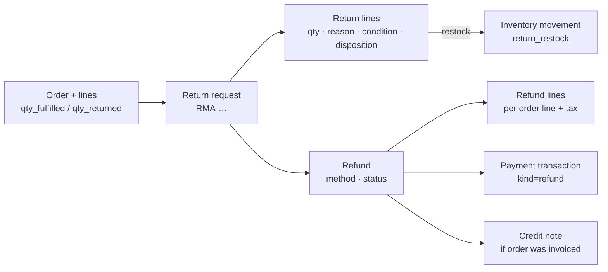

- **Return** is the physical and logistical process: request, approve, receive, inspect.
- **Refund** is the financial process: decide, execute against payments, document.
- They are **separate entities**. A refund can exist without a return (goodwill gesture, cancellation, price adjustment), and a return can resolve without a refund (rejected, or exchanged later). Neither one rewrites the original order. The order only maintains `qty_returned` and its money aggregates.

### 17.2 Return lifecycle

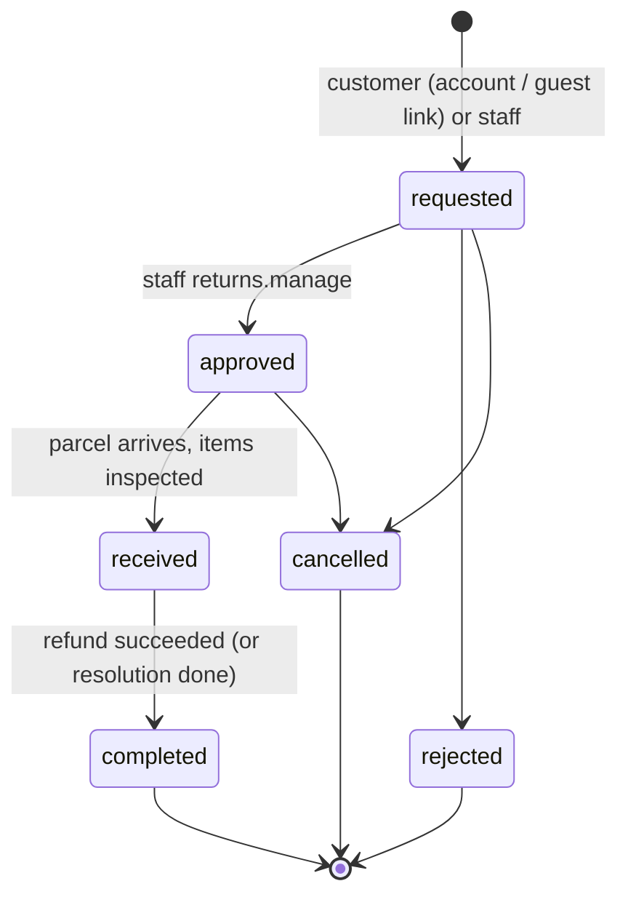

**Rules**
- **Return window:** within `return_window_days` of delivery.
- **Eligibility:** only for `products.is_returnable`.
- **Returnable quantity per line:** `qty_fulfilled − qty_returned − quantity already in open returns`. This is computed under the order lock, so two concurrent return requests cannot over-return.
- **Reason codes:** `too_small`, `too_large`, `not_as_described`, `defective`, `wrong_item`, `changed_mind`, `other`. Reporting on these feeds "fit" insights.

**On receipt**
- Staff record the received quantity, condition and **disposition**:
  - `restock` creates a `return_restock` movement.
  - `write_off` creates no `on_hand` change, because the item was already deducted at shipment. It is recorded on the return line and shows in a "damaged returns" report.
- A quarantine or seconds bucket is future work. It would be a separate location.

### 17.3 Refunds

**Calculation (pure functions, integer math)**
- A refund for *k* of *n* units on a line is `floor(line.total × k / n)`. The last remaining unit gets the remainder, so the refunds on a line always sum exactly to its total (tax included).
- The tax part is split out the same way, which keeps credit notes and tax reports correct.
- Shipping is refunded only by staff choice (default: no, unless the store was at fault or the whole order is returned).
- **The maximum refundable** is `captured − refunded − pending refunds`, checked under the order lock, with CHECK constraints as a backstop.

**Methods**

| Order paid by | Refund method (MVP) |
|---|---|
| Gateway | `original_payment` through the provider refund API. Partial refunds are supported |
| COD | `bank_transfer`, `mobile_wallet` or `cash`. These are recorded **manually** by staff with an external reference; the money is sent outside Auren |
| (post-MVP) any | `store_credit` |

**Execution**
1. One transaction creates the refund, its lines and the pending `refund` transactions.
2. A job calls the provider.
3. Once the refund succeeds, a single transaction marks the refund `succeeded`, updates `payments.refunded_amount`, `orders.refunded_amount` and `payment_status`, **issues the credit note** (if an invoice exists), sets the return to `completed`, writes the audit log and enqueues the email.

**Who can refund:** only staff, with `refunds.create`. Customers can **request** returns, but they never trigger money movement themselves. This keeps a human in the loop on every refund.

**Cancellations:** refunds for cancelled prepaid orders follow the same path, without a return and without a credit note (no invoice existed yet).

### 17.4 Exchanges and store credit

- **MVP:** an exchange is processed as a **return + refund** plus a **new order**. Staff can place the new order on the customer's behalf through the storefront. It is documented as a support procedure.
- **Post-MVP:**
  - An exchange workflow. The return gets `resolution = exchange`, the replacement variant is reserved immediately, and a replacement order is created at the price difference (charged or refunded).
  - **Store credit:** `store_credit_accounts` + `store_credit_entries`, an append-only ledger with `balance_after`. Store credit can be used as a payment method at checkout (`payments.method = store_credit`).

---

## 18. Customer Architecture

| Type | Representation | Notes |
|---|---|---|
| **Registered** | `customers` row with `user_id` → Better Auth `users` | Sign-up with email + password (email verification required before claiming orders). Social login is post-MVP |
| **Guest** | `customers` row with `user_id NULL`, keyed by unique email | Created or reused at guest checkout (email required, phone required for delivery) |
| **Walk-in** (POS, later) | No customer row (`orders.customer_id NULL`) | Optional quick-create with name and phone |

- **Claiming guest orders:** after a user **verifies** their email (a Better Auth hook), the `customers` row with that email gets `user_id` set. Its past guest orders then appear in their account. No merge is needed. Requiring verification is what makes this safe: possessing the email proves ownership.
- **Addresses:** registered customers keep an address book with defaults. Orders always **snapshot** the address used.
- **Profile metrics:** order count, total spent (net of refunds), average order value, and first and last order dates. These are computed by an aggregate query and shown on the admin customer page. Denormalize into a `customer_stats` table only if that becomes slow.
- **Account area:** profile, password, addresses, order history and detail, invoice download, return requests, and an account deletion request.
- **Admin:** search by name, email or phone; detail view with orders, returns and notes; anonymize (`customers.delete`).
- **Deletion = anonymization** (§8.7). Financial records are retained for the legal period.
- **Marketing consent:** stored explicitly (`marketing_opt_in` with a timestamp in audit). There is no marketing automation in the MVP.

---

## 19. Discount Architecture

### 19.1 Rules are data, the engine is a pure function

```text
discounts (what + how much)          discount_targets (to which items)        conditions (when)
- value_type: percentage | fixed     - include/exclude                         - min_subtotal_amount
  | free_shipping                    - product | variant | category | brand    - starts_at / ends_at
- percent_bps | amount                                                         - usage_limit / usage_count
- scope: order | items                                                         - once_per_customer
- code (NULL ⇒ automatic, later)                                               - channels, excludes_sale_items
```

The engine is `discounts.evaluate(context, discount) → { ok: true, allocations: [{ lineId, amount }], shippingDiscount } | { ok: false, reason }`.

- It is **deterministic and side-effect-free**, and it is exhaustively unit-tested.
- Checkout, cart preview and POS all call the same function.
- **Growth path:** a new kind of condition becomes a new column (or, if conditions multiply, a `conditions jsonb` validated by a Zod discriminated union) plus one evaluator clause. It never becomes an `if` in checkout code.

### 19.2 Semantics

- **Item-scope discounts** apply only to eligible lines: matched by an include target, not matched by an exclude target, and not on sale if `excludes_sale_items` is set.
- **Order-scope discounts** apply to the eligible subtotal.
- **Percentage:** `round_half_up(eligible_subtotal × bps / 10000)`, allocated to lines by largest remainder.
- **Fixed amount:** capped at the eligible subtotal, allocated in proportion to line value.
- **Free shipping:** zeroes the shipping amount.
- **Discounts reduce the taxable base.** Tax is computed after discounts. Confirm this for the jurisdiction (§30, Q2).
- **Sale prices are not discounts.** `compare_at_amount` is catalog pricing.
- **Stacking (MVP):** **one code per order**. Automatic discounts and a "best automatic + one code" rule come post-MVP.

### 19.3 Usage and abuse controls

- **Redemption happens at order placement**, in the order transaction:
  - The usage limit uses a conditional increment.
  - Once-per-customer uses a partial unique index on `customer_key` (the customer ID, or the normalized email for guests).
- A **cancelled or expired order releases** its redemption and decrements usage.
- **Code validation is rate-limited** per IP and per cart. Codes are case-insensitive. Error messages say why a code isn't valid (expired, minimum not met, used up) but don't reveal whether an inactive code exists.
- Creating, editing or disabling a discount is audit-logged. These actions require `discounts.manage`.

---

## 20. Dashboard & Analytics

### 20.1 Metric definitions (agreed once, used everywhere)

| Metric | Definition | Date basis |
|---|---|---|
| Orders | Count of orders not `cancelled` | `placed_at` |
| Gross sales | Σ `order_lines.subtotal_amount` of non-cancelled orders | `placed_at` |
| Discounts | Σ `orders.discount_amount` | `placed_at` |
| Refunds | Σ succeeded `refunds.amount` | `refunds.processed_at` |
| **Net sales** | Gross sales − discounts − refunds (excluding tax and shipping) | Mixed, as above |
| Tax, shipping | Σ `tax_amount`, Σ `shipping_amount` | `placed_at` |
| **Cash collected** | Σ succeeded capture and `cod_collect` transactions − succeeded refunds | Transaction time |
| COD outstanding | Σ COD payments `pending` on shipped orders | Now |
| Items sold | Σ `order_lines.quantity` of non-cancelled orders | `placed_at` |
| AOV | Net sales ÷ orders | — |
| New customers | Customers whose first non-cancelled order falls in the period | First `placed_at` |
| Repeat customers | Customers with ≥ 2 non-cancelled orders, at least one in the period | — |
| Inventory value | Σ `on_hand × cost_amount` (current cost) | Now |

- **All day, week and month buckets use `store_settings.timezone`**: `date_trunc('day', placed_at AT TIME ZONE tz)`.
- **COD caveat:** placed COD orders can still be refused. The dashboard shows placed-basis sales for operations *and* cash collected for finance. It never mixes the two.

### 20.2 MVP dashboard

- **Sales:**
  - today, last 7 days, last 30 days and month-to-date, each against the previous period
  - a daily sales chart
  - split by channel (online / POS, with POS empty until built)
  - orders, items sold, AOV, refunds
  - cash collected and COD outstanding
- **Operations:** orders awaiting fulfillment, on-hold orders, returns awaiting action, payments needing attention.
- **Inventory:**
  - total active products and variants
  - low-stock and out-of-stock lists (linked to inventory)
  - inventory value (needs `products.cost.read`)
- **Products:**
  - top 10 products, categories (primary) and variants by units and by net sales
  - sales by size and by colour (from the `order_lines.attributes` snapshot)
- **Customers:** total, new, repeat, top customers by spend.

### 20.3 Computation strategy

| Metric family | MVP source | Expected cost at MVP scale | Upgrade path |
|---|---|---|---|
| Sales, orders, items, AOV | Direct SQL over `orders` / `order_lines` with `IX(placed_at)` | < 200 ms up to ~100k orders | `daily_sales_summary` (day × channel) maintained by a job, or `MATERIALIZED VIEW … REFRESH CONCURRENTLY` every 15 min |
| Product, category, size, colour | `order_lines` joined with `product_categories` (primary) and the `attributes` snapshot | Same | `daily_product_sales` (day × variant) summary table |
| Inventory metrics | `inventory_levels` (live) | Trivial | — |
| Customer metrics | Aggregates over `orders` grouped by customer | < 300 ms up to ~50k customers | `customer_stats` table updated by order jobs |
| Cash and COD | `payment_transactions`, `payments` | Trivial | Settlement imports (post-MVP) |

- Dashboard responses are cached **in-process for 60 s** per (range, permission set).
- **Rule:** add a summary table only when a measured query exceeds its budget (dashboard p95 > 1 s). Analytics never needs a second database in the MVP. A read replica is the step after summary tables.
- **Reports:** sales by day, product, category or variant; inventory valuation; low stock; payments (gateway vs COD); refunds and returns by reason; invoice register. All export to CSV.
- **Not in the MVP:**
  - cohort and retention analysis
  - forecasting
  - storefront funnel and clickstream analytics, which need client events and a consent decision
  - margin reports beyond line cost × quantity

---

## 21. Audit Logging

### 21.1 Strategy

**An app-level audit log is written explicitly by services, in the same transaction as the change**, through `audit.record(tx, entry)`.

Database triggers are not used. They see rows, not intent, and they have no actor or reason unless session variables are threaded through every connection. Semantic action names (`variant.price_changed`) are far more useful than row diffs.

| Question | Field |
|---|---|
| Who? | `actor_type` (`staff`/`customer`/`system`/`webhook`), `actor_id`, `actor_label` (snapshot of name and email), plus `metadata.ip` and `metadata.user_agent` |
| What? | `action`, e.g. `variant.price_changed`, `inventory.adjusted`, `order.cancelled`, `refund.created`, `role.permissions_changed` |
| When? | `occurred_at` (transaction time) |
| Which entity? | `entity_type` + `entity_id`, plus `root_type` + `root_id` (the aggregate, e.g. the order for a shipment). This drives the per-order timeline |
| What changed / previous state? | `changes` = `{ field: [old, new] }` for updates (changed fields only). Full snapshots for deletes and archives |
| Why? | `metadata.reason`, required for adjustments, cancellations, refunds and overrides |
| Correlation | `request_id` links the entry to logs and Sentry |

### 21.2 What is audited (MVP)

- **Catalog:**
  - product create, update, publish, archive, restore and delete
  - variant create and update, **price and compare-at changes** (a dedicated `variant.price_changed` action), cost changes
  - category, brand and attribute changes
- **Inventory:** receipts, adjustments, count corrections, in-store sale stock-outs, threshold changes, import runs.
- **Orders:**
  - confirm, hold, cancel, address or note edit
  - shipment status changes
  - COD collection and manual payments
  - customer-initiated cancellations
- **Money:** refund created, succeeded or failed; invoice issued; credit note issued; invoice reprinted or downloaded by staff.
- **Returns:** created, approved, rejected, received (with disposition).
- **Discounts:** create, update, disable.
- **Customers:** updates by staff, anonymization.
- **Access:**
  - staff invited, activated, suspended or reactivated
  - role created or changed (with a permission diff)
  - staff role assignment
  - **staff sign-in success and failure, 2FA enrolment and reset**, through Better Auth hooks
- **Settings:** every change, with a diff.
- **System:** reservation expiry, automatic cancellation of unpaid orders, webhook-driven payment transitions, hold triggers.

### 21.3 Integrity and hygiene

- **Append-only:** the app role has `INSERT, SELECT` only, and a trigger blocks `UPDATE`/`DELETE`. A hash chain (`prev_hash`) for tamper evidence can be added later.
- **Redaction:** the diff helper takes a deny-list (passwords, tokens, secrets). Customer PII is kept to IDs and labels where possible.
- **Retention:** the same period as financial records (§30, Q6). The volume is small, a few hundred thousand rows a year. Partitioning comes only if it exceeds ~10M rows.
- **Relation to domain ledgers:** `inventory_movements` and `payment_transactions` are the operational truth, and every stock or money computation uses them. `audit_logs` is accountability. A manual adjustment writes both.
- **UI:** a global audit viewer (`audit.read`) with filters, a "History" tab on product, customer and staff pages, and an **order timeline** (audit entries where `root = order`).

---

## 22. Security

### 22.1 Threat model

| Asset | Threat actors |
|---|---|
| Staff accounts (high privilege: prices, refunds, stock) | Credential-stuffing bots, phishing, malicious or compromised insiders |
| Payment integrity (paid status, amounts, refunds) | Fraudulent customers, forged webhooks, replay |
| Customer PII (names, emails, phones, addresses, order history) | External attackers (IDOR, injection), over-privileged staff |
| Inventory and price integrity | Bots (inventory denial), tampered cart requests |
| Invoices and financial records | Insiders altering history |
| Availability of checkout | Scrapers, bot floods, COD fake-order spam |

| # | Threat | Mitigation |
|---|---|---|
| T1 | Staff account takeover | Mandatory TOTP 2FA; 12 h sessions; immediate revocation; fresh session for sensitive actions; sign-in rate limits; breached-password check; sign-in audit with failure alerts |
| T2 | Privilege escalation (customer → admin, cashier → refunds) | Separate `/admin` surface with `requireStaff`; deny-by-default per-route permissions (tested); no-escalation rule when assigning roles; the server never trusts UI visibility |
| T3 | IDOR (reading or modifying another customer's order) | Queries scoped by session `customerId`; guest access only with order-scoped hashed tokens; 404 instead of 403 |
| T4 | Price, discount or total tampering | The server reprices everything from the DB. The client total is only an `expected_total` check |
| T5 | Forged or replayed payment webhooks; paid status from a redirect | Signature plus timestamp tolerance; inbox dedupe; amount and currency verification; a redirect never marks an order paid; provider re-fetch on doubt |
| T6 | Double charge or double refund | Three-layer idempotency (§14.7); DB CHECKs; order-row serialization |
| T7 | Inventory denial (bots holding stock) | Reservations only at order placement; prepaid TTL; checkout rate limits per IP, cart and email; per-line quantity cap. **COD fake orders** are limited by a max COD amount, optional COD review, per-phone/email velocity limits, and a CAPTCHA (e.g. Turnstile) that can be switched on for checkout. Phone OTP for COD is post-MVP |
| T8 | CSRF | SameSite=Lax host-only cookies; Origin / Sec-Fetch-Site check on every mutation; JSON-only bodies; Better Auth origin checks |
| T9 | XSS | React escaping; sanitized rich text (allow-list); strict **CSP** (nonce-based scripts, `img-src` limited to the CDN, no `unsafe-eval`); no SVG uploads; JSON-LD escaped (`<` → `<`) |
| T10 | SQL injection | Drizzle parameterized queries only; raw `sql` template tags with bound parameters; a lint rule bans `sql.raw` with variables |
| T11 | Malicious uploads | Presigned uploads with content-type and size constraints; server-side magic-byte verification; images served from a separate bucket and CDN domain; no user-supplied filenames in keys |
| T12 | Sensitive data exposure | Per-surface DTOs (store DTOs never include cost, internal notes or other customers' data); log redaction; TLS everywhere; managed encryption at rest; least-privilege DB roles; secrets only in env or a secret manager |
| T13 | Insider tampering with history | Append-only ledgers and invoices (grants plus triggers); audit log; no hard deletes of financial data |
| T14 | Supply chain | Lockfile; pnpm `minimumReleaseAge` (with security-patch exclusions); `allowBuilds` allow-list; Renovate or Dependabot; `pnpm audit` in CI |

### 22.2 Controls checklist

- **CORS:** not needed, because everything is same-origin. The API sends no `Access-Control-Allow-Origin` and rejects cross-origin mutations. If an `api.` subdomain is ever introduced, use an explicit allow-list with credentials, never `*`.
- **Rate limits (initial values):**
  - sign-in: 5/min per IP+email
  - password reset: 3/h per email
  - checkout: 10 per 10 min per IP and 5 per 10 min per cart
  - coupon apply: 10/min per IP
  - order lookup: 5/h per IP
  - general store API: 300/min per IP
  - admin: 600/min per user
  - Counters are in-process while there is one API instance; move them to Postgres or Redis when scaling out.
- **Headers:** HSTS, `X-Content-Type-Options`, `Referrer-Policy: strict-origin-when-cross-origin`, CSP `frame-ancestors 'none'`, `Permissions-Policy`.
- **Input validation:** Zod on every input (body, query, params, relevant headers), with strict objects (unknown keys rejected), max lengths and numeric bounds. Environment variables are validated at boot.
- **PCI DSS:** card data never touches Auren (hosted payment page or provider elements, SAQ-A). Only provider references and last-4/brand metadata are stored, if supplied.
- **Database:**
  - The app connects as `auren_app` (DML only on `public`, restricted on append-only tables). Migrations run as `auren_migrator`.
  - Exception, verified in Phase 0: `auren_app` owns the `graphile_worker` job-queue schema and has `CREATE` on the database. graphile-worker's row-level security only lets the schema owner enqueue, and its bootstrap always runs `CREATE SCHEMA IF NOT EXISTS`. It still has no DDL rights on `public`.
  - The app never uses a superuser account.
  - Connections to the database use TLS.
- **Secrets:** the Better Auth secret, DB URLs, gateway keys, webhook secrets, the revalidation HMAC secret, S3 keys and email keys. Each environment has its own. Document the rotation procedure.
- **Security testing:** authorization matrix tests (every admin route × role), IDOR tests on store routes, a webhook signature test, a dependency audit in CI, and a pre-launch review checklist (Phase 11).

---

## 23. Testing Strategy

### 23.1 Levels and tools

| Level | Tool | Scope | Database |
|---|---|---|---|
| Unit | Vitest | Pure domain logic: pricing, tax, rounding and allocation, discount engine, state-machine transition maps, refund calculation, money parsing and formatting, permission helpers | None |
| Integration | Vitest + **Testcontainers (postgres:18)** + Hono `app.request()` | Route → middleware → service → real Postgres: transactions, constraints, locking, auth guards, idempotency, webhooks (fake provider) | One migrated **template DB**. Each test worker clones it (`CREATE DATABASE … TEMPLATE`), and tables are truncated between tests |
| Concurrency | Vitest integration with parallel connections | The races that matter (§23.2) | Same |
| Contract | OpenAPI snapshot plus `tsc` on the `hc` clients | Breaking-change detection; every `/admin` route declares a permission | — |
| E2E | **Playwright** against docker compose (web + api + worker + postgres + seaweedfs + mailpit) with the **fake payment provider** | Critical customer and staff journeys in a real browser | Seeded per run |

### 23.2 Critical workflows

| Workflow | Unit | Integration | E2E |
|---|:-:|:-:|:-:|
| Guest buys a product with COD → stock reserved → staff ship → COD collected → invoice issued | totals | ✅ | ✅ |
| Customer pays through the gateway → webhook delivered twice → one capture, order confirmed | — | ✅ | ✅ (fake provider) |
| **Two customers try to buy the last item** → exactly one order; the other gets `409 OUT_OF_STOCK`; `on_hand`/`reserved` consistent | — | ✅ (20 parallel attempts) | — |
| Payment arrives after reservation expiry and the stock is gone → order `on_hold`, staff alerted | — | ✅ | — |
| Coupon with `usage_limit = 1` redeemed concurrently by 10 checkouts → exactly 1 succeeds | ✅ engine | ✅ | — |
| Customer returns 1 of 2 items → approve → receive (restock) → partial refund → credit note → stock +1 | ✅ refund math | ✅ | ✅ |
| Concurrent refunds on one order cannot exceed the captured amount | — | ✅ | — |
| Admin changes a price → audit diff recorded → storefront revalidated → existing orders unchanged | — | ✅ | ✅ |
| Inventory adjustment (damaged) → movement with actor and reason, audit entry, low-stock flag | — | ✅ | ✅ |
| Staff attempts an unauthorized operation (Inventory Staff → refund) → 403, nothing written | — | ✅ (full role × route matrix) | ✅ (one case) |
| Customer A cannot read customer B's order; a guest token only opens its own order | — | ✅ | — |
| Cancel a prepaid confirmed order → stock released, coupon released, refund executed | — | ✅ | — |
| COD refused (RTO) → stock restocked, payment voided, no invoice | — | ✅ | — |
| POS sale (post-MVP) → order, stock deducted, invoice | — | ✅ | ✅ |

### 23.3 Practices

- **Factories:** typed builders (`buildProduct()`, `buildOrder({ paid: true })`) that go through services, not raw inserts, so tests exercise the real invariants.
- **Injected clock:** a fake clock makes TTL and expiry tests deterministic. There are no real sleeps.
- **The invariant checker** (§8.4, the same code as the nightly job) runs **after every integration test** that touches stock or money.
- **Coverage targets:** ≥ 90% lines on the `pricing`, `discounts`, `inventory`, `payments` and `returns` services. There is no global coverage gate.
- **CI pipeline:**
  - Stages: `lint` → `typecheck` → `unit` → `integration` (Testcontainers) → `migrations-check` (`drizzle-kit generate` must produce no diff; migrations apply cleanly to an empty DB) → `build` → `e2e` (on PRs to main).
  - The pipeline also produces an OpenAPI diff report.
  - Turborepo caching keeps it fast.
- **Pre-launch UAT:** a written script covering every MVP workflow, run with real staff on staging.

---

## 24. Observability

### 24.1 MVP (must exist at launch)

| Capability | Implementation |
|---|---|
| Structured logs | `pino` JSON to stdout from the API and worker. Every line has `requestId`, `actor`, `route`, `status`, `durationMs`. Redaction paths cover auth headers, cookies, tokens, emails and phones. The web app logs server errors in the same format |
| Request IDs | `hono/request-id` (honours an incoming `X-Request-Id`). The Next.js server fetch helper generates and forwards one per render. The ID is returned in error envelopes and attached to audit entries and Sentry events |
| Error tracking | Sentry (or self-hosted GlitchTip) in web, api and worker: release tags, PII scrubbing, `requestId` tag |
| API latency | Per-request duration log, plus a `slow_request` warning above 1 s. Dashboards are built from the log platform |
| Database | `log_min_duration_statement = 250ms`, `pg_stat_statements` enabled, connection-pool stats logged every minute, counts of `40001`/`40P01`/`23xxx` errors logged |
| Business events | A structured `event` field on log lines: `order.placed`, `order.paid`, `order.cancelled`, `payment.failed`, `refund.succeeded`, `inventory.adjusted`, `inventory.oversold`, `webhook.failed`, `reconciliation.drift` |
| Health | `/api/health` (liveness) and `/api/ready` (DB reachable, migrations at the expected version). The worker writes a heartbeat and an alert fires if it goes stale |
| Admin "System status" page | Failed jobs, webhook failures, stale pending payments, reservation backlog, last reconciliation result, on-hold orders |
| Alerts (email or Slack) | 5xx rate spikes, webhook signature failures, jobs failing after retries, inventory drift, orders on hold, lost worker heartbeat, uptime-check failures (external pinger) |

### 24.2 Later

- OpenTelemetry traces (Hono, Node, pg instrumentation) sent to a hosted backend
- Prometheus metrics with Grafana
- Centralized log search
- Storefront Real User Monitoring and Web Vitals
- SLO dashboards

---

## 25. Deployment

### 25.1 Requirements

- **Runtime:** Node 24 for `web` (the Next standalone server), `api` and `worker`. The api and worker share an image and differ only in their start command.
- **Database:** managed **PostgreSQL 18** with automated backups and **point-in-time recovery**.
- **Storage:** **S3-compatible object storage** (two buckets), with a **CDN** in front of `public-media`.
- **External services:** an email provider, the payment gateway (outbound HTTPS plus inbound webhooks) and error tracking.
- **Edge:** a TLS-terminating reverse proxy or load balancer that:
  - **routes by path** (`/api/*` → api)
  - blocks `/_internal/*` from the internet
  - sets `X-Forwarded-*` headers
  - allows request bodies up to 10 MB, for CSV imports

### 25.2 Reference production architecture (provider-agnostic)

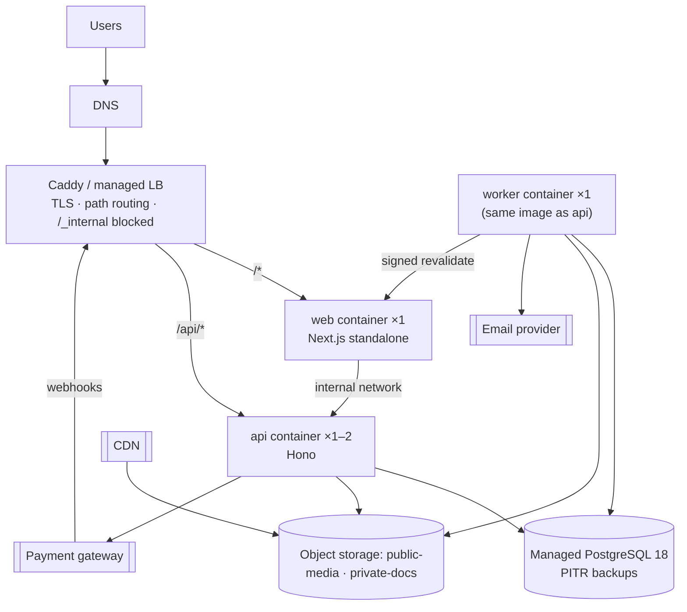

**Option A (recommended for the MVP): one container platform**, either a PaaS that runs Docker images or a single VM with Docker Compose and Caddy. Add managed Postgres, object storage and a CDN.
- Pros: one deployment model, low cost, portable. A single web instance avoids the Next.js multi-instance cache problem.
- Cons: if self-hosted on a VM, you patch it. A PaaS removes that work.

**Option B: Vercel for `web`, plus a container host for `api` and `worker`.** Vercel rewrites provide the same-origin `/api/*` routing, and its cache is shared across instances.
- Cons: two platforms, latency between web and api if they run in different regions, and vendor-specific features.
- The design supports both options.

#### 25.2.1 Chosen for launch (2026-10-03): a single VPS + Cloudflare

This is Option A on **one VPS**. Everything runs in Docker Compose on that machine, with Cloudflare in front.

| Component | Where it runs |
|---|---|
| Caddy (TLS, path routing, `/_internal` blocked), `web`, `api`, `worker` | Containers on the VPS |
| **PostgreSQL 18** | Container on the VPS. Named volume, **not exposed publicly**, reachable only on the internal Docker network |
| `public-media` and `private-docs` buckets | **Cloudflare R2** (S3-compatible, no egress fees). `public-media` is served through an R2 custom domain behind the Cloudflare cache. `private-docs` is reachable only through presigned URLs |
| DNS, CDN, DDoS protection | **Cloudflare** proxy, SSL mode "Full (strict)" with a Cloudflare origin certificate on Caddy |
| Backups | A private **R2 bucket** `backups` (separate credentials) |

**What this changes compared with the managed-Postgres assumption:**
- **Backups are our responsibility.**
  - At launch: nightly `pg_dump -Fc` to R2 with 30-day retention.
  - Phase 11: add **WAL-G** WAL archiving to R2 for point-in-time recovery (RPO ≤ 5 min). Until then, the RPO is 24 h.
  - The quarterly restore drill restores into a scratch container.
- **Client IPs:** Caddy trusts `CF-Connecting-IP` **only** from Cloudflare's published IP ranges. This feeds rate limits, the audit log and Better Auth `trustedProxies`.
- **VPS baseline:**
  - At least 2 vCPU and 4 GB RAM.
  - Ubuntu LTS with unattended security upgrades.
  - A firewall allowing only 22/80/443, with 80 and 443 ideally limited to Cloudflare IPs.
  - SSH keys only.
  - Docker log rotation.
- **Staging:** a second Compose project on the same VPS (separate database, buckets and subdomain) is acceptable at first. Move it to a separate small VPS if resource contention appears.

### 25.3 Build and release

- **Images:** multi-stage Dockerfiles using `turbo prune --docker`, Next `output: 'standalone'`, non-root users, and pinned `node:24-slim` base images.
- **Release pipeline:**
  1. CI builds and tests.
  2. Images are pushed, tagged with the commit SHA.
  3. A **migration job** runs (`db:migrate` as `auren_migrator`).
  4. The api and worker roll out.
  5. The web app rolls out, with the same `deploymentId` and server-actions key on every instance.
  6. Smoke tests run (`/api/ready` plus a synthetic storefront check).
- **Rollback:** redeploy the previous images. Expand/contract keeps migrations backward-compatible.
- **Environments:**
  - `local`: docker compose, the fake payment provider, Mailpit
  - `staging`: production-like, the gateway's **sandbox**, seeded demo data, used for UAT
  - `production`
- **Configuration:** environment variables are validated by Zod at boot (fail fast). Secrets come from the platform's secret store.

### 25.4 Backups and disaster recovery

- **Postgres:** PITR (RPO ≤ 5 min), daily snapshots kept 30 days, a weekly logical dump to separate storage, and a **quarterly restore drill**.
- **Object storage:** versioning on `private-docs` (invoices), with lifecycle rules.
- **RTO** ≤ 4 h for the MVP.
- **Runbooks:**
  - DB restore
  - Payment provider down: COD stays available, and the gateway can be disabled with a settings toggle.

### 25.5 Scaling path (only when measurements justify it)

1. Scale the API horizontally (it is stateless), and move rate-limit counters to Postgres or Redis.
2. Add a shared Next.js cache handler (Redis) and scale the web app.
3. Add a Postgres read replica for reports.
4. Add analytics summary tables.
5. Add a dedicated search engine.
6. Split the worker by queue.

None of these steps needs a domain rewrite.

---

## 26. Development Phases

### 26.1 Sequence and why it differs from the proposed order

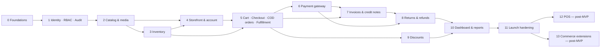

| Change from the proposed order | Reason |
|---|---|
| **RBAC and audit moved from 11 to 1** | Every later feature needs permission checks and audit entries. Adding them afterwards means touching every endpoint, and gaps get missed |
| Inventory (3) comes before the storefront (4) and checkout (5) | Checkout depends on the reservation primitives, and those must be concurrency-tested first. Phase 3 also delivers the in-store stock-out stop-gap (§30, R1) |
| "Cart + checkout" and "Orders + payments" are split by **payment type** rather than by entity | Placing an order *is* checkout. Phase 5 delivers a complete, launchable COD flow. Phase 6 adds the gateway, which depends on an external provider decision (§30, Q1) and should not block the core |
| **POS moved to post-MVP** | User decision. The model supports it already |
| Invoices (7) come before returns (8) | Refunds on invoiced orders must produce credit notes |
| Discounts (9) can run in parallel with 6–8 | They depend only on the Phase 5 pricing engine. They can move earlier if marketing needs launch coupons |
| Testing and observability are **continuous**, not a final phase | Each phase ships with its tests and logging. Phase 11 is launch hardening only |

The size estimates below are relative (S/M/L). Calendar estimates depend on team size (§30, Q13).

### Phase 0: Foundations · S/M

- **Goal:** a running, tested, deployable skeleton that proves the architecture's riskiest plumbing: same-origin routing, cookies, migrations and CI.
- **Features:**
  - **Setup:** `git init`. pnpm 11 workspace with catalogs, Turborepo, `packages/config`. Node 24 pinned (`.nvmrc`, `engines`). Docker Compose (pg18, SeaweedFS, mailpit).
  - **API skeleton:** env validation, pino, request ID, error envelope, `AppError`, transaction helper with retry, money library, OpenAPI document, health and ready endpoints.
  - **Database and contracts:** `packages/db` with drizzle-kit and a custom SQL migration (extensions, DB roles `auren_app`/`auren_migrator`). `packages/contracts` (error codes, money, pagination).
  - **Web skeleton:** Next 16 with Tailwind 4 and shadcn, layout shells, a server fetch helper (cookie and request-ID forwarding), typed `hc` clients, dev rewrites.
  - **Worker:** worker entrypoint (graphile-worker, crontab, heartbeat).
  - **Testing:** Vitest with Testcontainers template DB, a Playwright smoke test.
  - **Delivery:** CI pipeline, Dockerfiles, staging deployment with edge path routing.
- **Database:** extensions, roles, `store_settings` (singleton).
- **API:** `/api/health`, `/api/ready`, `/api/openapi.json`.
- **Frontend:** placeholder storefront and admin shells.
- **Dependencies:** none. Needs a staging hosting choice (§30, Q12).
- **Tests:** unit and integration harness working; E2E smoke (page renders, `/api/health` reachable through the web origin).
- **Done when:**
  - `pnpm dev` starts everything.
  - CI is green.
  - The pipeline deploys staging.
  - A cookie set by `/api/*` is visible to the web app on the same origin in staging.

### Phase 1: Identity, staff, RBAC & audit · M

- **Goal:** secure access for customers and staff, plus the permission and audit infrastructure every later phase uses.
- **Features:**
  - **Authentication:** Better Auth (email and password, verification, reset); customer sign-up and sign-in (creates a `customers` row).
  - **Staff onboarding:** staff invite flow; `create-owner` CLI; mandatory TOTP enrolment; staff session policy (12 h, immediate revocation, fresh-session helper).
  - **Access control:** permission catalog; `requireStaff` and `requirePermission`; the origin-check middleware; rate limits.
  - **Audit:** `audit.record` and the audit viewer.
  - **Email and UI:** auth emails through the worker; admin shell with permission-aware navigation; staff and role management.
- **Database:** Better Auth tables, `staff_members`, `staff_invites`, `roles`, `role_permissions`, `customers`, `audit_logs`, `idempotency_keys`.
- **API:**
  - `/api/auth/*`
  - `/admin/me`, `/admin/staff*`, `/admin/roles*`, `/admin/audit-logs`
  - `/store/me`
- **Frontend:**
  - Customer auth pages: login, register, verify, forgot and reset password.
  - Admin login with 2FA enrolment, staff and roles screens, audit viewer.
- **Dependencies:** P0.
- **Tests:**
  - Authentication flows.
  - **The role × route authorization matrix harness**, reused by every later phase.
  - Privilege escalation and the last-owner rule.
  - Session revocation on suspension.
  - Origin-check rejection.
- **Done when:**
  - An owner invites a manager, who must enrol 2FA before accessing anything.
  - Forbidden actions return 403 and write nothing.
  - Every staff action in the phase appears in the audit log.

### Phase 2: Catalog & media · L

- **Goal:** staff can build the complete fashion catalog.
- **Features:**
  - **Settings:** store settings (currency, timezone, policies); tax classes and rates.
  - **Structure:** attributes and values (seeded colour and size); category tree; brands; tags; size charts.
  - **Products:**
    - product editor with a **variant matrix generator** (colour × size)
    - SKU and barcode uniqueness
    - price, compare-at and cost (permission-gated)
    - publish, archive and restore
    - bulk price edit
  - **Media:** images through the storage abstraction (presigned upload, verification, colour tagging, ordering, alt text).
  - **Other:** search vector maintenance; admin product list with search by name, SKU or barcode; price changes audited.
- **Database:** catalog tables, `media_assets`, `tax_rates`, `size_charts`.
- **API:** `/admin/products*`, `/admin/variants/bulk`, `/admin/categories*`, `/admin/brands*`, `/admin/tags*`, `/admin/attributes*`, `/admin/size-charts*`, `/admin/media*`, `/admin/settings`, `/admin/tax-rates*`.
- **Frontend:** admin catalog screens (list, product editor, variant grid, image manager), settings.
- **Dependencies:** P1.
- **Tests:**
  - `option_key` uniqueness and composite FK enforcement.
  - Publish rules.
  - Price-change audit diff.
  - Cost hidden without permission.
  - Upload type and size validation.
  - Archive vs delete rules.
- **Done when:** staff can create "Oversized Cotton T-Shirt" (3 colours × 4 sizes, images per colour) and publish it, and the price change history appears in the audit log.

### Phase 3: Inventory · M

- **Goal:** trustworthy stock for every variant, with full history.
- **Features:**
  - **Records:** levels (auto-created per variant at the default location); stock receipts; adjustments with reasons and required notes; count corrections.
  - **In-store and thresholds:** **quick stock-out by barcode scan** for in-store sales (MVP stop-gap); low-stock thresholds.
  - **History views:** movement history and reservation view per variant.
  - **Reservations:** **reserve, release and commit primitives**, concurrency-tested.
  - **Imports and checks:** opening-balance CSV import (dry run plus report); nightly reconciliation job.
- **Database:** `stock_locations` (seeded), `inventory_levels`, `inventory_movements`, `inventory_reservations`, `stock_receipts`; append-only triggers.
- **API:** `/admin/inventory*`.
- **Frontend:**
  - inventory list (low and out-of-stock filters) and variant stock drawer
  - receive, adjust and import screens
  - quick stock-out (scan) screen
- **Dependencies:** P2.
- **Tests:**
  - Ledger invariants after randomized operation sequences (property-based).
  - Negative stock rejected.
  - **20 parallel reservations for the last unit: exactly 1 succeeds.**
  - Multi-line reservations deadlock-free (sorted locks).
  - Oversold flag.
- **Done when:** every `on_hand` change has a movement with actor, reason and reference; the invariant checker passes; the race tests are green.

### Phase 4: Storefront browsing, search & customer account · L

- **Goal:** customers can discover products, and the site is ready for search engines.
- **Features:**
  - **Pages:** home; category pages (filters, sort, pagination); PDP (colour gallery, variant selector, live availability island, size chart, sale price, related products from the primary category); search with facets.
  - **SEO:** metadata, JSON-LD, sitemap, robots, canonicals, 410 for archived products.
  - **Caching:** `'use cache'` with tags, plus worker-driven revalidation through `/_internal/revalidate`.
  - **Account:** profile and addresses.
  - **Quality:** a baseline for accessibility (WCAG 2.2 AA target) and responsive design.
- **Database:** `customer_addresses`; indexes for listing and search.
- **API:** `/store/categories*`, `/store/products*`, `/store/search`, `/store/products/{slug}/availability`, `/store/me/addresses*`.
- **Frontend:** storefront and account pages.
- **Dependencies:** P2 and P3 (availability).
- **Tests:**
  - Filter correctness.
  - Search smoke and relevance fixtures.
  - **Contract test: no cost or internal fields in store DTOs.**
  - A price edit revalidates the PDP.
  - Performance budget on PDP and PLP (Lighthouse CI on staging).
- **Done when:**
  - The published catalog is browsable.
  - A price edit is live on the PDP within seconds.
  - The LCP target is met on staging.
  - The sitemap validates.

### Phase 5: Cart, checkout, COD orders & fulfillment · L (core)

- **Goal:** take real orders end-to-end with Cash on Delivery, and fulfil them.
- **Features:**
  - **Cart:** guest cookie, merge on login, soft stock checks, price-changed notice.
  - **Pricing:** flat-rate shipping methods; the pricing and tax engine (integer, allocation).
  - **Checkout and order placement:**
    - guest and registered checkout
    - **place-order transaction** (idempotency, reservations, COD payment)
    - COD limits and the optional review hold
    - confirmation page
    - guest order tokens and lookup
    - customer order history
  - **Admin orders:** list, detail with timeline, confirm and hold, cancel, address edit.
  - **Fulfillment:**
    - shipments, with stock committed at shipment
    - shipped, delivered, failed and returned-to-origin
    - packing-slip print view
  - **COD collection:** single and bulk.
  - **Background jobs:** reservation and unpaid-order jobs.
  - **Order emails:** placed, shipped, delivered, cancelled.
- **Database:** `carts`, `cart_lines`, `shipping_methods`, `orders`, `order_lines`, `order_addresses`, `order_discounts`, `shipments`, `shipment_lines`, `payments`, `payment_transactions`, sequences.
- **API:** `/store/cart*`, `/store/shipping-methods`, `/store/checkout*`, `/store/orders*`, `/store/me/orders`, `/admin/orders*`, `/admin/shipments*`, `/admin/orders/{id}/payments/*`, `/admin/payments/cod-collect/bulk`.
- **Frontend:** cart, checkout, confirmation, account orders, admin orders and fulfillment.
- **Dependencies:** P3, P4.
- **Tests:**
  - **E2E:** guest COD purchase → ship → collect.
  - **API-level:** last-item race; double submit (idempotency); `PRICE_CHANGED`; cancel releases stock; RTO restock.
  - **Unit:** totals, tax and allocation.
  - The invariant checker after each test.
- **Done when:** a complete COD lifecycle runs on staging with the correct ledger, reservation, payment, status and audit state at every step. The invoice hook exists but is a no-op until P7.

### Phase 6: Online payment gateway · M

- **Goal:** prepaid online orders through one provider.
- **Features:**
  - **Provider integration:** the provider adapter (§30, Q1); `fake` provider parity; session creation after commit; return page with polling.
  - **Webhooks:** **webhook inbox** with a processing job; a stale-pending poller.
  - **Reservation lifecycle:** reservation TTL and sweeper; **late payment → `on_hold`**; payment retry.
  - **Refunds:** cancellation of paid orders creates refunds executed through the provider (the refunds core is introduced here).
  - **Operations:** payment exception views; a settings toggle to disable the gateway.
- **Database:** `webhook_events`, `refunds`, `refund_lines`.
- **API:** `/api/webhooks/{provider}`, `/store/orders/{n}/payments`, `/admin/payments`.
- **Frontend:** gateway option at checkout, return/processing page, admin payment panels.
- **Dependencies:** P5, provider sandbox credentials.
- **Tests:**
  - Signature verification.
  - **Five concurrent duplicate deliveries → one capture.**
  - Out-of-order events.
  - Amount mismatch → hold.
  - Late payment (both outcomes).
  - Retry.
  - Cancel and refund through the fake provider.
  - A manual sandbox E2E run.
- **Done when:** sandbox payments succeed, fail and retry correctly; duplicate webhooks are provably harmless; refunds reach the sandbox.

### Phase 7: Invoices & credit notes · M

- **Goal:** immutable, legally sound invoices.
- **Features:**
  - **Issuing:** `issueIfDue` (prepaid at shipment, COD at collection); gapless numbering; snapshots.
  - **PDFs:** rendering job and private storage.
  - **Access:** admin list, detail, download and reprint; customer download; link in emails.
  - **Credit notes and export:** credit notes on refund success for invoiced orders; CSV export.
- **Database:** `invoices`, `invoice_lines`, `document_counters`, immutability triggers and grants.
- **API:** `/admin/invoices*`, `/store/orders/{n}/invoice`.
- **Frontend:** admin invoices, account invoice download.
- **Dependencies:** P5, P6.
- **Tests:**
  - Concurrent issuance stays gapless.
  - `UPDATE` and `DELETE` are rejected by the DB.
  - Totals equal the order totals.
  - PDF snapshot.
  - No credit note when there is no invoice.
- **Done when:** an accountant has reviewed and **signed off** a sample invoice and credit note (human-in-the-loop, §30, Q3), and the numbering is verified under load.

### Phase 8: Returns & refunds · M/L

- **Goal:** complete post-sale handling with history intact.
- **Features:**
  - **Returns:** requests (customer and staff), approval, receiving with condition and disposition (restock or write-off).
  - **Refunds:**
    - partial refund calculation (per line, tax included, rounding rule)
    - methods: gateway API, or manual for COD with an external reference
    - goodwill refunds without a return
  - **Documents and notifications:** credit notes, return emails, return and refund reports.
- **Database:** `return_requests`, `return_lines`.
- **API:** `/store/orders/{n}/returns`, `/store/me/returns`, `/admin/returns*`, `/admin/orders/{id}/refunds`, `/admin/refunds/{id}/retry`.
- **Frontend:** account return flow, admin returns queue, refund dialog with server-computed amounts.
- **Dependencies:** P5–P7.
- **Tests:**
  - E2E: return 1 of 2 → refund → credit note → stock +1.
  - Concurrent refunds are capped.
  - Over-return is prevented.
  - k-of-n rounding.
  - A write-off leaves `on_hand` unchanged.
- **Done when:** every §17 rule has a test, and finance has signed off on the refund documents.

### Phase 9: Discounts · M

- **Goal:** coupon codes for marketing.
- **Features:**
  - **Discount editor:** percentage, fixed or free shipping; order or items scope; include/exclude targets; minimum subtotal; dates; usage limits; once per customer; exclude sale items.
  - **Engine integration:** in the cart, quote and checkout; redemption and release.
  - **Admin and protection:** usage stats; rate-limited code entry.
- **Database:** `discounts`, `discount_targets`, `discount_redemptions`.
- **API:** `/store/cart/discount`, `/admin/discounts*`.
- **Frontend:** coupon field, admin discount editor.
- **Dependencies:** P5 (can run in parallel with P6–P8).
- **Tests:**
  - Table-driven engine tests.
  - Allocation sums exactly.
  - Concurrent redemption at the limit.
  - Release on cancel or expiry.
  - Refunds respect allocated discounts.
- **Done when:** a 20%-off category coupon with a usage limit behaves correctly under concurrency.

### Phase 10: Dashboard & reports · M

- **Goal:** owners can see how the business is doing.
- **Features:** the §20 dashboard, reports with CSV export, the system status page.
- **Database:** indexes only. Summary tables only if a performance budget fails.
- **API:** `/admin/reports/*`.
- **Frontend:** dashboard charts, report tables.
- **Dependencies:** P5–P9.
- **Tests:**
  - Golden-number fixtures.
  - Timezone and midnight edge cases.
  - Permission gating of cost and inventory value.
  - A performance test on a synthetic dataset of 100k orders (p95 < 1 s).
- **Done when:** the dashboard matches a hand-computed fixture, and its p95 is within budget.

### Phase 11: Launch hardening · M

- **Goal:** a safe production launch.
- **Features:**
  - **Security:** a review against the §22 checklist; tuning of CSP and rate limits.
  - **Load testing:** concurrent checkout of scarce items, catalog browsing.
  - **Operations readiness:** backups with a **restore drill**; alert wiring with test alerts; runbooks.
  - **Data and content:** **data import** (products, variants, images, opening stock, optionally customers); legal pages (terms, privacy, returns policy).
  - **Go-live:** UAT with staff; production deployment; a go-live checklist.
- **Dependencies:** all MVP phases.
- **Tests:** the full E2E suite, the authorization matrix and the load test, with results recorded in `docs/`.
- **Done when:** the owner signs off the go-live checklist (human decision), the restore drill has passed and alerts have been verified.

### Phase 12 (post-MVP): POS · L

Everything in §15: barcode lookup, the POS sale transaction, cash and card-present with split tender, walk-in customers, receipts, in-store returns, then registers and shifts. The `in_store_sale` stop-gap is retired.

### Phase 13+ (post-MVP): commerce extensions

Ordered by measured demand; see §28.

---

## 27. MVP Scope

**The MVP is the smallest system with which Auren can run its online store and back office safely.**

| Area | In the MVP |
|---|---|
| Access | Customer accounts; guest checkout; staff invites; mandatory staff 2FA; role → permission RBAC with five default roles; audit log |
| Catalog | Products, global colour/size attributes, variant matrix, SKU and barcode, price, compare-at and cost, categories (3 levels, multiple per product), brands, tags, size charts, colour-level images, SEO fields, draft/publish/archive |
| Inventory | Single location; balance + ledger + reservations; receipts; adjustments with reasons; count corrections; **in-store sale stock-out**; low and out-of-stock thresholds; opening-balance CSV import; nightly reconciliation |
| Storefront | Home, category listing with filters and sort, PDP, Postgres search, SEO (metadata, JSON-LD, sitemap), account (profile, addresses, orders, returns) |
| Checkout | Cart (guest and customer, merge), flat-rate domestic shipping, tax-exclusive pricing with a single-jurisdiction tax, **COD + one gateway**, idempotent order placement, guest order links |
| Orders | Unified order model with four status dimensions, confirm/hold/cancel, shipments (manual tracking), COD collection (single and bulk), order timeline, emails |
| Payments | Provider abstraction, webhook inbox, stale-payment poller, retries, refunds via provider or recorded manually |
| Invoices | Immutable invoices and credit notes, gapless numbering, PDFs, history, reprint, CSV export |
| Returns | Customer and staff return requests, approval, receive and inspect, restock or write-off, partial refunds |
| Discounts | Coupon codes: percentage, fixed or free shipping; order or item scope with targets; min subtotal; dates; usage limits; once per customer |
| Reporting | Dashboard (§20.2), CSV reports, system status page |
| Platform | Background jobs, email notifications, S3-compatible storage with a CDN, structured logs, Sentry, health checks, backups, CI/CD, staging |

## 28. Post-MVP Scope

### 28.1 Post-MVP (important; next in line once the MVP is live)

1. **POS** (Phase 12): in-store sales, barcode scanning, walk-in customers, split tender, receipts, in-store returns, registers and shifts. **First priority**, because of §30 R1.
2. **Store credit** (ledger) and **guided exchanges**.
3. **Automatic discounts**, scheduled sales and price changes, "best automatic + one code" stacking.
4. **Click & collect** (store pickup shipping method) — cheap, and a good fit for a single physical store.
5. Low-stock **email digests**; abandoned-cart emails (with consent).
6. Slug redirects, curated related products and collections, "best-selling" sort (with summary tables).
7. Purchase orders and suppliers; stock-count sessions; weighted-average cost.
8. Courier COD remittance reconciliation; gateway settlement import.
9. Customer duplicate merge; GDPR-style data export; social login.
10. Destination-based tax, or a tax-service integration behind `TaxCalculator`.

### 28.2 Future (only when a real requirement appears)

- Multiple stores or locations with transfers and fulfilment routing (the schema is ready with `location_id`)
- A dedicated search engine (Meilisearch or Typesense) behind `CatalogSearch`
- Offline-capable POS
- Courier API integrations and label printing
- SMS/WhatsApp notifications, push, a notification preference centre
- Loyalty, gift cards, wishlists with back-in-stock alerts, product reviews
- Multi-currency or multi-language storefront
- A public API or mobile app (the OpenAPI contract is already there)
- A data warehouse, BI or forecasting
- A Redis cache, read replicas, horizontal web scaling (see §25.5 for the order)

---

## 29. Architectural Decisions

| ID | Decision | Options considered | **Recommended** | Reason | Trade-offs |
|---|---|---|---|---|---|
| D1 | Backend shape | Microservices · modular monolith · serverless functions | **Modular monolith (Hono)** with a separate worker process | One store, small team; cross-domain transactions (order + stock + coupon) must be ACID | Module discipline must be enforced through convention and lint rules |
| D2 | API style | REST + OpenAPI · Hono RPC only · tRPC · GraphQL | **REST-ish resources + action endpoints, `@hono/zod-openapi`, typed `hc` clients** | HTTP semantics (webhooks, caching, idempotency), end-to-end types, a documented contract for future clients | More verbose route definitions than bare RPC |
| D3 | Route organization | By entity · **by audience surface × domain module** | `/store`, `/admin`, `/webhooks`; each module provides `routes.store.ts` / `routes.admin.ts` | Different auth, rate limits and DTOs per audience; prevents leaking admin fields | A few domains have two route files |
| D4 | Service structure | Classes + DI container · **plain function modules with a `ctx`** | Functions taking `ctx { db, actor, requestId, clock }`; services open transactions; collaborators receive `tx` | Simple, testable, no framework | Dependencies are explicit parameters rather than injected |
| D5 | Data access | Repository layer everywhere · **Drizzle directly in services + module `queries.ts`** | Direct Drizzle | Drizzle is already a typed query layer; tests use real Postgres | Services are tied to Drizzle (acceptable; changing ORM is not a goal) |
| D6 | Authentication | Better Auth in the API · in Next.js · external IdP | **Better Auth inside Hono, same-origin routing, one users table + profile tables** | The API owns the DB; first-party cookies; one identity for people who are both staff and customers | Staff policies (2FA required, shorter sessions) are custom middleware and hooks |
| D7 | RBAC | Better Auth admin plugin · organization plugin · **custom tables** | Permission catalog in code + `roles`/`role_permissions` in the DB, one role per staff member | Editable roles, typed permission checks, no forced organization model | We own the role editor and its tests |
| D8 | Inventory model | Single counter · **balance + ledger + reservations** · event-sourced stock | Balance (`on_hand`, `reserved`, generated `available`) + append-only movements + reservation rows | Explains every change; atomic reservation in one statement; cheap reads | Counters must be kept in sync (same transaction plus the nightly checker) |
| D9 | When to reserve stock | At add-to-cart · **at order placement** · at payment | At order placement, with a TTL for prepaid and no expiry for COD | Avoids bot and abandoned-cart lockups; guarantees the paid order | A customer can lose the item between cart and checkout (clear `OUT_OF_STOCK` UX) |
| D10 | When stock leaves `on_hand` | At placement · at payment · **at shipment** | At shipment (POS: at sale) | `on_hand` matches the shelf, so stock counts reconcile | Two numbers (`on_hand`, `available`) must be understood by staff (UI shows both) |
| D11 | Order status model | Single status · **separate dimensions** | Order / payment / fulfillment status + separate return entities | Avoids combinatorial states; each machine is small and testable | More fields to display (UI uses badges) |
| D12 | Caching | Redis · CDN only · **Next data cache with tags + no Redis** | Next `'use cache'` + tag revalidation from the API, one web instance | Simplest correct option at this scale | Scaling web horizontally requires a shared cache handler (Redis), the first trigger for Redis |
| D13 | Payment model | Payment fields on the order · **payment-per-attempt + transactions + inbox + adapters** | As described in §14 | Retries, partial refunds, idempotency, reconciliation, new providers without touching orders | More tables than a naive design |
| D14 | Return/refund model | Mutate the order · **separate return, refund and credit-note entities** | Separate entities; the order keeps only counters | History and financial documents stay intact | More workflow screens |
| D15 | Storefront listing read model | **Live SQL** · denormalized `product_listing` · search engine | Live SQL now; a denormalized table if p95 > 150 ms | No sync logic until needed | Listing queries are more complex SQL |
| D16 | Money | float · `numeric` · **`bigint` minor units (JS number)** · JS bigint | `bigint` minor units, `number` in TS, `BigInt` for intermediates | Exact and JSON-friendly; currency-exponent agnostic | Must always format with the exponent (helpers enforce it) |
| D17 | Product options | Fixed `size`/`color` columns · per-product options · **global attributes + per-product axes** | Global attributes and values; products choose their axes | Consistent filters and analytics across the catalog, while flexible (fit, length, waist) | Staff manage a shared value list (UI supports quick-add) |
| D18 | Sale pricing | `sale_price` + time window · **`price` + `compare_at`** | `price` is what you pay; `compare_at` is the struck-through price; schedules later | Sortable and indexable price; no time-dependent pricing logic | Scheduled sales need a post-MVP feature |
| D19 | Images and files | DB blobs · local disk · **S3-compatible + CDN, presigned uploads** | `StorageService` with an S3 adapter; public and private buckets | Portable, scalable, keeps binaries out of the API | Needs an upload-confirmation step |
| D20 | Search | Elasticsearch/OpenSearch · Meilisearch · **Postgres FTS + trigram behind `CatalogSearch`** | Postgres first | No extra infrastructure; enough for ≤ 50k SKUs | Weaker typo tolerance and faceting than dedicated engines |
| D21 | Background jobs | BullMQ (Redis) · cron in the API · custom outbox · **graphile-worker** (pg-boss fallback) | graphile-worker | Transactional enqueue inside business transactions; Postgres-only; cron built in | Job tables live in our DB (small load) |
| D22 | Analytics | Warehouse · materialized views now · **transactional queries now, summary tables when a budget fails** | Measured, incremental | Avoids premature pipelines | Must define and watch query budgets |
| D23 | Audit logging | DB triggers · change-data capture · **explicit app-level records in the same transaction** | App-level | Captures actor, intent and reason; semantic actions | Developers must call it (a review checklist plus tests for key actions) |
| D24 | Invoices | Editable invoices · **immutable with credit notes, gapless counter**; issue at placement vs at paid + shipped | Immutable; issue when paid and shipped (COD: at collection) | Legal integrity; no invoice/credit-note pairs for cancelled COD orders | Confirm the tax-point rules with an accountant |
| D25 | Primary keys | bigint serial · uuid v4 · **uuid v7** | uuid v7 (identity for append-only logs) | Ordered, generated in the app before insert, safe in URLs | 16 bytes per key (negligible) |
| D26 | Admin placement | Separate admin app · **route group in the same Next app** | Same app (`/admin`, noindex, staff-only) | One deployment; shared design system; POS can follow the same pattern | Admin JS must be code-split away from the storefront (route groups do this) |
| D27 | Shared packages | validation + types + ui · **contracts + auth + db + config** | §6.1 | One source of truth for schemas; no premature UI package | Extract `ui` later if a second app appears |
| D28 | Status columns | Postgres enums · **text + CHECK** | text + CHECK from shared const arrays | Easy to evolve; typed in TS | CHECK constraints are updated in migrations |
| D29 | Tax | External tax API · **`tax_rates` table + `TaxCalculator` seam** | Single-jurisdiction rates by tax class | Matches the confirmed tax-exclusive, single-currency scope | Destination-based tax needs the post-MVP adapter |

### 29.1 Decision log

| Date | Decision | By |
|---|---|---|
| 2026-10-03 | Single currency; prices **tax-exclusive**, tax added at checkout | User |
| 2026-10-03 | Online payments at launch: **Cash on Delivery + one online gateway** | User |
| 2026-10-03 | **POS excluded from the MVP** (the design must still support it) | User |
| 2026-10-03 | **Guest checkout allowed** | User |
| 2026-10-03 | D1–D29 proposed as above; plan reviewed by the owner | Plan / User |
| 2026-10-03 | **Hosting (Q12):** a single VPS running Docker Compose, with Postgres self-hosted on it, plus Cloudflare R2 and the Cloudflare CDN (§25.2.1) | User |
| 2026-10-03 | **TypeScript 6.0.x** instead of 7.x: typescript-eslint supports only TypeScript `<6.1` (verified in Phase 0) | Phase 0 |

---

## 30. Risks & Open Questions

### 30.1 Repository inspection (2026-10-03)

- The repository is **empty**: no source code, configuration, documentation or git history, so there are no conflicts with existing work. `git init` is part of Phase 0.
- Local toolchain findings:
  - **Node v23.11.1** is end-of-life. Pin Node 24 LTS before any work.
  - pnpm 11.20.0 is fine (update to the latest 11.x).
  - The **psql 14** client is too old for PG 18 `pg_dump`/`pg_restore` and reaches EOL on 2026-11-12. Use the Docker image's tools.
  - Docker 29 is available.

### 30.2 Open questions

Each question lists the assumption the plan currently makes and what changes if the answer differs.

| # | Question | Assumption in this plan | Impact if different |
|---|---|---|---|
| Q1 | Which **country and currency**, and which **payment gateway**? | One currency with 2 decimals; gateway chosen before Phase 6 | Gateway adapter and webhook format; currency exponent; COD and wallet norms; legal invoice rules. Blocks Phase 6 |
| Q2 | **Tax rules:** single rate or destination-based? Is shipping taxable? Product exemptions (e.g. clothing thresholds)? Rounding per line or per invoice? Do discounts reduce the taxable base? | One jurisdiction; rates by tax class; discounts reduce the base; per-rate-group rounding (configurable); shipping taxability configurable | Pricing engine, invoice layout, possibly an external tax service (post-MVP adapter) |
| Q3 | **Invoice legal requirements:** tax point, numbering format and reset, mandatory fields, e-invoicing or fiscal-device mandates? | §16: issue when paid and shipped; `INV-YYYY-NNNNNN` per year | `invoicing.issueIfDue` trigger, numbering series, possibly integration with a tax authority (large scope) |
| Q4 | **Shipping:** domestic only? Zones and rates? Couriers? Store pickup? | Domestic flat-rate methods, manual tracking numbers, pickup post-MVP | Shipping rate model (zones), courier integrations, address formats |
| Q5 | **Existing data:** current catalog, stock and customers — where, in what format? Existing SKUs and barcodes? Need to print barcode labels? | CSV import of products, variants, images and opening stock; barcodes optional | Import tooling scope; a barcode label printing feature (likely needed before POS) |
| Q6 | **Data retention and privacy law** (GDPR or local)? | 7-year retention of financial records; customer deletion = anonymization | Retention jobs, consent records, data export feature |
| Q7 | **Checkout contact data:** email required? Phone-only customers (common with COD)? | Email and phone required | Customer identity (currently email-unique), notification channel (SMS), guest order access |
| Q8 | **COD policy:** review or confirmation calls? Maximum amount? COD fee? Partial delivery? | No review by default (toggle available); configurable maximum; no fee; whole-order delivery | Order states (`on_hold` usage), a COD fee as a new charge line |
| Q9 | **Payment received but stock gone:** automatic refund or manual decision? | Manual decision (`on_hold` + alert), per the human-in-the-loop policy | An auto-refund job (small change) |
| Q10 | **Return policy:** window, who pays return shipping, refundable shipping, exchange and store-credit demand, final-sale items? | 14 days from delivery; shipping refunded only on store fault; exchanges = return + new order; per-product `is_returnable` | Return rules, refund calculation, priority of store credit and exchanges |
| Q11 | **Languages:** single language? RTL? | Single language (English); no i18n framework in the MVP | Adding i18n later touches every UI string (moderate) |
| Q12 | **Hosting:** preference, budget, existing cloud accounts, domain? | Option A (container platform + managed Postgres + S3-compatible storage) | Deployment pipeline (Phase 0) |
| Q13 | **Team and timeline:** how many developers, target launch date? | 1–2 full-stack developers, phases in order with P9 parallelizable | Phase grouping and MVP cuts |
| Q14 | **Staff 2FA:** every staff member has a phone for TOTP? Shared store devices? Is a breached-password check available in Better Auth 1.7? | Personal accounts with TOTP; no shared logins; HIBP check via plugin or hook | Session policy; POS later may need fast staff switching (PIN on a shared device) |
| Q15 | **Catalog size and traffic:** number of products and variants, peak orders per hour, flash sales or drops? | ≤ 5k products / 50k variants, ≤ 50 orders/hour peak, no flash-sale queueing | Search engine, caching and scaling choices; a waiting room for drops |
| Q16 | **Marketing and analytics integrations** (GA4, Meta Pixel, email marketing) and cookie consent? | None in the MVP | Consent banner, CSP changes, event tracking |
| Q17 | **Gift wrapping, gift cards, preorders or backorders, loyalty?** | None in the MVP | Order line types, inventory policy (`allow_backorder`), payments |
| Q18 | **Manager role scope:** may managers issue refunds of any size, and edit roles? | Matrix in §10.5 (managers may refund; only owners and admins manage users and settings) | Seeded role matrix; possibly refund-amount thresholds that need approval |

### 30.3 Risks

| # | Risk | Likelihood / impact | Mitigation |
|---|---|---|---|
| **R1** | **In-store sales happen outside the system until POS exists**, so online stock drifts and online orders oversell | High / High | Phase 3 delivers **quick stock-out by barcode scan** (`in_store_sale` movements) and a staff procedure to record every in-store sale immediately. Optionally an **online safety buffer** (reserve check uses `on_hand − reserved − buffer`) for low-stock items, to be decided with the owner in Phase 3. POS is the first post-MVP phase |
| R2 | The gateway decision (Q1) delays Phase 6 | Medium / Medium | COD-first sequencing; fake provider; the interface is fixed now; the decision is needed before Phase 5 ends |
| R3 | Tax and invoice legal requirements force rework (Q2, Q3) | Medium / High | Rounding mode and invoice trigger are configurable in one place; accountant review before Phase 7; immutable snapshots make corrections additive |
| R4 | COD fraud and refusals (fake orders tie up stock and shipping costs) | Medium / Medium | T7 controls, COD maximum and review toggle, velocity limits, RTO reporting, phone OTP post-MVP |
| R5 | Next.js 16 caching complexity, or revalidation failures leaving stale prices | Medium / Medium | Prices are re-verified at checkout (`PRICE_CHANGED`); tag naming conventions; revalidation integration test; one web instance; short `cacheLife` fallback |
| R6 | Drizzle v1 GA brings migration churn | Medium / Low | Stay on 0.45 until GA; core query builder for writes; the upgrade is a separate, tested task |
| R7 | TypeScript 7 tooling incompatibilities (typescript-eslint, plugins) | Medium / Low | TS 6 alias for lint; fall back to TS 6 entirely if blocked |
| R8 | Better Auth upgrades change behaviour our custom staff policies rely on | Low / Medium | Pinned versions; integration tests for 2FA enforcement, session lifetime and revocation |
| R9 | **Scope creep.** The requirement list is very broad | High / High | §27 is the MVP boundary; changes go through this document (§29.1 log); Post-MVP and Future lists exist so ideas have a home |
| R10 | Subtle money or stock bugs (rounding, counters) | Medium / High | Pure, unit-tested money functions; DB CHECKs; invariant checker after tests and nightly; concurrency tests |
| R11 | Poor opening data (wrong stock at go-live) | Medium / High | Import dry runs and reports; a physical count right after import (`count_correction`); go-live stock freeze window |
| R12 | Transactional emails land in spam | Medium / Medium | Dedicated sending domain with SPF, DKIM and DMARC; provider with good reputation; deliverability test in Phase 11 |
| R13 | Live listing SQL becomes slow with many filters | Low / Medium | Query budgets measured in Phase 4; denormalized listing table ready as D15 fallback |
| R14 | Inconsistent developer environments (local Node 23, psql 14) | High / Low | `.nvmrc`, `engines` + `engineStrict`, Docker-based DB tooling, Phase 0 checklist |

### 30.4 Over-engineered requirements (scoped down)

| Requirement | Plan's scoping |
|---|---|
| Separate `Payment` and `PaymentAttempt` entities | One `payments` row per attempt + `payment_transactions` |
| Separate `Coupon` and `Discount` | A `code` column on `discounts` |
| Separate `Invoice` and credit-note tables; an `Inventory` table separate from levels | Merged (`invoices.kind`; `inventory_levels`) |
| Exchanges and store credit in the first version | Post-MVP; MVP uses return + new order |
| Broad analytics (variant/size/colour/customer metrics) | Transactional SQL, no pipelines, summary tables only when measured |
| Many notification types | Email only, through jobs; SMS and push later |
| "Future inventory expansion" | Only `location_id` (one seeded location); no transfers or routing |
| Multiple POS payment methods | Deferred with POS |

### 30.5 Under-specified requirements

- **Tax, invoicing law, shipping, return policy, COD operations** (who collects, remittance timing, refusal handling): see Q1–Q10.
- **Order editing** after placement (add or remove items): the plan says cancel and re-order; confirm.
- **Backorders and preorders**, typical for fashion drops: not supported; confirm.
- **Accessibility and performance targets:** assumed WCAG 2.2 AA and LCP < 2.5 s; confirm.
- **Image specifications** (aspect ratio, minimum resolution, background), **size-guide content ownership**, and **product content workflow** (who writes copy, approvals).
- **Uptime and support expectations** (SLA, out-of-hours alerting).
- **The exact permissions of each default role** (§10.5 matrix to confirm with the owner).

### 30.6 Database consistency concerns (and controls)

- **Denormalized values** (`reserved`, `usage_count`, `paid_amount`, `refunded_amount`, `payment_status`, `fulfillment_status`, `qty_fulfilled`, `qty_returned`):
  - Each one is updated by exactly one service function, in the same transaction as its source rows.
  - Recompute-from-source functions exist, and the nightly invariant job checks them.
- **Polymorphic references without FKs** (`inventory_movements.reference_*`, `audit_logs.entity_*`): a typed resolver per reference type, and tests that every reference type resolves.
- **Manual production SQL fixes bypass the ledgers.** Policy: humans get read-only production access; corrections go through admin adjustments (audited).
- **Timezone bucketing errors:** a single `storeDay()` SQL helper, plus tests around midnight and DST.
- **Snapshot vs live data in reports** (for example a renamed variant): reports use order-line snapshots for labels and live IDs for grouping.
- **Changing currency or tax after orders exist:** currency is locked once orders exist; tax rates are versioned by `valid_from`, never edited in place.

### 30.7 Security concerns to resolve early

- Staff 2FA enforcement and the session policy in Phase 1, not later.
- The webhook signature scheme and the replay window depend on the chosen provider (Q1).
- Guest-order token design: emailed links can leak through forwarding. Tokens are order-scoped and read- or return-only; consider expiry plus re-request via lookup.
- COD abuse controls (T7) must be live at launch.
- A CSP that still allows the gateway's scripts (if not a pure redirect) and the CDN.
- PII minimization in logs and Sentry, verified before launch.

---

## 31. Final Recommended Architecture

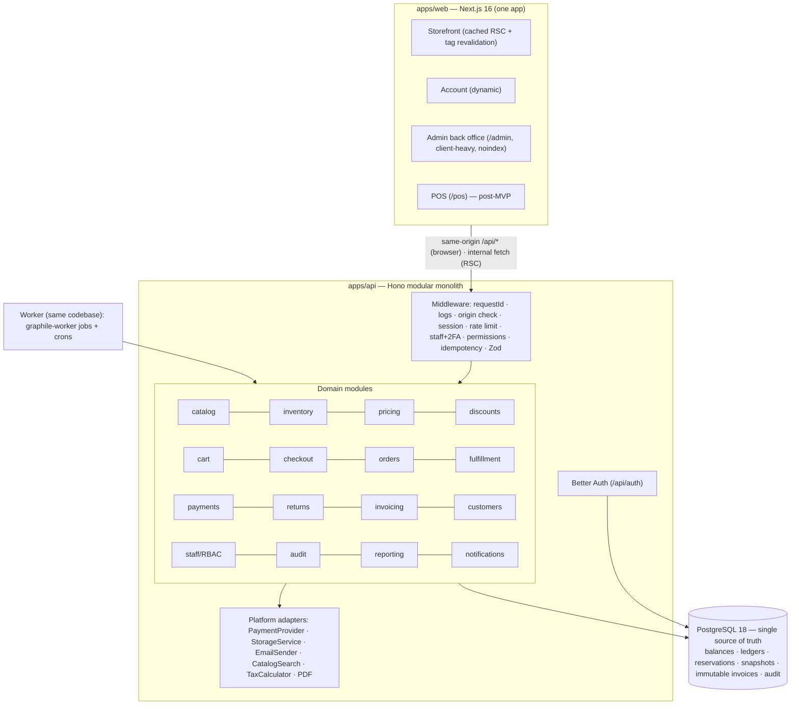

**In one paragraph:** Auren is a **Next.js storefront and back office** that talks only to a **Hono modular-monolith API**, which is the sole owner of a **single PostgreSQL database**. Stock is a **balance + ledger + reservation** model protected by atomic conditional updates. Orders are one model across channels, with **independent order, payment and fulfillment state machines**. Money is **integer minor units**, payments go through **provider adapters with a deduplicating webhook inbox and three layers of idempotency**, and invoices and credit notes are **immutable with gapless numbering**. Access is **Better Auth sessions on one origin**, with **mandatory 2FA and database-driven role → permission RBAC for staff**, and every important action is written to an **append-only audit log** in the same transaction. Side effects run in a **Postgres-backed job worker** that is enqueued transactionally. There is **no Redis, no search engine, no microservices**, and each one has a documented trigger for when it would be added.

**Before Phase 0 starts:**
1. Review this plan; confirm or amend D1–D29 and the role matrix (§10.5).
2. Answer Q1 (country, currency, gateway), Q12 (hosting) and Q13 (team and timeline). Q2, Q3 and Q5 are needed before Phases 5, 7 and 11 respectively.
3. Install Node 24 LTS locally, then begin Phase 0.

